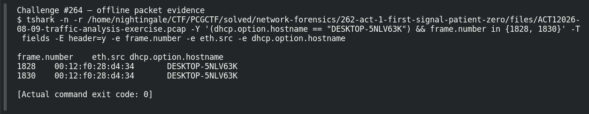

# ACT 1 - FIRST SIGNAL: Name the Host

| Item | Record |
|---|---|
| Platform | PCGCTF |
| Challenge ID | 264 |
| Category | Network Forensics |
| Points | 100 |
| Difficulty | Not separately recorded in the available inventory |
| Verification | Verified — marked solved in the original authenticated PCGCTF snapshot. The offline extraction below was reproduced for this draft; no fresh platform submission was made. |

## Challenge and objective

Recover the compromised workstation’s Windows hostname.

The original description and prerequisite chain are preserved in [the challenge README](../../solved/network-forensics/264-act-1-first-signal-name-the-host/README.md). The supplied evidence is `ACT12026-08-09-traffic-analysis-exercise.pcap`; related storyline questions reuse the same capture rather than providing another download.

## Initial analysis

DHCP is useful because a client can announce a hostname before it has been assigned an IPv4 address. I used the already-established MAC to keep those pre-address packets tied to the victim.

I kept the original capture intact and used offline packet analysis. The file’s SHA-256 is `0ea6b597732a9ce6af9a7e3adff4512c9a91b4bce27184c8fdeb746f05cce170`. This identifies the exact evidence behind the frame references; no reconstructed program was executed and no request was sent to an address found inside the capture.

## Step-by-step solution

### 1. Narrow the incident to a reproducible evidence set

The discovery filter for this question is:

```wireshark
dhcp.option.hostname == "DESKTOP-5NLV63K"
```

In Wireshark, the filter removes unrelated frames from the display without deleting them from the file. For a command-line reproduction, the following extraction additionally selects the cited frames where appropriate:

```sh
tshark -n \
  -r /home/nightingale/CTF/PCGCTF/solved/network-forensics/262-act-1-first-signal-patient-zero/files/ACT12026-08-09-traffic-analysis-exercise.pcap \
  -Y '(dhcp.option.hostname == "DESKTOP-5NLV63K") && frame.number in {1828, 1830}' \
  -T fields -E header=y -e frame.number -e eth.src -e dhcp.option.hostname
```

`-n` disables address/name resolution so that recorded numeric addresses stay visible. `-r` reads the existing capture, and `-Y` applies a display filter after decoding. `-T fields` outputs selected fields; each `-e` adds one named column, and `-E header=y` records the column names. The `frame.number in {...}` clause makes the final evidence small and auditable; the wider discovery filter remains documented above.

**Actual reproduced output** (tab-separated; full lines are preserved in the linked TSV):

```text
frame.number	eth.src	dhcp.option.hostname
1828	00:12:f0:28:d4:34	DESKTOP-5NLV63K
1830	00:12:f0:28:d4:34	DESKTOP-5NLV63K
```

### 2. Interpret the result

DHCP frames 1828 and 1830 carry DESKTOP-5NLV63K from MAC 00:12:f0:28:d4:34. NBNS announcements in the saved identity table corroborate that workstation name after the address is established.

## Captured screenshots and evidence

Captured on 2026-10-29 from actual terminal sessions or browser views. Captions distinguish new results, preserved records, source images and blockers. No platform acceptance is inferred from these images.

### Challenge #264 — offline packet evidence



Fresh execution of the draft’s field-specific TShark command.

Command/action actually executed:

```sh
tshark -n -r /home/nightingale/CTF/PCGCTF/solved/network-forensics/262-act-1-first-signal-patient-zero/files/ACT12026-08-09-traffic-analysis-exercise.pcap -Y '(dhcp.option.hostname == "DESKTOP-5NLV63K") && frame.number in {1828, 1830}' -T fields -E header=y -e frame.number -e eth.src -e dhcp.option.hostname
```

[Actual command transcript](../screenshots/capture-work/264-network.terminal.log) · [Execution record](../screenshots/capture-work/264-network.result.json). Notice the result fields discussed in the corresponding solution step; the transcript retains lines that extend beyond the screenshot viewport.

## Flag discovery and verification

Saved submission candidate:

```text
pcgCTF{DESKTOP-5NLV63K}
```

Verified — marked solved in the original authenticated PCGCTF snapshot. The offline extraction below was reproduced for this draft; no fresh platform submission was made. The exact wrapper comes from the challenge’s `pcgCTF{...}` requirement; literal spaces, capitalization and separators are retained as recorded. The solved snapshot confirms challenge completion, not an independently captured acceptance response for this exact text.

## Conclusion and lesson

A DHCP packet sourced from 0.0.0.0 can still identify the correct endpoint through its hardware address. The artifact-backed answer and the platform acceptance state remain separate in this draft.

## Reproduction evidence and references

- [Original challenge description](../../solved/network-forensics/264-act-1-first-signal-name-the-host/README.md)
- [Actual TShark field output](../evidence/network/264-fields.tsv)
- [Commands, hashes and reproduction results](../evidence/network/reproduction.json)
- [TShark version](../evidence/network/tshark-version.txt)
- [TShark official manual](https://www.wireshark.org/docs/man-pages/tshark.html)

- [Earlier local solution and provenance](../../solved/network-forensics/264-act-1-first-signal-name-the-host/solution.md)
