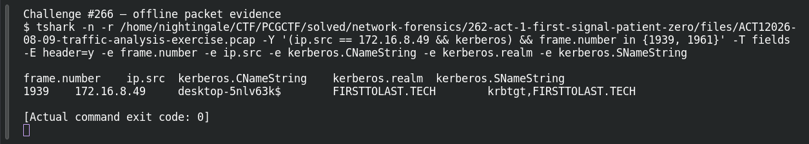

# ACT 1 — First Signal: Full Identity

**Platform:** PCGCTF · **Challenge ID:** 266 · **Category:** Network Forensics · **Points:** 100

**Status:** Solved in the authenticated snapshot; reproduced from the Act 1 capture.

## The challenge

Build the victim's fully qualified domain name.

## Solving it

Kerberos ties the two halves together — the client name and the realm appear in the AS-REQ:

```sh
tshark -nr act1.pcap -Y 'kerberos.CNameString' \
  -T fields -e kerberos.CNameString -e kerberos.realm
```

```text
desktop-5nlv63k$   FIRSTTOLAST.TECH
```

So the hostname is `DESKTOP-5NLV63K` and the domain is `firsttolast.tech` — put together, `DESKTOP-5NLV63K.firsttolast.tech`.

## Screenshot



## Flag

```text
pcgCTF{DESKTOP-5NLV63K.firsttolast.tech}
```

## Takeaway

Kerberos carries both the machine account (the `$`-suffixed CNameString) and the realm, which is exactly the hostname + domain you need for an FQDN.

## Reference

- [Original challenge description](../../solved/network-forensics/266-act-1-first-signal-full-identity/README.md)
