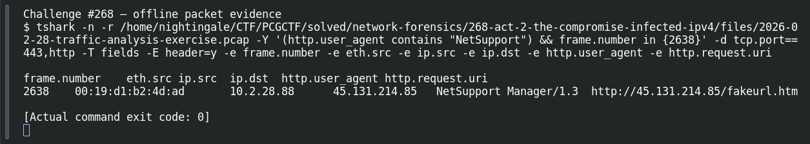

# ACT 2 — The Compromise: Infected IPv4

**Platform:** PCGCTF · **Challenge ID:** 268 · **Category:** Network Forensics · **Points:** 100

**Status:** Solved in the authenticated snapshot; reproduced from the Act 2 capture.

## The challenge

Identify the Windows client generating NetSupport RAT traffic.

## Solving it

NetSupport RAT announces itself in the User-Agent, so I filtered on it:

```sh
tshark -nr act2.pcap -Y 'http.user_agent contains "NetSupport"' \
  -T fields -e ip.src -e ip.dst -e http.user_agent -e http.request.uri
```

```text
10.2.28.88  45.131.214.85  NetSupport Manager/1.3  http://45.131.214.85/fakeurl.htm
```

The client is 10.2.28.88, calling out to 45.131.214.85.

## Screenshot



## Flag

```text
pcgCTF{10.2.28.88}
```

## Takeaway

Commodity RATs often leave their own name in the User-Agent — `NetSupport Manager/1.3` is a gift.

## Reference

- [Original challenge description](../../solved/network-forensics/268-act-2-the-compromise-infected-ipv4/README.md)
