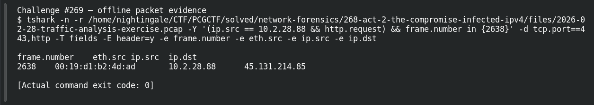

# ACT 2 — The Compromise: Victim MAC

**Platform:** PCGCTF · **Challenge ID:** 269 · **Category:** Network Forensics · **Points:** 100

**Status:** Solved in the authenticated snapshot; reproduced from the Act 2 capture.

## The challenge

Recover the MAC of the infected NetSupport client (10.2.28.88).

## Solving it

Same frame as the RAT check-in gives the source MAC alongside the IP:

```sh
tshark -nr act2.pcap -Y 'ip.src==10.2.28.88' -T fields -e eth.src -e ip.src
```

```text
00:19:d1:b2:4d:ad  10.2.28.88
```

## Screenshot



## Flag

```text
pcgCTF{00:19:d1:b2:4d:ad}
```

## Takeaway

Pull the MAC and IP from one of the host's own frames so the pairing isn't in doubt.

## Reference

- [Original challenge description](../../solved/network-forensics/269-act-2-the-compromise-victim-mac/README.md)
