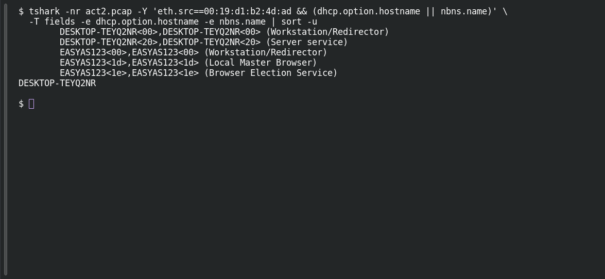

# ACT 2 — The Compromise: Victim Hostname

**Platform:** PCGCTF · **Challenge ID:** 270 · **Category:** Network Forensics · **Points:** 100

**Status:** Solved in the authenticated snapshot; reproduced from the Act 2 capture.

**Evidence:** Packets 2, 135 · UDP streams 0, 13 · [2026-02-28-traffic-analysis-exercise.pcap](../../solved/network-forensics/268-act-2-the-compromise-infected-ipv4/files/2026-02-28-traffic-analysis-exercise.pcap).

## The challenge

Recover the infected client's hostname.

## Solving it

Use [the shared capture](../../solved/network-forensics/268-act-2-the-compromise-infected-ipv4/files/2026-02-28-traffic-analysis-exercise.pcap) as `act2.pcap` for the commands below.

The host announces its name in both DHCP (before it has an IP) and NBNS:

```sh
tshark -nr act2.pcap -Y 'eth.src==00:19:d1:b2:4d:ad && (dhcp.option.hostname || nbns.name)' \
  -T fields -e dhcp.option.hostname -e nbns.name | sort -u
```

```text
DESKTOP-TEYQ2NR<00>,DESKTOP-TEYQ2NR<00> (Workstation/Redirector)
	DESKTOP-TEYQ2NR<20>,DESKTOP-TEYQ2NR<20> (Server service)
	EASYAS123<00>,EASYAS123<00> (Workstation/Redirector)
	EASYAS123<1d>,EASYAS123<1d> (Local Master Browser)
	EASYAS123<1e>,EASYAS123<1e> (Browser Election Service)
DESKTOP-TEYQ2NR
```

Both agree: `DESKTOP-TEYQ2NR`.

## Screenshot

Fresh local reproduction using the command described above.



## Flag

```text
pcgCTF{DESKTOP-TEYQ2NR}
```

## Takeaway

When DHCP and NBNS name the same host, that's solid corroboration — no need to guess from anything else.

## Reference

- [Original challenge description](../../solved/network-forensics/270-act-2-the-compromise-victim-hostname/README.md)
