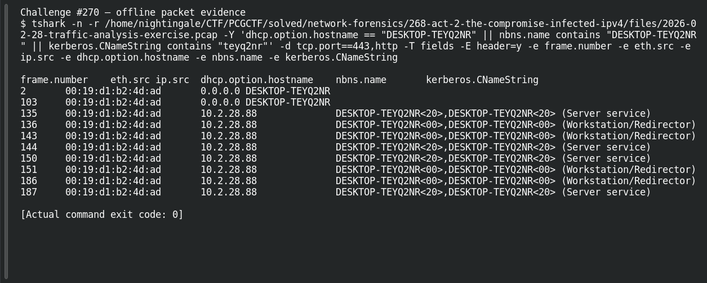

# ACT 2 - THE COMPROMISE: VICTIM HOSTNAME

| Item | Record |
|---|---|
| Platform | PCGCTF |
| Challenge ID | 270 |
| Category | Network Forensics |
| Points | 100 |
| Difficulty | Not separately recorded in the available inventory |
| Verification | Verified — marked solved in the original authenticated PCGCTF snapshot. The offline extraction below was reproduced for this draft; no fresh platform submission was made. |

## Challenge and objective

Recover the NetSupport-infected client’s hostname.

The original description and prerequisite chain are preserved in [the challenge README](../../solved/network-forensics/270-act-2-the-compromise-victim-hostname/README.md). The supplied evidence is `2026-02-28-traffic-analysis-exercise.pcap`; related storyline questions reuse the same capture rather than providing another download.

## Initial analysis

The hostname should be tied to the infected NIC rather than picked from the many domain controller and workstation names in the capture.

I kept the original capture intact and used offline packet analysis. The file’s SHA-256 is `3dc470f5490ec15b4024c513e87c67e0b17caeae2a2ce3d83541be24ef407e61`. This identifies the exact evidence behind the frame references; no reconstructed program was executed and no request was sent to an address found inside the capture.

## Step-by-step solution

### 1. Narrow the incident to a reproducible evidence set

The discovery filter for this question is:

```wireshark
dhcp.option.hostname == "DESKTOP-TEYQ2NR" || nbns.name contains "DESKTOP-TEYQ2NR" || kerberos.CNameString contains "teyq2nr"
```

In Wireshark, the filter removes unrelated frames from the display without deleting them from the file. For a command-line reproduction, the following extraction additionally selects the cited frames where appropriate:

```sh
tshark -n \
  -r /home/nightingale/CTF/PCGCTF/solved/network-forensics/268-act-2-the-compromise-infected-ipv4/files/2026-02-28-traffic-analysis-exercise.pcap \
  -Y 'dhcp.option.hostname == "DESKTOP-TEYQ2NR" || nbns.name contains "DESKTOP-TEYQ2NR" || kerberos.CNameString contains "teyq2nr"' -d tcp.port==443,http \
  -T fields -E header=y -e frame.number -e eth.src -e ip.src -e dhcp.option.hostname -e nbns.name -e kerberos.CNameString
```

`-n` disables address/name resolution so that recorded numeric addresses stay visible. `-r` reads the existing capture, and `-Y` applies a display filter after decoding. `-T fields` outputs selected fields; each `-e` adds one named column, and `-E header=y` records the column names. `-d tcp.port==443,http` tells the dissector to treat that port as HTTP for this known capture. It changes the decoding choice, not the underlying bytes, and does not mean all port-443 traffic is HTTP.

**Actual reproduced output** (tab-separated; full lines are preserved in the linked TSV):

```text
frame.number	eth.src	ip.src	dhcp.option.hostname	nbns.name	kerberos.CNameString
2	00:19:d1:b2:4d:ad	0.0.0.0	DESKTOP-TEYQ2NR		
103	00:19:d1:b2:4d:ad	0.0.0.0	DESKTOP-TEYQ2NR		
135	00:19:d1:b2:4d:ad	10.2.28.88		DESKTOP-TEYQ2NR<20>,DESKTOP-TEYQ2NR<20> (Server service)	
136	00:19:d1:b2:4d:ad	10.2.28.88		DESKTOP-TEYQ2NR<00>,DESKTOP-TEYQ2NR<00> (Workstation/Redirector)	
143	00:19:d1:b2:4d:ad	10.2.28.88		DESKTOP-TEYQ2NR<00>,DESKTOP-TEYQ2NR<00> (Workstation/Redirector)	
144	00:19:d1:b2:4d:ad	10.2.28.88		DESKTOP-TEYQ2NR<20>,DESKTOP-TEYQ2NR<20> (Server service)	
[excerpt ends; full TSV linked below]
```

### 2. Interpret the result

Fresh extraction finds DHCP Host Name DESKTOP-TEYQ2NR in frames 2 and 103, sent by 00:19:d1:b2:4d:ad. Additional NBNS/machine-account records in the full extraction reinforce that name. The packet source can be 0.0.0.0 during DHCP without weakening the MAC correlation.

## Captured screenshots and evidence

Captured on 2026-10-29 from actual terminal sessions or browser views. Captions distinguish new results, preserved records, source images and blockers. No platform acceptance is inferred from these images.

### Challenge #270 — offline packet evidence



Fresh execution of the draft’s field-specific TShark command.

Command/action actually executed:

```sh
tshark -n -r /home/nightingale/CTF/PCGCTF/solved/network-forensics/268-act-2-the-compromise-infected-ipv4/files/2026-02-28-traffic-analysis-exercise.pcap -Y 'dhcp.option.hostname == "DESKTOP-TEYQ2NR" || nbns.name contains "DESKTOP-TEYQ2NR" || kerberos.CNameString contains "teyq2nr"' -d tcp.port==443,http -T fields -E header=y -e frame.number -e eth.src -e ip.src -e dhcp.option.hostname -e nbns.name -e kerberos.CNameString
```

[Actual command transcript](../screenshots/capture-work/270-network.terminal.log) · [Execution record](../screenshots/capture-work/270-network.result.json). Notice the result fields discussed in the corresponding solution step; the transcript retains lines that extend beyond the screenshot viewport.

## Flag discovery and verification

Saved submission candidate:

```text
pcgCTF{DESKTOP-TEYQ2NR}
```

Verified — marked solved in the original authenticated PCGCTF snapshot. The offline extraction below was reproduced for this draft; no fresh platform submission was made. The exact wrapper comes from the challenge’s `pcgCTF{...}` requirement; literal spaces, capitalization and separators are retained as recorded. The solved snapshot confirms challenge completion, not an independently captured acceptance response for this exact text.

## Conclusion and lesson

Use early address-configuration traffic to identify a host, and verify that its MAC matches the later malicious conversation. The artifact-backed answer and the platform acceptance state remain separate in this draft.

## Reproduction evidence and references

- [Original challenge description](../../solved/network-forensics/270-act-2-the-compromise-victim-hostname/README.md)
- [Actual TShark field output](../evidence/network/270-fields.tsv)
- [Commands, hashes and reproduction results](../evidence/network/reproduction.json)
- [TShark version](../evidence/network/tshark-version.txt)
- [TShark official manual](https://www.wireshark.org/docs/man-pages/tshark.html)

- [Earlier local solution and provenance](../../solved/network-forensics/270-act-2-the-compromise-victim-hostname/solution.md)
