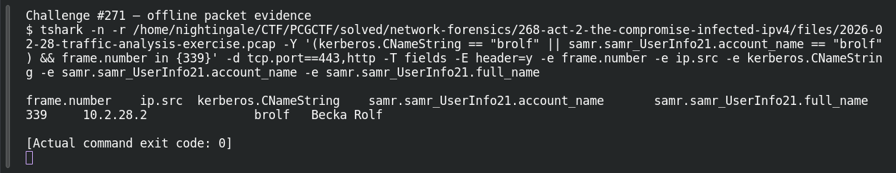

# ACT 2 - THE COMPROMISE: Identify the User -User Account

| Item | Record |
|---|---|
| Platform | PCGCTF |
| Challenge ID | 271 |
| Category | Network Forensics |
| Points | 100 |
| Difficulty | Not separately recorded in the available inventory |
| Verification | Verified — marked solved in the original authenticated PCGCTF snapshot. The offline extraction below was reproduced for this draft; no fresh platform submission was made. |

## Challenge and objective

Identify the domain user account associated with the infected client.

The original description and prerequisite chain are preserved in [the challenge README](../../solved/network-forensics/271-act-2-the-compromise-identify-the-user-user-account/README.md). The supplied evidence is `2026-02-28-traffic-analysis-exercise.pcap`; related storyline questions reuse the same capture rather than providing another download.

## Initial analysis

A human user and a machine account can both authenticate. I looked for a user-information response instead of treating the computer’s dollar-suffixed Kerberos account as the person.

I kept the original capture intact and used offline packet analysis. The file’s SHA-256 is `3dc470f5490ec15b4024c513e87c67e0b17caeae2a2ce3d83541be24ef407e61`. This identifies the exact evidence behind the frame references; no reconstructed program was executed and no request was sent to an address found inside the capture.

## Step-by-step solution

### 1. Narrow the incident to a reproducible evidence set

The discovery filter for this question is:

```wireshark
kerberos.CNameString == "brolf" || samr.samr_UserInfo21.account_name == "brolf"
```

In Wireshark, the filter removes unrelated frames from the display without deleting them from the file. For a command-line reproduction, the following extraction additionally selects the cited frames where appropriate:

```sh
tshark -n \
  -r /home/nightingale/CTF/PCGCTF/solved/network-forensics/268-act-2-the-compromise-infected-ipv4/files/2026-02-28-traffic-analysis-exercise.pcap \
  -Y '(kerberos.CNameString == "brolf" || samr.samr_UserInfo21.account_name == "brolf") && frame.number in {339}' -d tcp.port==443,http \
  -T fields -E header=y -e frame.number -e ip.src -e kerberos.CNameString -e samr.samr_UserInfo21.account_name -e samr.samr_UserInfo21.full_name
```

`-n` disables address/name resolution so that recorded numeric addresses stay visible. `-r` reads the existing capture, and `-Y` applies a display filter after decoding. `-T fields` outputs selected fields; each `-e` adds one named column, and `-E header=y` records the column names. The `frame.number in {...}` clause makes the final evidence small and auditable; the wider discovery filter remains documented above. `-d tcp.port==443,http` tells the dissector to treat that port as HTTP for this known capture. It changes the decoding choice, not the underlying bytes, and does not mean all port-443 traffic is HTTP.

**Actual reproduced output** (tab-separated; full lines are preserved in the linked TSV):

```text
frame.number	ip.src	kerberos.CNameString	samr.samr_UserInfo21.account_name	samr.samr_UserInfo21.full_name
339	10.2.28.2		brolf	Becka Rolf
```

### 2. Interpret the result

SAMR frame 339 explicitly pairs account brolf with full name Becka Rolf. The question asks for the account string, so brolf is the output here; the next identity question requests the full name.

## Captured screenshots and evidence

Captured on 2026-10-29 from actual terminal sessions or browser views. Captions distinguish new results, preserved records, source images and blockers. No platform acceptance is inferred from these images.

### Challenge #271 — offline packet evidence



Fresh execution of the draft’s field-specific TShark command.

Command/action actually executed:

```sh
tshark -n -r /home/nightingale/CTF/PCGCTF/solved/network-forensics/268-act-2-the-compromise-infected-ipv4/files/2026-02-28-traffic-analysis-exercise.pcap -Y '(kerberos.CNameString == "brolf" || samr.samr_UserInfo21.account_name == "brolf") && frame.number in {339}' -d tcp.port==443,http -T fields -E header=y -e frame.number -e ip.src -e kerberos.CNameString -e samr.samr_UserInfo21.account_name -e samr.samr_UserInfo21.full_name
```

[Actual command transcript](../screenshots/capture-work/271-network.terminal.log) · [Execution record](../screenshots/capture-work/271-network.result.json). Notice the result fields discussed in the corresponding solution step; the transcript retains lines that extend beyond the screenshot viewport.

## Flag discovery and verification

Saved submission candidate:

```text
pcgCTF{brolf}
```

Verified — marked solved in the original authenticated PCGCTF snapshot. The offline extraction below was reproduced for this draft; no fresh platform submission was made. The exact wrapper comes from the challenge’s `pcgCTF{...}` requirement; literal spaces, capitalization and separators are retained as recorded. The solved snapshot confirms challenge completion, not an independently captured acceptance response for this exact text.

## Conclusion and lesson

Use the same directory response to distinguish login identifiers from display names. The artifact-backed answer and the platform acceptance state remain separate in this draft.

## Reproduction evidence and references

- [Original challenge description](../../solved/network-forensics/271-act-2-the-compromise-identify-the-user-user-account/README.md)
- [Actual TShark field output](../evidence/network/271-fields.tsv)
- [Commands, hashes and reproduction results](../evidence/network/reproduction.json)
- [TShark version](../evidence/network/tshark-version.txt)
- [TShark official manual](https://www.wireshark.org/docs/man-pages/tshark.html)

- [Earlier local solution and provenance](../../solved/network-forensics/271-act-2-the-compromise-identify-the-user-user-account/solution.md)
