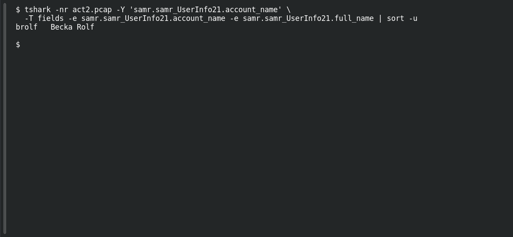

# ACT 2 — The Compromise: Identify the User Account

**Platform:** PCGCTF · **Challenge ID:** 271 · **Category:** Network Forensics · **Points:** 100

**Status:** Solved in the authenticated snapshot; reproduced from the Act 2 capture.

**Evidence:** Packet 339 · TCP stream 9 · [2026-02-28-traffic-analysis-exercise.pcap](../../solved/network-forensics/268-act-2-the-compromise-infected-ipv4/files/2026-02-28-traffic-analysis-exercise.pcap).

## The challenge

Identify the domain user account tied to the infected client.

## Solving it

Use [the shared capture](../../solved/network-forensics/268-act-2-the-compromise-infected-ipv4/files/2026-02-28-traffic-analysis-exercise.pcap) as `act2.pcap` for the commands below.

A SAMR query in the capture exposes the account directly:

```sh
tshark -nr act2.pcap -Y 'samr.samr_UserInfo21.account_name' \
  -T fields -e samr.samr_UserInfo21.account_name -e samr.samr_UserInfo21.full_name | sort -u
```

```text
brolf	Becka Rolf
```

The account is `brolf` (full name Becka Rolf — that's the follow-up question, #272).

## Screenshot

Fresh local reproduction using the command described above.



## Flag

```text
pcgCTF{brolf}
```

## Takeaway

SAMR/LSARPC traffic hands you account names and full names in cleartext — a reliable way to attribute a host to a user.

## Reference

- [Original challenge description](../../solved/network-forensics/271-act-2-the-compromise-identify-the-user-user-account/README.md)
