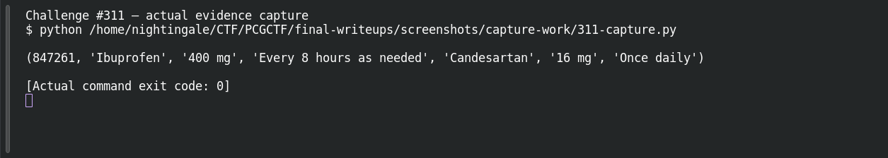

# SQL Skillz

**Platform:** PCGCTF · **Challenge ID:** 311 · **Category:** Aurora Patient Zero · **Points:** 100

**Status:** Solved in the last snapshot; reproduced from the extracted database.

## The challenge

Query the Aurora iOS app's local medication database for the current patient's medication (the one that isn't Ibuprofen).

## Solving it

The IPA is a ZIP, and the app's database is a plain SQLite file — no keychain or encrypted backup involved. I pulled `Payload/aurora-patient-portal.app/aurora_meds.sqlite` out and opened it read-only:

```sh
sqlite3 'file:aurora_meds.sqlite?mode=ro' \
  "SELECT medication FROM meds WHERE pid=847261 AND medication NOT LIKE '%Ibuprofen%';"
```

```text
Candesartan
```

The current patient (pid 847261) is on Candesartan besides the Ibuprofen.

## Screenshot



## Flag

```text
deadface{Candesartan}
```

## Takeaway

A mobile app's "local database" is often just an unencrypted SQLite file sitting in the bundle — open it read-only and query it like any other DB.

## Reference

- [Original challenge and attachments](../../solved/aurora-patient-zero/311-sql-skillz/README.md)
