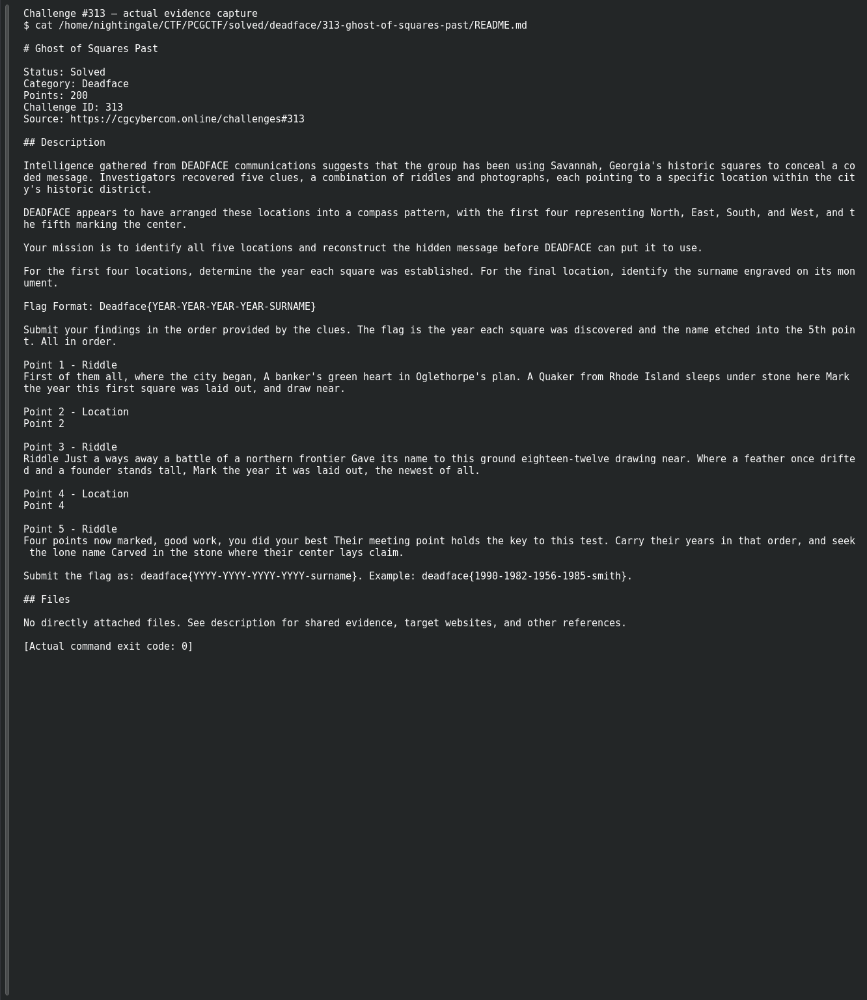

# Ghost of Squares Past

**Platform:** PCGCTF · **Challenge ID:** 313 · **Category:** Deadface · **Points:** 200

**Difficulty:** Not recorded in the available platform metadata.

**Verification status:** Verified — solved in the last PCGCTF snapshot. Historical site solve and teammate-reported flag; Point 2/4 photo identities and full compass reconstruction remain incomplete.

## Challenge and objective

Identify five Savannah square clues in compass order, combine the first four establishment years, and append the monument surname at the center.

Original description: [saved challenge description](</home/nightingale/CTF/PCGCTF/solved/deadface/313-ghost-of-squares-past/README.md>). Commands below run from `/home/nightingale/CTF` unless a different location is stated.

## Initial analysis

The clue order is part of the flag. Johnson Square’s “first of them all” clue and Chippewa Square’s battle/Forrest Gump references give specific anchors. The final surname is a monument inscription at the center, not a square’s name. Two other points depend on photographs that are not present in the saved description, so the full geographic reconstruction cannot be independently completed from the text alone.

## Step-by-step solution

### 1. Solve the preserved textual location clues

The first riddle describes Johnson Square and its 1733 establishment. The battle and feather/bench references identify Chippewa Square, established in 1815. These mappings are in the teammate’s reconstruction; the two intermediate photo locations are not named in the local material.

```sh
Read the saved Point 1 and Point 3 riddles, then compare their named historical and cultural clues with city/museum records.
```

**Recorded clue interpretation; missing photo links explicit:**

```text
Point 1: Johnson Square → 1733
Point 2: exact square unrecorded → reported 1742
Point 3: Chippewa Square → 1815
Point 4: exact square unrecorded → reported 1733
```

The preserved sequence of years matches the saved flag, but it is not a complete proof of all four locations.

### 2. Check the center monument and assemble only in clue order

The teammate identifies Wright Square’s William Washington Gordon monument as the center. To reproduce that geometry, the original Point 2 and Point 4 photos must first be recovered and identified. Keep the original clue order rather than sorting the years numerically.

```sh
Plot the four verified square locations as N/E/S/W, inspect their center, and read the surname on its monument.
```

**Teammate-recorded assembly:**

```text
Reported final order: 1733-1742-1815-1733-gordon
```

The lowercase surname and hyphen-separated structure are preserved from the saved answer. They do not substitute for a missing four-point map.

## Captured screenshots and evidence

Captured on 2026-10-29 from actual terminal sessions or browser views. Captions distinguish new results, preserved records, source images and blockers. No platform acceptance is inferred from these images.

### Challenge #313 — actual evidence capture



Actual original clue inventory; no recreated photos are asserted.

Command/action actually executed:

```sh
cat /home/nightingale/CTF/PCGCTF/solved/deadface/313-ghost-of-squares-past/README.md
```

[Actual command transcript](../screenshots/capture-work/313-clues.terminal.log) · [Execution record](../screenshots/capture-work/313-clues.result.json). Notice the result fields discussed in the corresponding solution step; the transcript retains lines that extend beyond the screenshot viewport.

## Flag discovery and verification

Saved result / candidate:

```text
deadface{1733-1742-1815-1733-gordon}
```

Historical site solve and teammate-reported flag; Point 2/4 photo identities and full compass reconstruction remain incomplete.

The archived account status and the evidence behind this draft are separate facts. No new PCGCTF acceptance is claimed. Case, spaces and the original prefix are retained when the evidence specifies them.

## Remaining review tasks

- Recover the missing Point 2 and Point 4 images from the original challenge page or organizer archive.
- Identify their exact squares and verify the two establishment years with primary local records.
- Create a real annotated map showing N/E/S/W and the center monument; capture the surname inscription.

## What this challenge taught me

A multi-location OSINT answer is a chain of dependent claims. A known final flag does not justify silently filling missing photo identifications or pretending a compass intersection was plotted.

## Evidence and attribution

- [Original challenge and attachments](</home/nightingale/CTF/PCGCTF/solved/deadface/313-ghost-of-squares-past/README.md>)
- [Earlier solution / teammate provenance](</home/nightingale/CTF/PCGCTF/solved/deadface/313-ghost-of-squares-past/solution.md>)
- [source.md](</home/nightingale/CTF/PCGCTF/team-writeups/garcia-day1/source.md>)
