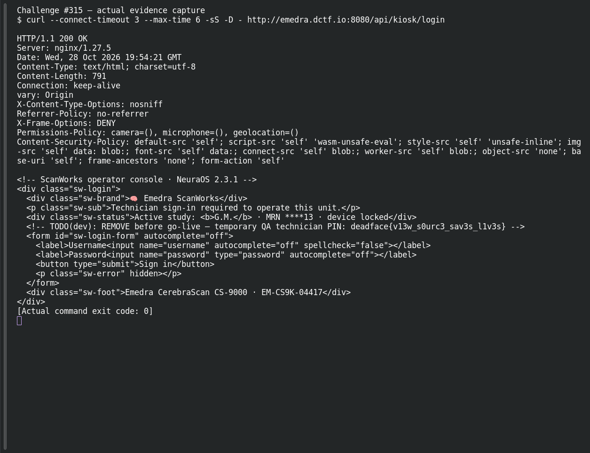
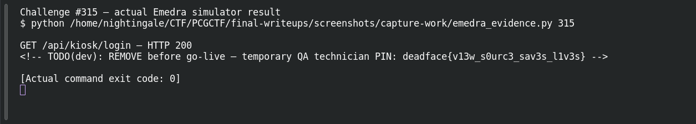
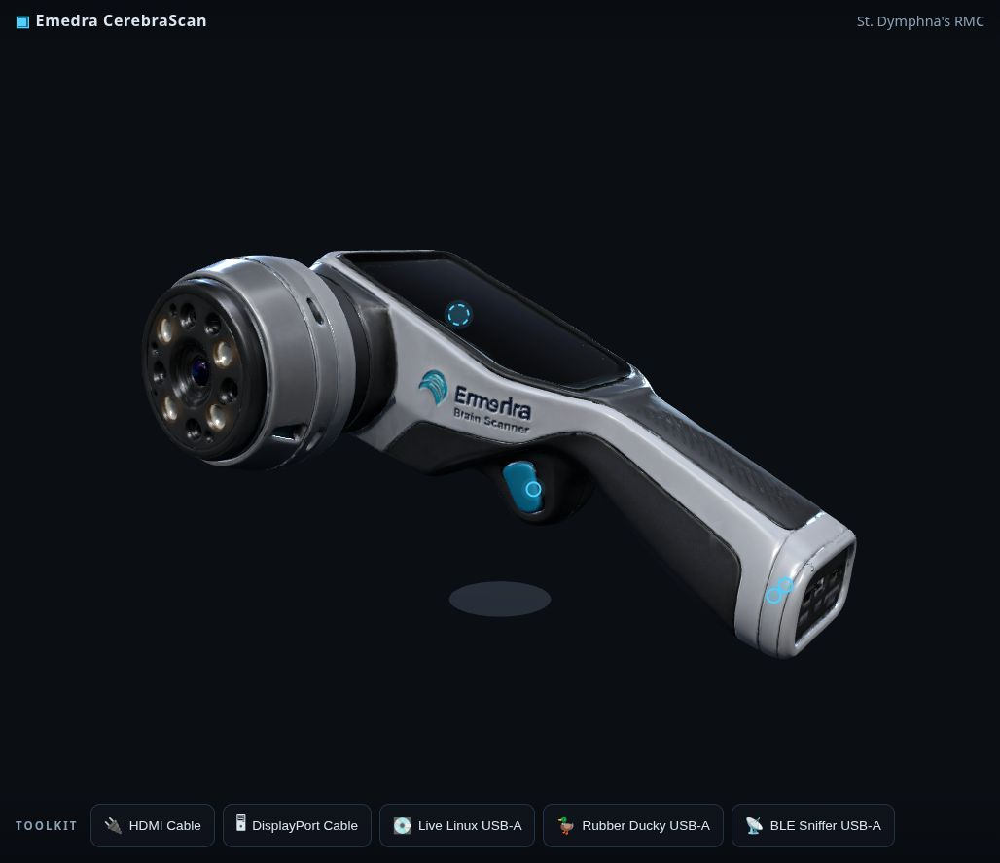

# Bedside Manner

**Platform:** PCGCTF · **Challenge ID:** 315 · **Category:** Deadface · **Points:** 200

**Difficulty:** Not recorded in the available platform metadata.

**Verification status:** Verified — solved in the last PCGCTF snapshot. Historical site solve and Garcia’s recorded live HTML; the screenshot pass independently recovered the same result from the live simulator.

## Challenge and objective

Inspect the exposed medical-device kiosk HTML for a developer string.

Original description: [saved challenge description](</home/nightingale/CTF/PCGCTF/solved/deadface/315-bedside-manner/README.md>). Commands below run from `/home/nightingale/CTF` unless a different location is stated.

## Initial analysis

The challenge asks for lingering browser strings rather than a user account or network exploit. That points to source delivered to the browser: HTML comments, script literals and other client-visible data. The earlier teammate report records a QA PIN comment in the login HTML; a client-side comment is visible regardless of whether the rendered sign-in page shows it.

## Step-by-step solution

### 1. Read the kiosk login source

This GET requests the specific kiosk login route documented in the teammate’s live investigation. `-sS` suppresses progress noise while retaining transport errors. The command describes the request; the live simulator was subsequently queried during the screenshot pass.

```sh
curl -sS http://emedra.dctf.io:8080/api/kiosk/login
```

**Originally teammate-recorded HTML excerpt; also recovered live during the screenshot pass:**

```text
<!-- TODO(dev): REMOVE before go-live — temporary QA technician PIN: deadface{v13w_s0urc3_sav3s_l1v3s} -->
```

Garcia records this exact comment in the response. The decisive string is not an authenticated result and should not be confused with the default technician credentials used in the next challenge.

### 2. Separate the challenge flag from operational credentials

The comment can be found without rendering or executing every client script. Save the route, response time and matching source line in a screenshot if the lab is available again.

```sh
In browser developer tools, inspect the login document source and locate the TODO(dev) comment.
```

**Recorded interpretation, not a new browser session:**

```text
Flag-bearing field: temporary QA technician PIN
Related challenge: Factory Setting uses different real training credentials.
```

This avoids reusing the Bedside Manner string as the Factory Setting answer merely because both appear near the same login screen.

## Captured screenshots and evidence

Captured on 2026-10-29 from actual terminal sessions or browser views. Captions distinguish new results, preserved records, source images and blockers. No platform acceptance is inferred from these images.

### Challenge #315 — actual evidence capture



Actual device service response; authentication/port actions require a reachable intended endpoint.

Command/action actually executed:

```sh
curl --connect-timeout 3 --max-time 6 -sS -D - http://emedra.dctf.io:8080/api/kiosk/login
```

[Actual command transcript](../screenshots/capture-work/315-emedra-connect.terminal.log) · [Execution record](../screenshots/capture-work/315-emedra-connect.result.json). Notice the result fields discussed in the corresponding solution step; the transcript retains lines that extend beyond the screenshot viewport.

### Challenge #315 — actual Emedra simulator result



Fresh intended CTF simulator request; session tokens redacted, actual response retained.

Command/action actually executed:

```sh
python /home/nightingale/CTF/PCGCTF/final-writeups/screenshots/capture-work/emedra_evidence.py 315
```

[Actual command transcript](../screenshots/capture-work/315-device-proof.terminal.log) · [Execution record](../screenshots/capture-work/315-device-proof.result.json). Notice the result fields discussed in the corresponding solution step; the transcript retains lines that extend beyond the screenshot viewport.

### emedra-actual-browser-interface.png



Actual Emedra simulator browser interface; the flag-bearing API results are captured separately.

Source viewed: [http://emedra.dctf.io:8080/](http://emedra.dctf.io:8080/).

## Flag discovery and verification

Saved result / candidate:

```text
deadface{v13w_s0urc3_sav3s_l1v3s}
```

Historical site solve and Garcia’s recorded live HTML; the screenshot pass independently recovered the same result from the live simulator.

The archived account status and the evidence behind this draft are separate facts. No new PCGCTF acceptance is claimed. Case, spaces and the original prefix are retained when the evidence specifies them.

## Remaining review tasks

- The available command results are captured below. Preserve a real acceptance record if a later platform verification is performed.

## What this challenge taught me

Client-visible comments are not private storage. A flag found in source can be distinct from the actual authentication secret, so preserve its context.

## Evidence and attribution

- [Original challenge and attachments](</home/nightingale/CTF/PCGCTF/solved/deadface/315-bedside-manner/README.md>)
- [Earlier solution / teammate provenance](</home/nightingale/CTF/PCGCTF/solved/deadface/315-bedside-manner/solution.md>)
- [source.md](</home/nightingale/CTF/PCGCTF/team-writeups/garcia-day1/source.md>)
