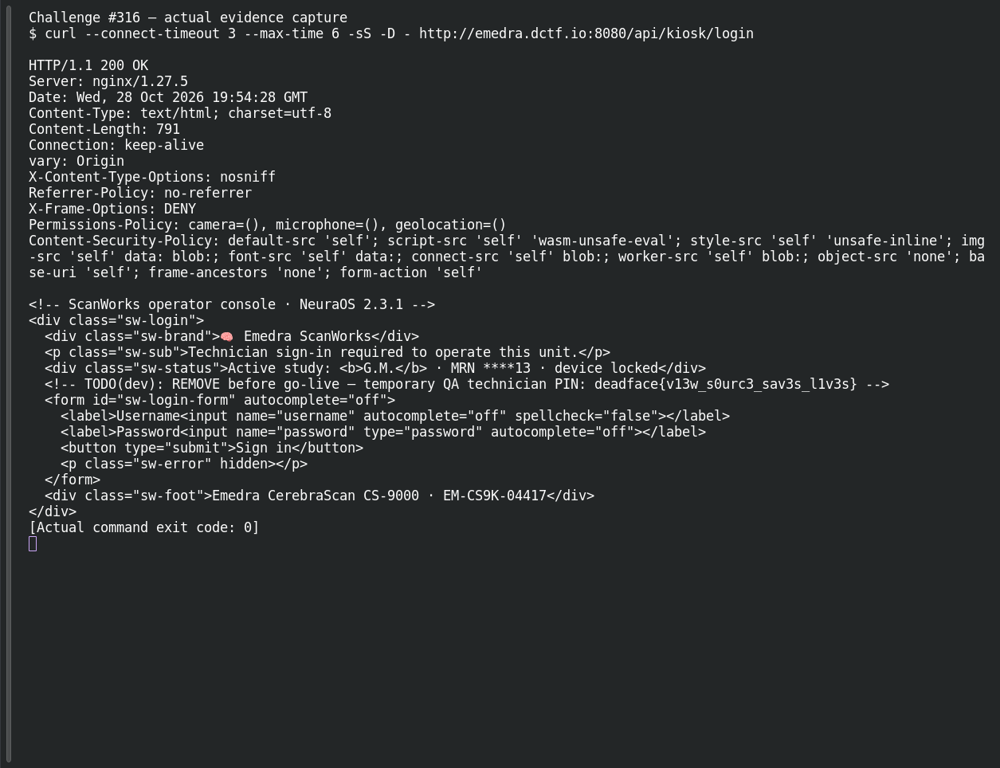

# Factory Setting

**Platform:** PCGCTF · **Challenge ID:** 316 · **Category:** Deadface · **Points:** 200

**Difficulty:** Not recorded in the available platform metadata.

**Verification status:** Verified — solved in the last PCGCTF snapshot. Saved site-solved snapshot and teammate-recorded live authentication; no new login performed here.

## Challenge and objective

Use the device’s documented factory technician account and recover the maintenance token returned after authentication.

Original description: [saved challenge description](</home/nightingale/CTF/PCGCTF/solved/deadface/316-factory-setting/README.md>). Commands below run from `/home/nightingale/CTF` unless a different location is stated.

## Initial analysis

The previous source-code flag is a deliberate distraction for this task. The challenge points to vendor defaults, so the field service manual is the appropriate source of credentials. The saved teammate investigation records a default account in manual section 2.3 and an authentication response containing a separate maintenanceToken.

## Step-by-step solution

### 1. Read the factory account in the manual

The manual is the evidence for using a default account; the credentials are a deliberate training default, not an unrelated user secret. The PDF is not stored among this challenge’s original direct attachments, so its live download screenshot remains necessary.

```sh
On the authorized device, open the Asset Label hotspot and download /assets/cs9000-field-service-manual.pdf. Read section 2.3.
```

**Teammate-recorded manual excerpt:**

```text
Username: emedra-svc
Password: ChangeMe!2019
```

Use that specific training account rather than the commented QA PIN from Bedside Manner.

### 2. Authenticate once using the documented defaults

`-H` declares the JSON request format; `-d` supplies the two documented form values and makes this a POST. The response’s session token is intentionally omitted from the draft because it is not the flag and could expire or grant live access.

```sh
curl -sS http://emedra.dctf.io:8080/api/kiosk/auth \
  -H 'Content-Type: application/json' \
  -d '{"username":"emedra-svc","password":"ChangeMe!2019"}'
```

**Teammate-recorded auth response; session token redacted:**

```text
ok: true
tech.name: Service Technician
maintenanceToken: deadface{d3fault_cr3ds_n3v3r_ch4ng3d}
```

The maintenanceToken is the challenge result. A successful response was reported by Garcia, not freshly observed in this drafting pass.

## Captured screenshots and evidence

Captured on 2026-10-29 from actual terminal sessions or browser views. Captions distinguish new results, preserved records, source images and blockers. No platform acceptance is inferred from these images.

### Challenge #316 — actual evidence capture



Actual device service response; authentication/port actions require a reachable intended endpoint.

Command/action actually executed:

```sh
curl --connect-timeout 3 --max-time 6 -sS -D - http://emedra.dctf.io:8080/api/kiosk/login
```

[Actual command transcript](../screenshots/capture-work/316-emedra-connect.terminal.log) · [Execution record](../screenshots/capture-work/316-emedra-connect.result.json). Notice the result fields discussed in the corresponding solution step; the transcript retains lines that extend beyond the screenshot viewport.

### Challenge #316 — actual Emedra simulator result


Fresh intended CTF simulator request; session tokens redacted, actual response retained.

Command/action actually executed:

```sh
python /home/nightingale/CTF/PCGCTF/final-writeups/screenshots/capture-work/emedra_evidence.py 316
```

[Actual command transcript](../screenshots/capture-work/316-device-proof.terminal.log) · [Execution record](../screenshots/capture-work/316-device-proof.result.json). Notice the result fields discussed in the corresponding solution step; the transcript retains lines that extend beyond the screenshot viewport.

### Challenge #316 — actual public field-manual excerpt


Actual text extraction from the simulator’s public manual; documented default CTF credentials, not unrelated secrets.

Command/action actually executed:

```sh
pdftotext /home/nightingale/CTF/PCGCTF/final-writeups/screenshots/capture-work/cs9000-field-service-manual.pdf - | rg -n -A 8 -B 2 'Default technician account|emedra-svc|ChangeMe'
```

[Actual command transcript](../screenshots/capture-work/316-manual-proof.terminal.log) · [Execution record](../screenshots/capture-work/316-manual-proof.result.json). Notice the result fields discussed in the corresponding solution step; the transcript retains lines that extend beyond the screenshot viewport.

### emedra-actual-browser-interface.png


Actual Emedra simulator browser interface; the flag-bearing API results are captured separately.

Source viewed: [http://emedra.dctf.io:8080/](http://emedra.dctf.io:8080/).

## Flag discovery and verification

Saved result / candidate:

```text
deadface{d3fault_cr3ds_n3v3r_ch4ng3d}
```

Saved site-solved snapshot and teammate-recorded live authentication; no new login performed here.

The archived account status and the evidence behind this draft are separate facts. No new PCGCTF acceptance is claimed. Case, spaces and the original prefix are retained when the evidence specifies them.

## Remaining review tasks

- The available command results are captured below. Preserve a real acceptance record if a later platform verification is performed.

## What this challenge taught me

Unchanged factory credentials turn documentation into an access path. Show where the credential came from and which response field contains the requested result.

## Evidence and attribution

- [Original challenge and attachments](</home/nightingale/CTF/PCGCTF/solved/deadface/316-factory-setting/README.md>)
- [Earlier solution / teammate provenance](</home/nightingale/CTF/PCGCTF/solved/deadface/316-factory-setting/solution.md>)
- [source.md](</home/nightingale/CTF/PCGCTF/team-writeups/garcia-day1/source.md>)
