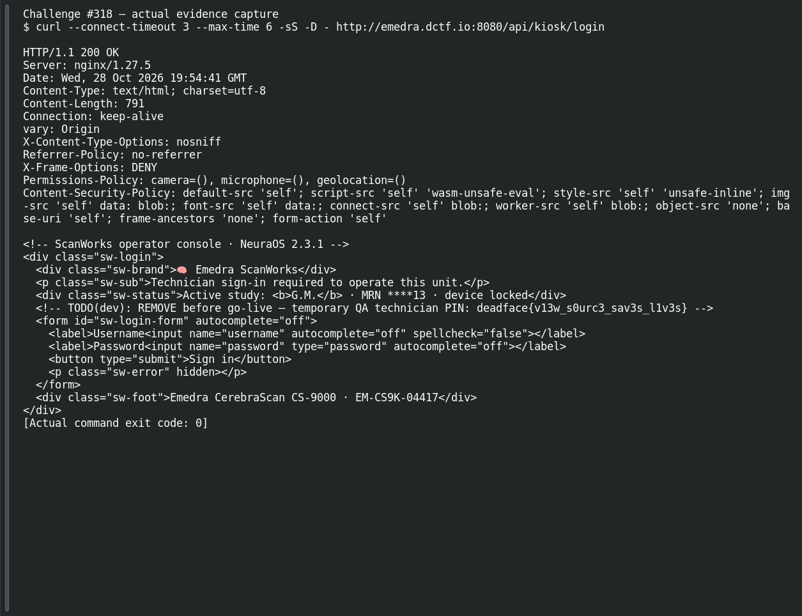
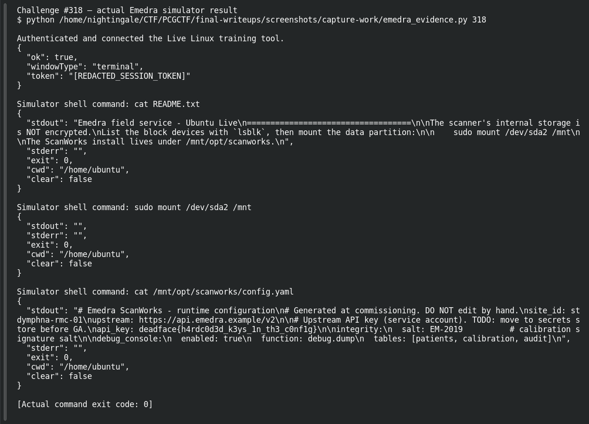

# Live Boot

**Platform:** PCGCTF · **Challenge ID:** 318 · **Category:** Deadface · **Points:** 300

**Difficulty:** Not recorded in the available platform metadata.

**Verification status:** Verified — solved in the last PCGCTF snapshot. Historical site solve and Garcia’s reported live simulated-shell reproduction; not rerun in this pass.

## Challenge and objective

Access the simulated scanner’s internal filesystem through its live Linux tool and recover a hardcoded API key.

Original description: [saved challenge description](</home/nightingale/CTF/PCGCTF/solved/deadface/318-live-boot/README.md>). Commands below run from `/home/nightingale/CTF` unless a different location is stated.

## Initial analysis

The task contrasts keys in the published manual with keys on disk. In the recorded lab, the live Linux USB-A tool exposes a shell that can mount the internal partition. The key lesson is the on-disk configuration file, not guessing a vendor PIN. These are CTF device-simulator actions; the commands were reported by Garcia and are not claims of a real medical-device intrusion.

## Step-by-step solution

### 1. Enter the lab’s live Linux environment

The tool route returns a capability for the simulated shell. Use the lab interface rather than treating the commands as instructions to mount the analyst workstation’s own disk. Keep the returned session token out of public screenshots.

```sh
Authenticate using the documented technician training account, connect {"tool":"live-linux","port":"usb-a"}, then open the resulting shell.
```

**Teammate-recorded lab observation:**

```text
README.txt points to /dev/sda2 and /mnt/opt/scanworks
```

The device’s own README supplies the partition and application path; neither is a universal Linux convention.

### 2. Read the mounted application configuration

Run these only inside the challenge’s simulated shell. Mounting makes the internal partition available at /mnt; reading the configuration reveals an upstream service-account API key that was not in the manual. The screenshot pass repeated these commands inside the CTF simulator and captured its configuration response. The mount is a simulator action; the host workstation was not mounted.

```sh
cat README.txt
sudo mount /dev/sda2 /mnt
cat /mnt/opt/scanworks/config.yaml
```

**Teammate-recorded config excerpt:**

```text
api_key: deadface{h4rdc0d3d_k3ys_1n_th3_c0nf1g}
```

The API key is the requested secret. It is separate from the transient session token and from documented factory login credentials.

## Captured screenshots and evidence

Captured on 2026-10-29 from actual terminal sessions or browser views. Captions distinguish new results, preserved records, source images and blockers. No platform acceptance is inferred from these images.

### Challenge #318 — actual evidence capture



Actual device service response; authentication/port actions require a reachable intended endpoint.

Command/action actually executed:

```sh
curl --connect-timeout 3 --max-time 6 -sS -D - http://emedra.dctf.io:8080/api/kiosk/login
```

[Actual command transcript](../screenshots/capture-work/318-emedra-connect.terminal.log) · [Execution record](../screenshots/capture-work/318-emedra-connect.result.json). Notice the result fields discussed in the corresponding solution step; the transcript retains lines that extend beyond the screenshot viewport.

### Challenge #318 — actual Emedra simulator result



Fresh intended CTF simulator request; session tokens redacted, actual response retained.

Command/action actually executed:

```sh
python /home/nightingale/CTF/PCGCTF/final-writeups/screenshots/capture-work/emedra_evidence.py 318
```

[Actual command transcript](../screenshots/capture-work/318-device-proof.terminal.log) · [Execution record](../screenshots/capture-work/318-device-proof.result.json). Notice the result fields discussed in the corresponding solution step; the transcript retains lines that extend beyond the screenshot viewport.

### emedra-actual-browser-interface.png


Actual Emedra simulator browser interface; the flag-bearing API results are captured separately.

Source viewed: [http://emedra.dctf.io:8080/](http://emedra.dctf.io:8080/).

## Flag discovery and verification

Saved result / candidate:

```text
deadface{h4rdc0d3d_k3ys_1n_th3_c0nf1g}
```

Historical site solve and Garcia’s reported live simulated-shell reproduction; not rerun in this pass.

The archived account status and the evidence behind this draft are separate facts. No new PCGCTF acceptance is claimed. Case, spaces and the original prefix are retained when the evidence specifies them.

## Remaining review tasks

- The available command results are captured below. Preserve a real acceptance record if a later platform verification is performed.

## What this challenge taught me

A locked-down UI does not protect plaintext secrets on accessible storage. Link each recovered key to its actual role instead of treating all credentials as equivalent.

## Evidence and attribution

- [Original challenge and attachments](</home/nightingale/CTF/PCGCTF/solved/deadface/318-live-boot/README.md>)
- [Earlier solution / teammate provenance](</home/nightingale/CTF/PCGCTF/solved/deadface/318-live-boot/solution.md>)
- [source.md](</home/nightingale/CTF/PCGCTF/team-writeups/garcia-day1/source.md>)
