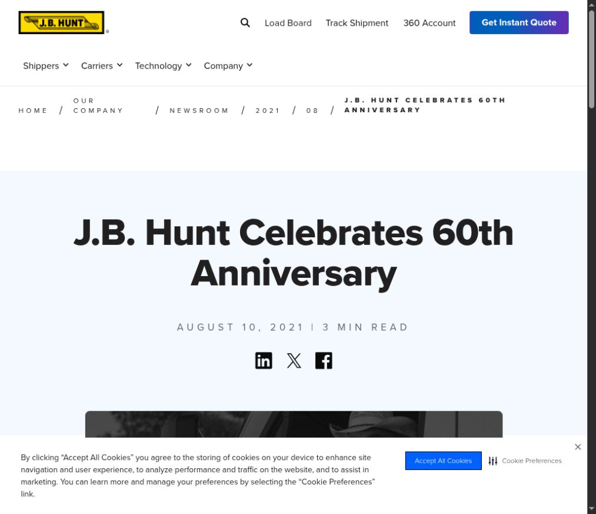

# Car Crash

**Platform:** PCGCTF · **Challenge ID:** 319 · **Category:** Deadface · **Points:** 200

**Difficulty:** Not recorded in the available platform metadata.

**Verification status:** Verified — solved in the last PCGCTF snapshot. Historical site solve; date and USDOT pivot retained from Garcia’s report, but original photo and fresh official lookup evidence are missing.

## Challenge and objective

Identify the trucking company in the crash image and return its founding date in MM_DD_YYYY format.

Original description: [saved challenge description](</home/nightingale/CTF/PCGCTF/solved/deadface/319-car-crash/README.md>). Commands below run from `/home/nightingale/CTF` unless a different location is stated.

## Initial analysis

The useful pivot in Garcia’s record is a USDOT carrier number, not the truck model or crash location. Such a registration number can identify a company even when branding is hard to read. However, the original crash photograph is absent from the snapshot, so the claimed 080806 marking cannot be independently read here.

## Step-by-step solution

### 1. Recover and read the carrier marking

This is the missing first link in the chain. Preserve the full image and a crop so the number can be read in context; do not replace it with a number copied from the answer.

```sh
Open the original car_crash.jpg and zoom to the cargo box’s upper-right USDOT marking.
```

**Teammate report; primary image missing:**

```text
Teammate-recorded marking: USDOT 080806
[ORIGINAL IMAGE / CROP NEEDED]
```

Use the exact observed registration number in an official carrier lookup. The company attribution should come from that record, not from a visual resemblance.

### 2. Corroborate the company and founding date

The carrier lookup connects the mark to the legal company. The company’s own history establishes the founding event. These are two different facts and should be captured separately. The current draft preserves Garcia’s result, not a new live lookup transcript.

```sh
Look up the observed USDOT number in FMCSA SAFER, then confirm the founding date in J.B. Hunt’s own company history.
```

**Originally teammate-recorded result; the company’s first-party anniversary page was also captured during the screenshot pass:**

```text
Reported carrier: J.B. Hunt Transport Services, Inc.
Reported founding date: August 10, 1961
Required date payload: 08_10_1961
```

The format is explicitly month_day_year. A generic founding year alone would not satisfy the requested granularity.

## Captured screenshots and evidence

Captured on 2026-10-29 from actual terminal sessions or browser views. Captions distinguish new results, preserved records, source images and blockers. No platform acceptance is inferred from these images.

### 319-primary-company-anniversary.png



Actual J.B. Hunt first-party 60th anniversary page, dated August 10, 2021. The original truck image remains missing.

Source viewed: [https://www.jbhunt.com/our-company/newsroom/2021/08/j-b--hunt-celebrates-60th-anniversary](https://www.jbhunt.com/our-company/newsroom/2021/08/j-b--hunt-celebrates-60th-anniversary).

**Partial evidence:** the company anniversary date is now supported by a captured first-party page. The truck photo and its USDOT-to-company match remain unavailable.

## Flag discovery and verification

Saved result / candidate:

```text
deadface{08_10_1961}
```

Historical site solve; date and USDOT pivot retained from Garcia’s report, but original photo and fresh official lookup evidence are missing.

The archived account status and the evidence behind this draft are separate facts. No new PCGCTF acceptance is claimed. Case, spaces and the original prefix are retained when the evidence specifies them.

## Remaining review tasks

- Recover car_crash.jpg and verify the exact USDOT digits in a labeled crop.
- Capture the matching FMCSA carrier record and first-party founding-date source; verify day/month order.

## What this challenge taught me

A visible registration identifier is a stronger OSINT pivot than a guessed logo. Keep the identification source and the date source separate and retain the required date order.

## Evidence and attribution

- [Original challenge and attachments](</home/nightingale/CTF/PCGCTF/solved/deadface/319-car-crash/README.md>)
- [Earlier solution / teammate provenance](</home/nightingale/CTF/PCGCTF/solved/deadface/319-car-crash/solution.md>)
- [source.md](</home/nightingale/CTF/PCGCTF/team-writeups/garcia-day1/source.md>)
