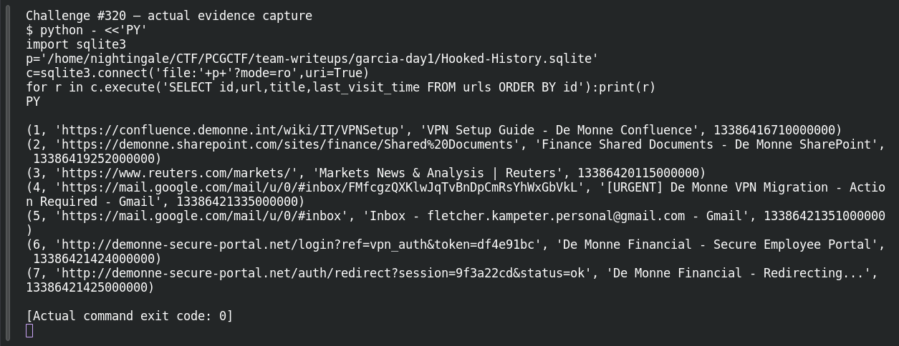

# Hooked

**Platform:** PCGCTF · **Challenge ID:** 320 · **Category:** Deadface · **Points:** 150

**Difficulty:** Not recorded in the available platform metadata.

**Verification status:** Verified — solved in the last PCGCTF snapshot. Local evidence independently reproduced; exact historical platform submission is not newly tested.

## Challenge and objective

Recover the phishing landing URL clicked from the employee’s captured Chrome history.

Original description: [saved challenge description](</home/nightingale/CTF/PCGCTF/solved/deadface/320-hooked/README.md>). Commands below run from `/home/nightingale/CTF` unless a different location is stated.

## Initial analysis

The archive contains a small browser profile with History, Login Data, Cookies and Cache. The History database directly models URL records and visits, so it is the best starting point for reconstructing the click chain. The post-submit redirect is a separate URL and would be the wrong answer even though it belongs to the same phishing host.

## Step-by-step solution

### 1. Inspect the read-only History copy

The saved copy comes from the original ZIP and was independently queried during the earlier import. SQLite URI `mode=ro` prevents writes. Selecting ID, URL, title and time keeps the identifiers needed to join visits to URLs.

```sh
python - <<'PY'
import sqlite3
p='/home/nightingale/CTF/PCGCTF/team-writeups/garcia-day1/Hooked-History.sqlite'
c=sqlite3.connect('file:'+p+'?mode=ro',uri=True)
for r in c.execute('SELECT id,url,title,last_visit_time FROM urls ORDER BY id'):print(r)
PY
```

**Recorded output / observation:**

```text
URL 4: urgent VPN migration email
URL 5: Gmail inbox
URL 6: http://demonne-secure-portal.net/login?ref=vpn_auth&token=df4e91bc
URL 7: http://demonne-secure-portal.net/auth/redirect?session=9f3a22cd&status=ok
```

URL 6 is the credential-collection landing page; URL 7 records the later redirect. The rest of the browser profile need not be exposed in the public draft.

### 2. Validate the visit chain and timestamp

The visit `url` field references `urls.id`, and `from_visit` links a visit to its predecessor. The epoch conversion removes the 1601-to-1970 offset after converting microseconds to seconds. Querying in order makes the landing-page and redirect relationship auditable.

```sql
SELECT id,url,from_visit,transition,visit_time
FROM visits ORDER BY visit_time;
-- Convert Chrome microseconds since 1601 to Unix seconds:
-- 13386421424000000 / 1000000 - 11644473600
```

**Recorded output / observation:**

```text
Landing visit time: 2025-03-14 10:23:44 UTC
Click chain: email → inbox → landing login URL → auth redirect
```

The time matches the challenge’s 10:23 AM event. Include the full path and query string of the clicked landing URL inside the explicit deadface wrapper.

## Captured screenshots and evidence

Captured on 2026-10-29 from actual terminal sessions or browser views. Captions distinguish new results, preserved records, source images and blockers. No platform acceptance is inferred from these images.

### Challenge #320 — actual evidence capture



Fresh execution of the documented offline step.

Command/action actually executed:

```sh
python - <<'PY'
import sqlite3
p='/home/nightingale/CTF/PCGCTF/team-writeups/garcia-day1/Hooked-History.sqlite'
c=sqlite3.connect('file:'+p+'?mode=ro',uri=True)
for r in c.execute('SELECT id,url,title,last_visit_time FROM urls ORDER BY id'):print(r)
PY
```

[Actual command transcript](../screenshots/capture-work/320-step-1.terminal.log) · [Execution record](../screenshots/capture-work/320-step-1.result.json). Notice the result fields discussed in the corresponding solution step; the transcript retains lines that extend beyond the screenshot viewport.

## Flag discovery and verification

Saved result / candidate:

```text
deadface{http://demonne-secure-portal.net/login?ref=vpn_auth&token=df4e91bc}
```

Local evidence independently reproduced; exact historical platform submission is not newly tested.

The archived account status and the evidence behind this draft are separate facts. No new PCGCTF acceptance is claimed. Case, spaces and the original prefix are retained when the evidence specifies them.

## Remaining review tasks

- The available command results are captured below. Preserve a real acceptance record if a later platform verification is performed.

## What this challenge taught me

Browser history is relational evidence, not just a list of strings. Follow URL/visit references and distinguish the clicked destination from automatic navigation after submission.

## Evidence and attribution

- [Original challenge and attachments](</home/nightingale/CTF/PCGCTF/solved/deadface/320-hooked/README.md>)
- [Earlier solution / teammate provenance](</home/nightingale/CTF/PCGCTF/solved/deadface/320-hooked/solution.md>)
- [Hooked-History.sqlite](</home/nightingale/CTF/PCGCTF/team-writeups/garcia-day1/Hooked-History.sqlite>)
- [independent-checks.json](</home/nightingale/CTF/PCGCTF/team-writeups/garcia-day1/independent-checks.json>)
