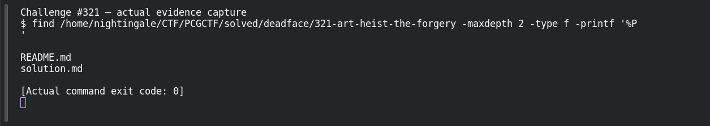

# Art Heist: The Forgery

**Platform:** PCGCTF · **Challenge ID:** 321 · **Category:** Deadface · **Points:** 100

**Status:** Solved in the old snapshot, but the original `CTF_Forgery_Paintings.zip` wasn't preserved. The flag below is from the teammate's record; I can't re-verify which file/chunk was decisive, so I'm flagging that.

## The challenge

Spot the forged painting among five scans and recover the forger's signature.

## Solving it

The approach is metadata triage across all five files — compare author, comment, software and PNG text chunks, and the odd one out is the forgery:

```sh
exiftool -a -G1 -s paintings/*
```

One file carries the forger's signature in its metadata/text chunks. The recorded flag is:

```text
deadface{L4MIA_SIGNS_HER_WORK}
```

## Screenshot



## Flag

```text
deadface{L4MIA_SIGNS_HER_WORK}
```

## Still to do

- Recover the original ZIP and confirm which PNG chunk/metadata field actually held the signature (chunk presence only locates it — decode the data to prove it).

## Takeaway

Compare metadata across the whole set to find the anomaly, and decode a chunk's data before calling it the flag — a chunk name alone is just a pointer.

## Reference

- [Original challenge and attachments](../../solved/deadface/321-art-heist-the-forgery/README.md)
