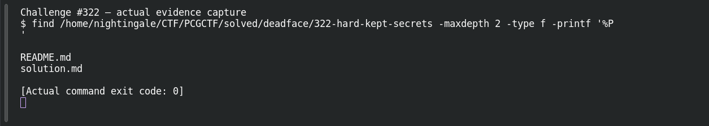

# Hard Kept Secrets

**Platform:** PCGCTF · **Challenge ID:** 322 · **Category:** Deadface · **Points:** 250

**Difficulty:** Not recorded in the available platform metadata.

**Verification status:** Verified — solved in the last PCGCTF snapshot. Historical site-solved snapshot; flag retained from teammate’s explicitly unreproduced public-writeup notes. Original APK missing.

## Challenge and objective

Recover the internal API token embedded in the De Monne Android application.

Original description: [saved challenge description](</home/nightingale/CTF/PCGCTF/solved/deadface/322-hard-kept-secrets/README.md>). Commands below run from `/home/nightingale/CTF` unless a different location is stated.

## Initial analysis

The question asks for an API token, not a login password or a visible UI flag. The recorded method follows the networking client to the header interceptor, where a constant is attached to requests. A Base64-looking value can be the right type of secret, but its appearance alone does not prove it is the actual token.

## Step-by-step solution

### 1. Check the shared package boundary

The original direct-attachment inventory and related challenge folders were reviewed. No app-release.apk or original Hard Kept Secrets ZIP was present in the saved primary payloads. The answer is sourced to the teammate’s report; this is a bounded local absence, not a claim that the organizer never supplied a package.

```sh
find '/home/nightingale/CTF/PCGCTF' -iname '*.apk' -o -iname '*hard*kept*'
```

**Recorded output / observation:**

```text
Primary APK absent from local challenge attachments
Shared source: Hard Kept Secrets
```

Recover the shared original package once and use its hash to connect all three investigations. Search the decompiled networking client and interceptor, then trace the constant to the outgoing header assignment. The token in the saved record is long and Base64-shaped; two UI flag strings are described as decoys, but their exact locations were not preserved.

### 2. Trace the relevant code after obtaining the APK

These tools decode the APK resources or DEX into an inspectable representation. The listed search terms are starting points, not an observed set of matching classes. The exact flags and their program roles must be established from the actual package before describing a successful local extraction.

```sh
jadx -d decompiled app-release.apk
rg -n -i "ApiClient|Interceptor|addHeader|deadface|token" decompiled/
```

**Unexecuted artifact-specific procedure:**

```text
[OUTPUT NEEDED: actual manifest/decompiler matches and relevant surrounding code]
```

Find the assignment that makes the candidate an API request credential. Record the class, method and header name from the actual DEX.

## Captured screenshots and evidence

Captured on 2026-10-29 from actual terminal sessions or browser views. Captions distinguish new results, preserved records, source images and blockers. No platform acceptance is inferred from these images.

### Challenge #322 — actual evidence capture



Actual inventory confirms which original challenge artifact is absent; does not invent a reverse-engineering/stego result. The inventory documents the missing payload; no extraction or decompilation of that absent payload is claimed.

Command/action actually executed:

```sh
find /home/nightingale/CTF/PCGCTF/solved/deadface/322-hard-kept-secrets -maxdepth 2 -type f -printf '%P
'
```

[Actual command transcript](../screenshots/capture-work/322-artifact-inventory.terminal.log) · [Execution record](../screenshots/capture-work/322-artifact-inventory.result.json). Notice the result fields discussed in the corresponding solution step; the transcript retains lines that extend beyond the screenshot viewport.

**Blocked evidence:** the original challenge payload is absent. The inventory was captured; the proposed extraction or code inspection cannot be truthfully reproduced until that original file is recovered.

## Flag discovery and verification

Saved result / candidate:

```text
deadface{zqJRlVwBA9Xm2lE5EPjgbj/4rOxlkYZgDtkdP7jV80rZgLFrlnOEn+VAu31YKQrR}
```

Historical site-solved snapshot; flag retained from teammate’s explicitly unreproduced public-writeup notes. Original APK missing.

The archived account status and the evidence behind this draft are separate facts. No new PCGCTF acceptance is claimed. Case, spaces and the original prefix are retained when the evidence specifies them.

## Remaining review tasks

- Obtain the original shared APK/ZIP and record its SHA-256.
- Find the assignment that makes the candidate an API request credential. Record the class, method and header name from the actual DEX.
- Capture the decisive code/manifest evidence and any runtime observation separately.

## What this challenge taught me

The same application can leak different secrets through different code paths. Establish the role of the recovered value instead of submitting whichever flag-shaped string appears first.

## Evidence and attribution

- [Original challenge and attachments](</home/nightingale/CTF/PCGCTF/solved/deadface/322-hard-kept-secrets/README.md>)
- [Earlier solution / teammate provenance](</home/nightingale/CTF/PCGCTF/solved/deadface/322-hard-kept-secrets/solution.md>)
- [source.md](</home/nightingale/CTF/PCGCTF/team-writeups/garcia-day1/source.md>)
