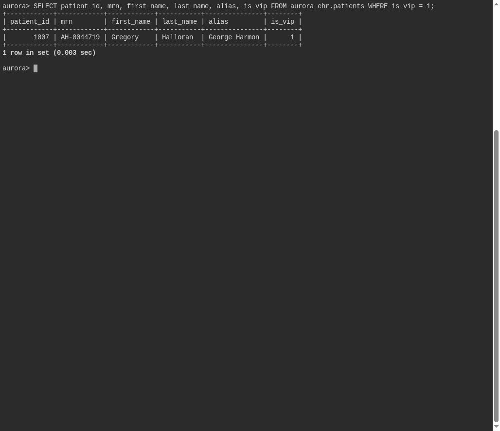

# Admitted Under Another Name

**Platform:** PCGCTF · **Challenge ID:** 326 · **Category:** Deadface · **Points:** 100

**Status:** Solved in the saved snapshot. The query and screenshots below come from the saved database verification.

## The challenge

Find the VIP record in the patient registry and report its real Medical Record Number — not the alias or display name.

## Solving it

The VIP is admitted under an alias, so I queried for the record and pulled the actual MRN column rather than the shown name:

```sql
SELECT patient_id, mrn, first_name, last_name, alias, is_vip
FROM aurora_ehr.patients
WHERE is_vip = 1;
```

Selected result from the saved verification:

```text
AH-0044719
```

The display name is the alias; the MRN `AH-0044719` is the real identifier the question wants.

## Screenshot



## Flag

```text
deadface{AH-0044719}
```

## Takeaway

Return the field the question actually asks for — the MRN is the stable identifier, not the alias/display name the record presents.

## Reference

- [Original challenge and attachments](../../solved/deadface/326-admitted-under-another-name/README.md)
