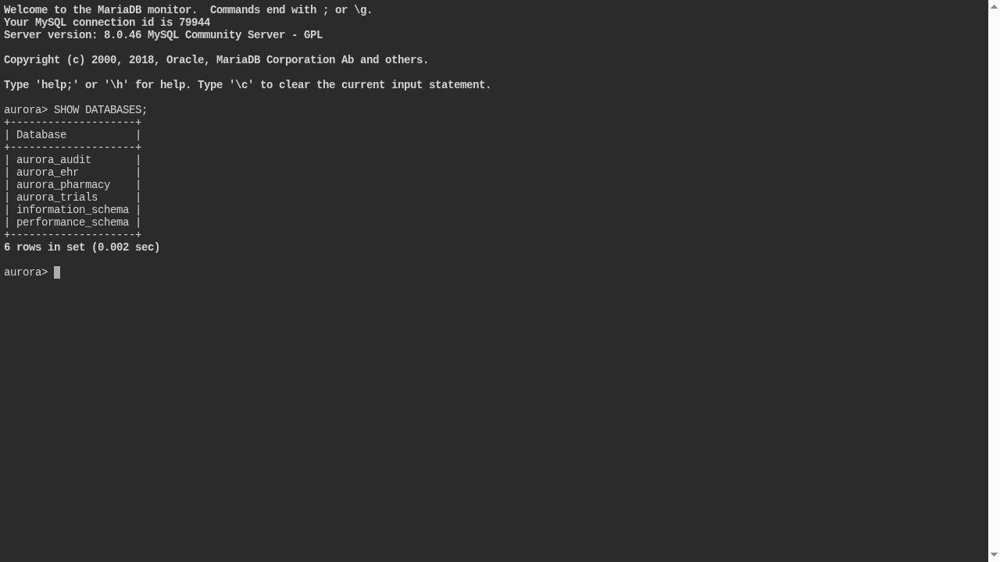
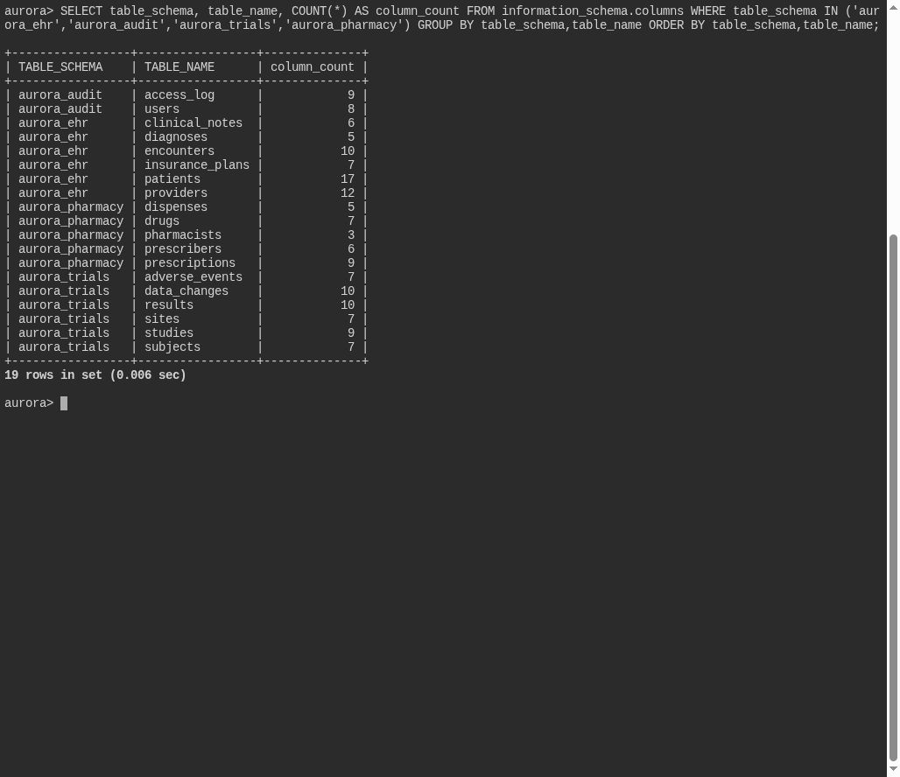
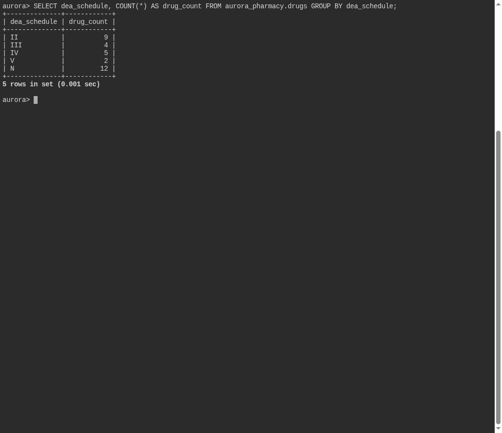

# Schedule of Concern

**Platform:** PCGCTF · **Challenge ID:** 327 · **Category:** Deadface · **Points:** 200

**Difficulty:** Not recorded in the available platform metadata.

**Verification status:** Verified — solved in the last PCGCTF snapshot. Solved in our saved PCGCTF snapshot; SQL procedure and decisive rows are recorded by Antonio B. Garcia Jr., independently repeated in the live Aurora shell during the screenshot pass.

## Challenge and objective

Count drugs classified as DEA Schedule II in Aurora’s formulary; the flag requires only the count.

Original description: [saved challenge description](</home/nightingale/CTF/PCGCTF/solved/deadface/327-schedule-of-concern/README.md>). Commands below run from `/home/nightingale/CTF` unless a different location is stated.

## Initial analysis

The useful distinction is between a drug record and a dispense. Counting prescriptions or total tablets would answer a different question. I would inspect the `drugs` schedule column first, because “Schedule II” can be stored as `II`, `CII` or `2` depending on the application.

## Step-by-step solution

### 1. Check the relevant schema

In the authorized Aurora SQL shell, confirm table and column names before adapting the query. `information_schema.columns` describes the database; sorting by schema, table and ordinal position groups related fields. This is a read-only discovery query.

```sql
SELECT table_schema, table_name, column_name, data_type
FROM information_schema.columns
WHERE table_schema IN ('aurora_ehr','aurora_audit','aurora_trials','aurora_pharmacy')
ORDER BY table_schema, table_name, ordinal_position;
```

**Live schema check:** the shared screenshot below shows the actual database/table inventory and column counts. The full column-list query above remains a reference procedure; that exact listing was not separately captured.

The live query below also checks that its referenced tables and columns exist in the current CTF database. Do not treat a missing or renamed column as a different solved result.

### 2. Apply the challenge-specific query

`GROUP BY` collects every formulary row with the same stored schedule. `COUNT(*)` counts those rows; it does not sum dosage or frequency. Listing every schedule confirms both the representation and the target count. The `II` group has nine records, so the result fits the required numeric wrapper.

```sql
SELECT dea_schedule, COUNT(*) AS drug_count
FROM aurora_pharmacy.drugs
GROUP BY dea_schedule;
```

**Originally teammate-recorded result; the query was independently repeated during the screenshot pass:**

```text
II | 9
III | 4
IV | 5
V | 2
N | 12
```

These values are the decisive rows recorded in Garcia’s Day 1 writeup. The original row transcription is attributed to that report. The screenshot pass independently executed the displayed query in Aurora; compare its actual rows in the capture below.

## Captured screenshots and evidence

Captured on 2026-10-29 from actual terminal sessions or browser views. Captions distinguish new results, preserved records, source images and blockers. No platform acceptance is inferred from these images.

### aurora-live-databases.png



Actual live SHOW DATABASES result.

Command/action actually executed:

```sh
SHOW DATABASES;
```

Source viewed: [https://aurora.dctf.io/](https://aurora.dctf.io/).

### aurora-live-schema.png



Actual live read-only schema/table inventory with column counts. This is a compact inventory, not the full column listing.

Source viewed: [https://aurora.dctf.io/](https://aurora.dctf.io/).

### 327-step-02.png



Actual live read-only Aurora query result; compare the returned rows with step 2. This is not a new PCGCTF acceptance.

Command/action actually executed:

```sql
SELECT dea_schedule, COUNT(*) AS drug_count
FROM aurora_pharmacy.drugs
GROUP BY dea_schedule;
```

Source viewed: [https://aurora.dctf.io/](https://aurora.dctf.io/).

## Flag discovery and verification

Saved result / candidate:

```text
deadface{9}
```

Solved in our saved PCGCTF snapshot; SQL procedure and decisive rows are recorded by Antonio B. Garcia Jr., independently repeated in the live Aurora shell during the screenshot pass.

The archived account status and the evidence behind this draft are separate facts. No new PCGCTF acceptance is claimed. Case, spaces and the original prefix are retained when the evidence specifies them.

## Remaining review tasks

- The available command results are captured below. Preserve a real acceptance record if a later platform verification is performed.

## What this challenge taught me

The right aggregate depends on the entity being counted. Establishing the stored category values first prevents a correct-looking query from returning zero because of a guessed label.

## Evidence and attribution

- [Original challenge and attachments](</home/nightingale/CTF/PCGCTF/solved/deadface/327-schedule-of-concern/README.md>)
- [Earlier solution / teammate provenance](</home/nightingale/CTF/PCGCTF/solved/deadface/327-schedule-of-concern/solution.md>)
- [source.md](</home/nightingale/CTF/PCGCTF/team-writeups/garcia-day1/source.md>)
