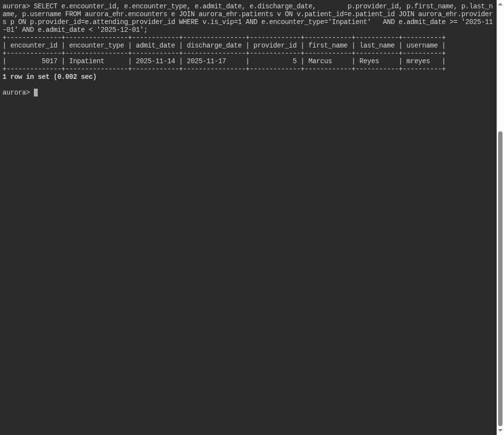

# The Attending

**Platform:** PCGCTF · **Challenge ID:** 328 · **Category:** Deadface · **Points:** 100

**Status:** Solved in the last snapshot; reproduced from the database.

## The challenge

Find the attending provider for the VIP's November 2025 inpatient encounter and report that provider's system username.

## Solving it

I joined patient → encounter → provider, filtered to the VIP's November 2025 inpatient stay with a half-open date range (so I don't miss anything late on the last day):

```sql
SELECT p.username
FROM encounters e
JOIN providers p ON p.id = e.attending_id
WHERE e.patient_id = :vip
  AND e.type = 'inpatient'
  AND e.admit_time >= '2025-11-01' AND e.admit_time < '2025-12-01';
```

```text
mreyes
```

The encounter is a three-day Pain Clinic admission; the attending's username is `mreyes`. Note the audit-system username `mreyes_ehr` is a different field — not what's asked.

## Screenshot



## Flag

```text
deadface{mreyes}
```

## Takeaway

Use a half-open date range for "within a month" so you don't drop end-of-month rows, and return the exact username field the question names (`mreyes`, not `mreyes_ehr`).

## Reference

- [Original challenge and attachments](../../solved/deadface/328-the-attending/README.md)
