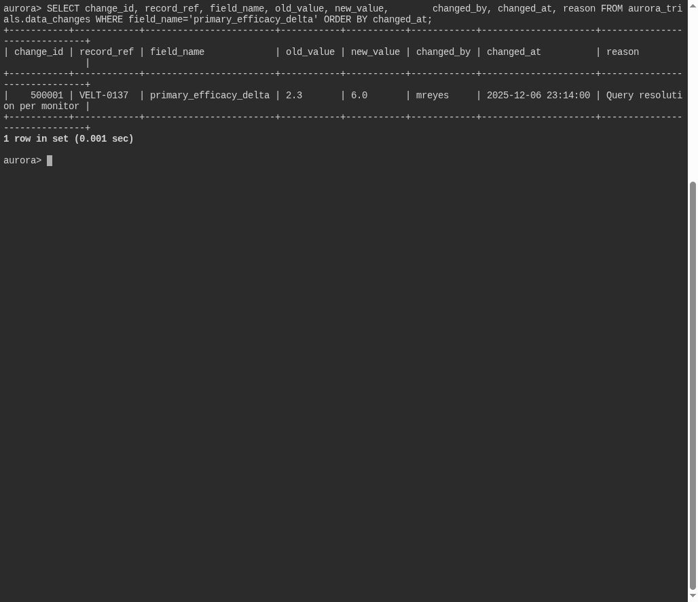

# The Original Reading

**Platform:** PCGCTF · **Challenge ID:** 330 · **Category:** Deadface · **Points:** 100

**Status:** Solved in the saved snapshot. The query and screenshots below come from the saved database verification.

## The challenge

Recover the original primary-efficacy value that was overwritten in the trial audit trail.

## Solving it

The audit trail keeps the before/after of each change, so I read the row where `primary_efficacy_delta` was edited:

```sql
SELECT change_id, record_ref, field_name, old_value, new_value,
       changed_by, changed_at, reason
FROM aurora_trials.data_changes
WHERE field_name='primary_efficacy_delta'
ORDER BY changed_at;
```

Selected result from the saved verification:

```text
old_value: 2.3   new_value: 6.0   changed_by: mreyes
```

The value was quietly changed from `2.3` to `6.0`. The *original* reading is 2.3.

## Screenshot



## Flag

```text
deadface{2.3}
```

## Takeaway

An audit trail defeats the cover-up — the `old_value` column preserves exactly what the `6.0` was meant to hide.

## Reference

- [Original challenge and attachments](../../solved/deadface/330-the-original-reading/README.md)
