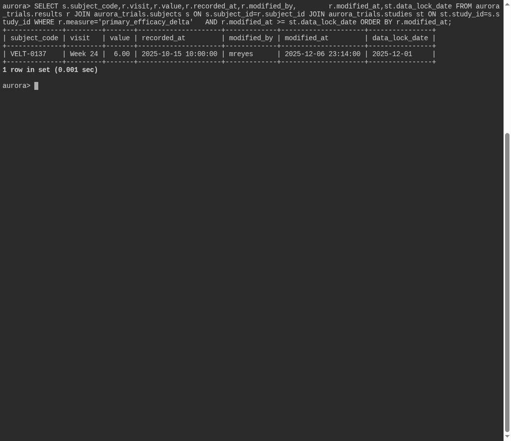

# After the Lock

**Platform:** PCGCTF · **Challenge ID:** 333 · **Category:** Deadface · **Points:** 100

**Status:** Solved in the last snapshot; reproduced from the database.

## The challenge

Find the subject whose primary-efficacy result was modified *after* its study's data-lock date.

## Solving it

I compared each result's `modified_at` against the study's `data_lock` date and kept the one changed afterward:

```sql
SELECT s.subject_code, r.value, r.modified_at, st.data_lock
FROM aurora_trials.results r
JOIN aurora_trials.subjects s ON s.id = r.subject_id
JOIN aurora_trials.studies st ON st.id = s.study_id
WHERE r.measure = 'primary_efficacy_delta'
  AND r.modified_at > st.data_lock;
```

```text
VELT-0137 | 6.00 | 2025-12-06 23:14:00 | data_lock 2025-12-01
```

Subject `VELT-0137` was edited on Dec 6, five days after the Dec 1 lock.

## Screenshot



## Flag

```text
deadface{VELT-0137}
```

## Takeaway

A post-lock modification is the red flag — compare the modification timestamp against the data-lock date, not just the record's age.

## Reference

- [Original challenge and attachments](../../solved/deadface/333-after-the-lock/README.md)
