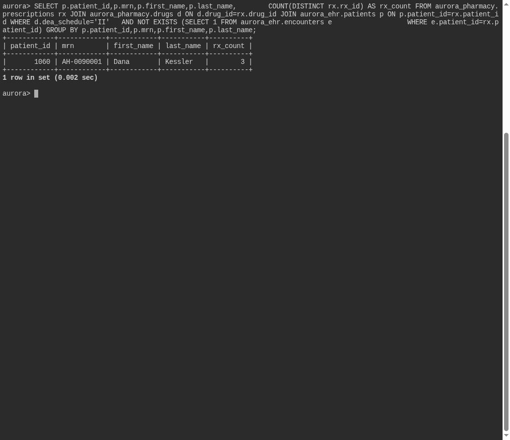

# Ghost in the Registry

**Platform:** PCGCTF · **Challenge ID:** 334 · **Category:** Deadface · **Points:** 100

**Status:** Solved in the last snapshot; reproduced from the database.

## The challenge

Find a patient with a Schedule II prescription but no recorded encounter, and return their MRN.

## Solving it

A prescription with no corresponding encounter is the anomaly — a phantom patient. I used `NOT EXISTS` against the encounters table:

```sql
SELECT p.mrn
FROM aurora_pharmacy.prescriptions rx
JOIN aurora_pharmacy.drugs d ON d.id = rx.drug_id
JOIN aurora_ehr.patients p ON p.patient_id = rx.patient_id
WHERE d.dea_schedule = 'II'
  AND NOT EXISTS (
    SELECT 1 FROM aurora_ehr.encounters e WHERE e.patient_id = rx.patient_id
  );
```

```text
AH-0090001
```

## Screenshot



## Flag

```text
deadface{AH-0090001}
```

## Takeaway

A controlled-substance script with no clinical encounter behind it is exactly the kind of gap `NOT EXISTS` surfaces cleanly.

## Reference

- [Original challenge and attachments](../../solved/deadface/334-ghost-in-the-registry/README.md)
