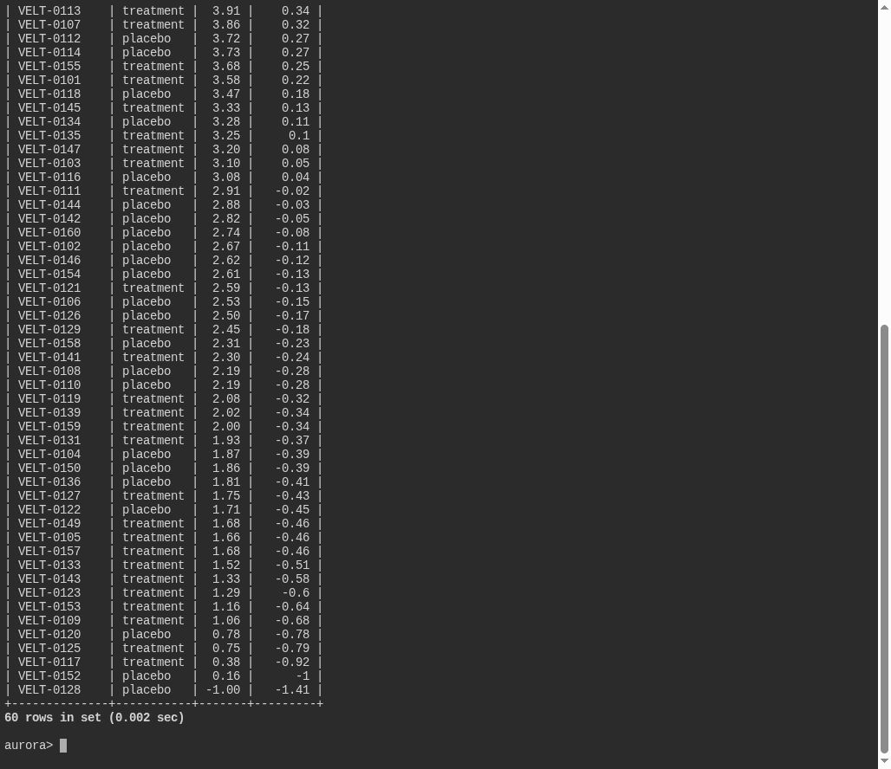
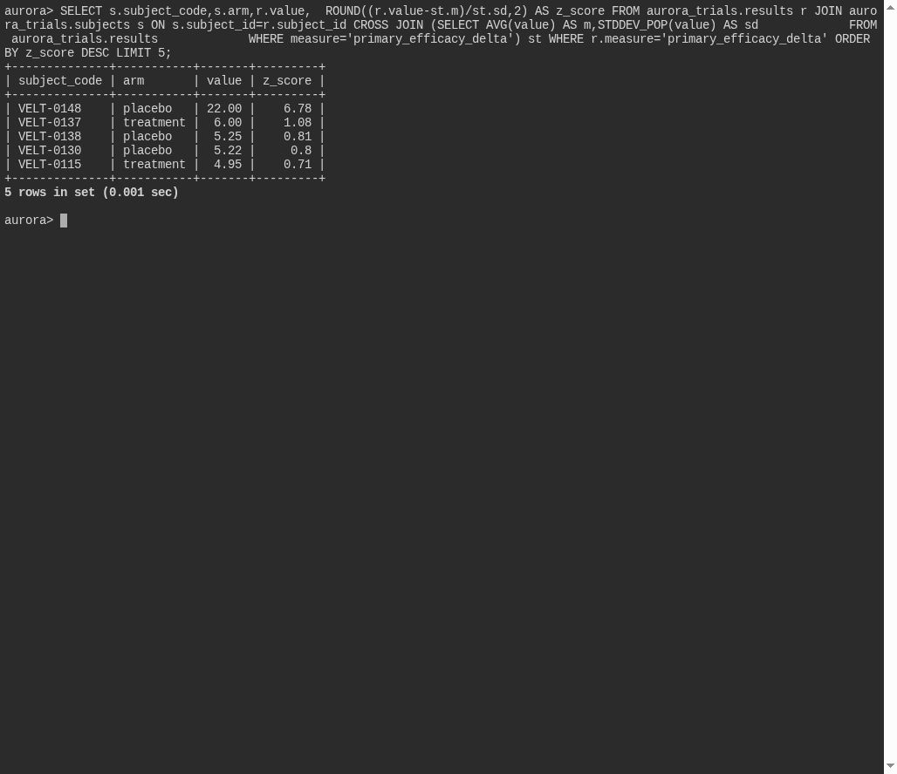

# Too Good to be True

**Platform:** PCGCTF · **Challenge ID:** 335 · **Category:** Deadface · **Points:** 100

**Status:** Solved in the last snapshot; reproduced from the database.

## The challenge

Find the primary-endpoint value more than three standard deviations above the study mean, and report its subject code.

## Solving it

I computed the mean and population standard deviation over all primary-efficacy values, then kept any row more than 3σ above the mean:

```sql
SELECT s.subject_code, r.value
FROM aurora_trials.results r
JOIN aurora_trials.subjects s ON s.id = r.subject_id
CROSS JOIN (
  SELECT AVG(value) AS m, STDDEV_POP(value) AS sd
  FROM aurora_trials.results WHERE measure = 'primary_efficacy_delta'
) st
WHERE r.measure = 'primary_efficacy_delta'
  AND r.value > st.m + 3 * st.sd;
```

```text
VELT-0148
```

One subject, `VELT-0148`, sits past the 3σ line — a statistically implausible result.

## Screenshots





## Flag

```text
deadface{VELT-0148}
```

## Takeaway

A value >3σ from the mean is a classic fabrication signal — compute the stats in-query with a CROSS JOIN rather than eyeballing the data.

## Reference

- [Original challenge and attachments](../../solved/deadface/335-too-good-to-be-true/README.md)
