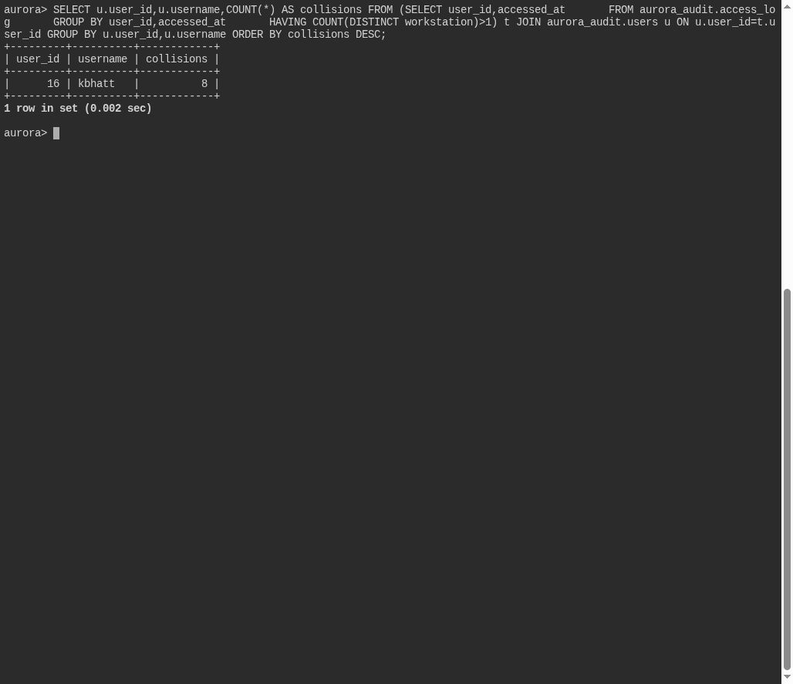

# Two Places at Once

**Platform:** PCGCTF · **Challenge ID:** 336 · **Category:** Deadface · **Points:** 100

**Status:** Solved in the saved snapshot. The query and screenshots below come from the saved database verification.

## The challenge

Identify the legitimate account logged into two different workstations at identical timestamps, repeatedly.

## Solving it

Group access records by account and timestamp, keeping timestamps with more than one workstation. Count those timestamps per account:

```sql
SELECT u.user_id,u.username,COUNT(*) AS collisions
FROM (SELECT user_id,accessed_at
      FROM aurora_audit.access_log
      GROUP BY user_id,accessed_at
      HAVING COUNT(DISTINCT workstation)>1) t
JOIN aurora_audit.users u ON u.user_id=t.user_id
GROUP BY u.user_id,u.username
ORDER BY collisions DESC;
```

The saved result is:

```text
user_id  username  collisions
16       kbhatt    8
```

The database username is **`kbhatt`**, with two `t`s. The teammate's submission record reports **`deadface{kbhat}`**, with one `t`, as the accepted spelling. The flag below preserves that reported spelling; it is not the literal username returned by the query.

The eight matching timestamps identify the account described by the exercise. The logs alone do not identify who was using its credentials.

## Screenshot



## Flag

```text
deadface{kbhat}
```

## Takeaway

Keep the evidence value and a reported accepted spelling separate when the two differ.

## Reference

- [Original challenge and attachments](../../solved/deadface/336-two-places-at-once/README.md)
