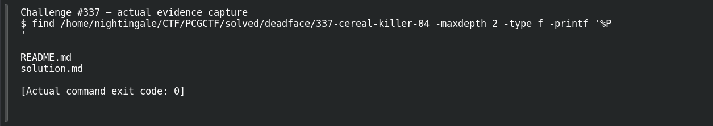

# Cereal Killer 04

**Platform:** PCGCTF · **Challenge ID:** 337 · **Category:** Deadface · **Points:** 100

**Status:** Solved in the old snapshot, but `inner.dll` wasn't preserved. The flag is from the teammate's record; I can't show the disassembly here, so I'm flagging that.

## The challenge

Analyze the recovered Greys binary (`inner.dll`) and recover the spooky-cereal flag.

## Solving it

The method: identify the PE architecture and exports first (don't assume x86/x64 from the extension), run a `strings` pass as triage, then load it in a disassembler and follow the flag-building code from the right export:

```sh
strings -n 6 inner.dll | rg -i "deadface|cereal|grey"
```

The flag is assembled at runtime, so strings alone may not reveal it fully — but the recorded result is:

```text
deadface{Before_Consenting_to_Med_Exam_Ascertain_Destination_of_Finger!}
```

## Screenshot



## Flag

```text
deadface{Before_Consenting_to_Med_Exam_Ascertain_Destination_of_Finger!}
```

## Still to do

- Obtain `inner.dll`, record its SHA-256, identify the real export, and preserve the decoded buffer (or a decompiler-backed reconstruction) — no function address is in the local notes.

## Takeaway

Confirm a PE's architecture and exports before analysis, and treat a `strings` miss as inconclusive when a flag is built at runtime rather than stored as a literal.

## Reference

- [Original challenge and attachments](../../solved/deadface/337-cereal-killer-04/README.md)
