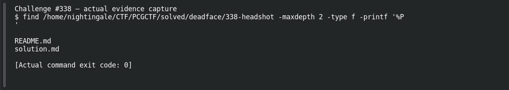

# Headshot

**Platform:** PCGCTF · **Challenge ID:** 338 · **Category:** Deadface · **Points:** 100

**Status:** Solved in the old snapshot, but `headshot.zip` wasn't preserved. The flag is from the teammate's record; I can't point to the exact tampered file here, so I'm flagging it.

## The challenge

Identify the one employee headshot that was tampered with and recover its hidden tag.

## Solving it

The method is metadata/structure comparison across all the headshots to find the anomaly, then read its hidden tag:

```sh
exiftool -a -G1 -s headshots/*
strings -n 6 headshots/* | rg -i "deadface|comment|author"
```

The tampered image carries the hidden tag:

```text
deadface{b00m_h34Dsh0TTT}
```

## Screenshot



## Flag

```text
deadface{b00m_h34Dsh0TTT}
```

## Still to do

- Obtain `headshot.zip`, identify the exact anomalous file and extraction method, and compare it against its peers rather than assuming the largest/odd file is the one.

## Takeaway

Compare metadata across the whole set to spot the outlier — and remember a `strings` miss doesn't rule out data hidden in compressed or pixel-encoded form.

## Reference

- [Original challenge and attachments](../../solved/deadface/338-headshot/README.md)
