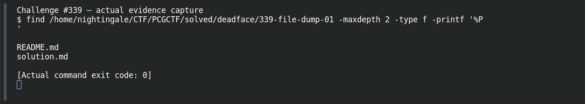

# File Dump 01

**Platform:** PCGCTF · **Challenge ID:** 339 · **Category:** Deadface · **Points:** 200

**Difficulty:** Not recorded in the available platform metadata.

**Verification status:** Verified — solved in the last PCGCTF snapshot. Historical site-solved snapshot; flag is retained from Garcia’s attributed public-writeup report, while the original payload and decisive extraction are missing.

## Challenge and objective

Identify the DEADFACE alias responsible for the stolen identity in the intercepted laptop dump.

Original description: [saved challenge description](</home/nightingale/CTF/PCGCTF/solved/deadface/339-file-dump-01/README.md>). Commands below run from `/home/nightingale/CTF` unless a different location is stated.

## Initial analysis

The laptop dump is the primary source that should tie an alias to the identity theft. The saved snapshot has no File_Dump_Challenge.zip member, while Garcia records gh0st404 from a public challenge writeup. That result can be retained as attributed knowledge without pretending that a particular image or hidden file was extracted locally.

## Step-by-step solution

### 1. Audit the available primary evidence

The challenge README and imported source were inspected. The attachment directory does not contain the primary payload named in the teammate’s report, which bounds what can be independently reconstructed here.

```sh
find '/home/nightingale/CTF/PCGCTF/solved/deadface/339-file-dump-01' -maxdepth 2 -type f -print
```

**Recorded output / observation:**

```text
Available: saved README and imported solution
Missing primary artifact: File_Dump_Challenge.zip
```

The solved snapshot remains valid historical status. It does not establish a new artifact extraction or make the intended method a recorded local execution.

### 2. Reproduce the first artifact-specific triage after recovery

Start with file type and explicit identity artifacts, then follow any actual steganography clue. `rg -a` treats file content as text for triage but does not replace a proper parser for archives or databases. A handle found in one unrelated note would need contextual corroboration.

```sh
file recovered-dump/*
exiftool -a -G1 -s recovered-dump/*
rg -a -n -i "deadface|gh0st404|Daniel" recovered-dump/
```

**Unexecuted reproduction plan:**

```text
[OUTPUT NEEDED: actual File_Dump_Challenge.zip analysis; no terminal output was fabricated.]
```

Recover the dump, identify the actual alias-bearing artifact and record why it refers to the responsible crew member rather than a contact or decoy.

## Captured screenshots and evidence

Captured on 2026-10-29 from actual terminal sessions or browser views. Captions distinguish new results, preserved records, source images and blockers. No platform acceptance is inferred from these images.

### Challenge #339 — actual evidence capture



Actual inventory confirms which original challenge artifact is absent; does not invent a reverse-engineering/stego result. The inventory documents the missing payload; no extraction or decompilation of that absent payload is claimed.

Command/action actually executed:

```sh
find /home/nightingale/CTF/PCGCTF/solved/deadface/339-file-dump-01 -maxdepth 2 -type f -printf '%P
'
```

[Actual command transcript](../screenshots/capture-work/339-artifact-inventory.terminal.log) · [Execution record](../screenshots/capture-work/339-artifact-inventory.result.json). Notice the result fields discussed in the corresponding solution step; the transcript retains lines that extend beyond the screenshot viewport.

**Blocked evidence:** the original challenge payload is absent. The inventory was captured; the proposed extraction or code inspection cannot be truthfully reproduced until that original file is recovered.

## Flag discovery and verification

Saved result / candidate:

```text
deadface{gh0st404}
```

Historical site-solved snapshot; flag is retained from Garcia’s attributed public-writeup report, while the original payload and decisive extraction are missing.

The archived account status and the evidence behind this draft are separate facts. No new PCGCTF acceptance is claimed. Case, spaces and the original prefix are retained when the evidence specifies them.

## Remaining review tasks

- Obtain the original File_Dump_Challenge.zip and verify its identity before following the proposed procedure.
- Recover the dump, identify the actual alias-bearing artifact and record why it refers to the responsible crew member rather than a contact or decoy.
- Capture the decisive extraction and, if available, the original accepted submission screenshot.

## What this challenge taught me

An attribution answer needs context linking a handle to the event; a bare matching string is only a lead.

## Evidence and attribution

- [Original challenge and attachments](</home/nightingale/CTF/PCGCTF/solved/deadface/339-file-dump-01/README.md>)
- [Earlier solution / teammate provenance](</home/nightingale/CTF/PCGCTF/solved/deadface/339-file-dump-01/solution.md>)
- [source.md](</home/nightingale/CTF/PCGCTF/team-writeups/garcia-day1/source.md>)
