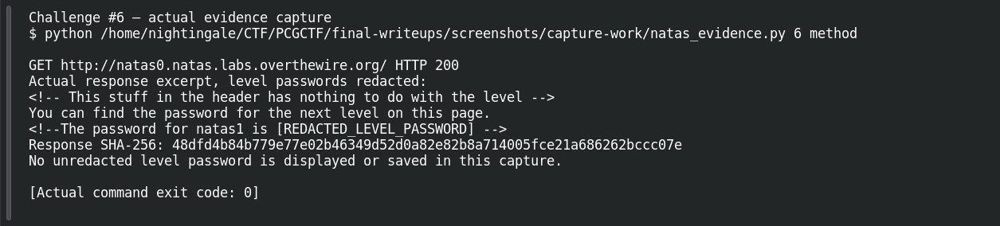
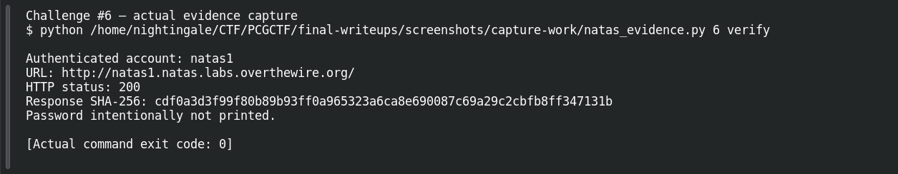

# Hidden in Plain Sight

**Platform:** OverTheWire Natas (mirrored by PCGCTF) · **Challenge ID:** 6 · **Category:** Web Exploitation — Natas · **Points:** 100

**Status:** Verified on OverTheWire from the saved live-auth record. PCGCTF acceptance is unconfirmed. The recovered next-level password is redacted here.

## The challenge

This is natas0. The hint says to view source and pull the password for natas1.

## Solving it

A page doesn't have to *show* a secret for the browser to have received it — an HTML comment is hidden by rendering but still sits in the page source. So I grabbed the source directly with curl (Ctrl+U in a browser gets you the same thing):

```sh
curl -sS --user natas0 http://natas0.natas.labs.overthewire.org/
```

(`natas0` is the public starting password.) The comment was right there in the markup:

```html
<!-- The password for natas1 is [REDACTED] -->
```

That value is the password *for natas1*, not a new natas0 login — easy to mix up. I confirmed it actually works by authenticating to the next level:

```sh
curl -sS --user natas1 -o /dev/null -w '%{http_code}\n' http://natas1.natas.labs.overthewire.org/
```

```text
200
```

A 200 means the recovered password really did log into natas1 — better evidence than just "it looked like a password in a comment."

## Screenshots





## Flag

The saved check authenticated to natas1 and returned HTTP 200. For PCGCTF, the candidate wraps the recovered password as `pcgCTF{<natas1 password>}`; I've kept the actual value in a private copy and redacted it here.

## Takeaway

Hiding something in an HTML comment doesn't protect it. Once a secret has been sent to the client, how the page chooses to display it is irrelevant.

## References

- [Original archived challenge](../../unsolved/web-exploitation-natas/006-hidden-in-plain-sight/README.md)
- [Sanitized live verification ledger](../evidence/ready-natas/natas-verification-redacted.json)
