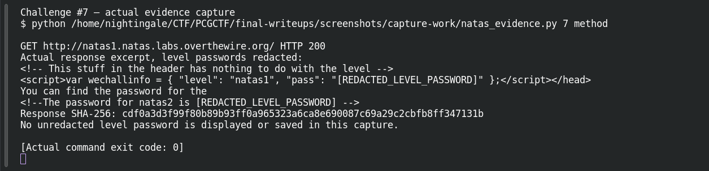
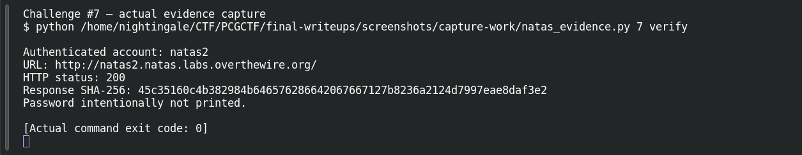

# Access Denied? Think Again

| Field | Details |
|---|---|
| Platform | OverTheWire Natas, mirrored by PCGCTF |
| Challenge ID | 7 |
| Technical category | Web Exploitation - Natas |
| Points in saved inventory | 100 |
| Difficulty | Not stated in the saved challenge description |
| Objective | Recover natas2’s password despite a client-side right-click restriction. |
| Result | Recovered next-level password — intentionally redacted in this publication draft. |

**Verified on OverTheWire** from the saved live-authentication record; PCGCTF acceptance remains unconfirmed.

## Reading the clues

The title makes the access restriction look more meaningful than it is. Blocking a browser context menu changes one interaction, not the server response. The useful question is whether the secret is still present in the response body.

## Working through the evidence

Commands below reproduce the recorded training procedure; the screenshot pass independently replayed the level-specific method and next-level authentication. `curl --user natasN` prompts for the current level password rather than putting it in shell history. `-sS` hides the progress meter while retaining errors. The output excerpts are redacted from the saved investigation; the redaction is not part of the server response.

### 1. Request the document directly

```sh
curl -sS --user natas1 http://natas1.natas.labs.overthewire.org/
```

Supply the current `natas1` credential privately at the prompt. Unlike a graphical browser, curl does not execute the page's JavaScript; a context-menu handler therefore never intervenes. A keyboard View Source shortcut is another route to the same evidence.

The original investigation records this comment:

```html
<!--The password for natas2 is [REDACTED_LEVEL_PASSWORD] -->
```

This is the decisive output, with the credential removed only in this public draft. The response discloses the password even though the usual right-click menu is blocked.

### 2. Separate UI bypass from authentication verification

```sh
curl -sS --user natas2 -o /dev/null -w '%{http_code}\n' http://natas2.natas.labs.overthewire.org/
```

The username changes because the recovered value belongs to the next level. The saved verification response was **200**. It confirms the credential, while the earlier request explains why the credential was obtainable.

## Captured screenshots and evidence

Captured on 2026-10-29 from actual terminal sessions or browser views. Captions distinguish new results, preserved records, source images and blockers. No platform acceptance is inferred from these images.

### Challenge #7 — actual evidence capture



Actual authenticated request to the named authorized Natas training level; passwords redacted before terminal display.

Command/action actually executed:

```sh
python /home/nightingale/CTF/PCGCTF/final-writeups/screenshots/capture-work/natas_evidence.py 7 method
```

[Actual command transcript](../screenshots/capture-work/007-natas-method.terminal.log) · [Execution record](../screenshots/capture-work/007-natas-method.result.json). Notice the result fields discussed in the corresponding solution step; the transcript retains lines that extend beyond the screenshot viewport.

### Challenge #7 — actual evidence capture



Actual authenticated request to the named authorized Natas training level; passwords redacted before terminal display.

Command/action actually executed:

```sh
python /home/nightingale/CTF/PCGCTF/final-writeups/screenshots/capture-work/natas_evidence.py 7 verify
```

[Actual command transcript](../screenshots/capture-work/007-natas-verify.terminal.log) · [Execution record](../screenshots/capture-work/007-natas-verify.result.json). Notice the result fields discussed in the corresponding solution step; the transcript retains lines that extend beyond the screenshot viewport.

## Flag discovery and final verification

The saved verification at **2026-10-28T22:37:26+08:00** authenticated to **natas2** at `http://natas2.natas.labs.overthewire.org/` and returned **HTTP 200**. Its response SHA-256 is `45c35160c4b382984b646576286642067667127b8236a2124d7997eae8daf3e2`. This is a recorded independent OverTheWire check, the earlier authentication record; the screenshot pass also made a fresh successful authentication, documented below.

The demonstration uses the level-specific host and username. Keep the recovered password in a private working copy; the PCGCTF candidate wraps that exact recovered value as `pcgCTF{<RECOVERED_NEXT_LEVEL_PASSWORD>}`. Neither that wrapper nor the PCGCTF solved state was independently confirmed. Redact the password from any browser or terminal capture before publishing it.

## What this challenge taught me

A JavaScript event handler can discourage a gesture, but it cannot make already-delivered source confidential. Inspecting the server response avoids confusing interface restrictions with access control.

## Evidence and references

[Original archived challenge](../../unsolved/web-exploitation-natas/007-access-denied-think-again/README.md)

- [Sanitized live verification ledger](../evidence/ready-natas/natas-verification-redacted.json)

**Provenance:** Rewritten from saved level-specific investigation and the 2026-10-28 live-authentication ledger. The screenshot pass independently repeated the intended level-specific requests and authentication; runtime passwords were redacted before terminal display and logging.
