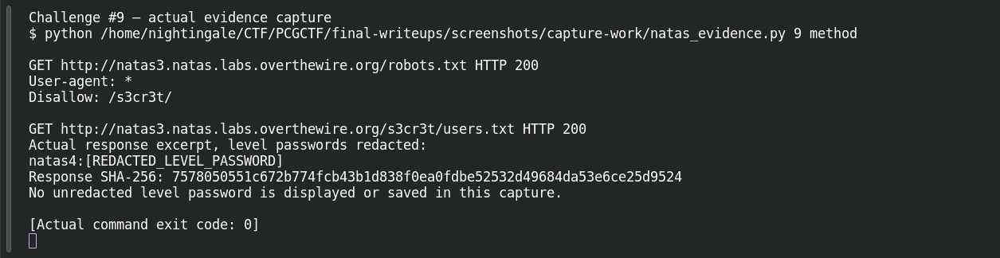
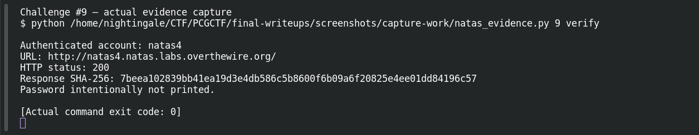

# Robots Know Everything

| Field | Details |
|---|---|
| Platform | OverTheWire Natas, mirrored by PCGCTF |
| Challenge ID | 9 |
| Technical category | Web Exploitation - Natas |
| Points in saved inventory | 100 |
| Difficulty | Not stated in the saved challenge description |
| Objective | Use robots.txt to locate a hidden directory and recover natas4’s password. |
| Result | Recovered next-level password — intentionally redacted in this publication draft. |

**Verified on OverTheWire** from the saved live-authentication record; PCGCTF acceptance remains unconfirmed.

## Reading the clues

The robots clue points to a public crawler instruction file. A disallow rule means that compliant crawlers should avoid a path; it does not mean the server prevents users from requesting it. The path itself can become the disclosure.

## Working through the evidence

Commands below reproduce the recorded training procedure; the screenshot pass independently replayed the level-specific method and next-level authentication. `curl --user natasN` prompts for the current level password rather than putting it in shell history. `-sS` hides the progress meter while retaining errors. The output excerpts are redacted from the saved investigation; the redaction is not part of the server response.

### 1. Read crawler instructions

```sh
curl -sS --user natas3 http://natas3.natas.labs.overthewire.org/robots.txt
```

The recorded response says:

```text
User-agent: *
Disallow: /s3cr3t/
```

The wildcard applies the instruction to all crawlers. The significant evidence is the literal `/s3cr3t/` path, whose spelling should be preserved.

### 2. Inspect the disclosed directory and its credential file

```sh
curl -sS --user natas3 http://natas3.natas.labs.overthewire.org/s3cr3t/
curl -sS --user natas3 http://natas3.natas.labs.overthewire.org/s3cr3t/users.txt
```

The directory index exposes `users.txt`, and the saved file excerpt contains:

```text
natas4:[REDACTED_LEVEL_PASSWORD]
```

The second request follows an observed filename, not an assumed convention. This makes the chain reproducible: crawler instruction → listed directory → credential record.

### 3. Confirm that the value belongs to natas4

The recorded authentication to `http://natas4.natas.labs.overthewire.org/` returned **200**. Its URL and response digest are preserved in the redacted ledger linked below.

## Captured screenshots and evidence

Captured on 2026-10-29 from actual terminal sessions or browser views. Captions distinguish new results, preserved records, source images and blockers. No platform acceptance is inferred from these images.

### Challenge #9 — actual evidence capture



Actual authenticated request to the named authorized Natas training level; passwords redacted before terminal display.

Command/action actually executed:

```sh
python /home/nightingale/CTF/PCGCTF/final-writeups/screenshots/capture-work/natas_evidence.py 9 method
```

[Actual command transcript](../screenshots/capture-work/009-natas-method.terminal.log) · [Execution record](../screenshots/capture-work/009-natas-method.result.json). Notice the result fields discussed in the corresponding solution step; the transcript retains lines that extend beyond the screenshot viewport.

### Challenge #9 — actual evidence capture



Actual authenticated request to the named authorized Natas training level; passwords redacted before terminal display.

Command/action actually executed:

```sh
python /home/nightingale/CTF/PCGCTF/final-writeups/screenshots/capture-work/natas_evidence.py 9 verify
```

[Actual command transcript](../screenshots/capture-work/009-natas-verify.terminal.log) · [Execution record](../screenshots/capture-work/009-natas-verify.result.json). Notice the result fields discussed in the corresponding solution step; the transcript retains lines that extend beyond the screenshot viewport.

## Flag discovery and final verification

The saved verification at **2026-10-28T22:37:26+08:00** authenticated to **natas4** at `http://natas4.natas.labs.overthewire.org/` and returned **HTTP 200**. Its response SHA-256 is `7beea102839bb41ea19d3e4db586c5b8600f6b09a6f20825e4ee01dd84196c57`. This is a recorded independent OverTheWire check, the earlier authentication record; the screenshot pass also made a fresh successful authentication, documented below.

The demonstration uses the level-specific host and username. Keep the recovered password in a private working copy; the PCGCTF candidate wraps that exact recovered value as `pcgCTF{<RECOVERED_NEXT_LEVEL_PASSWORD>}`. Neither that wrapper nor the PCGCTF solved state was independently confirmed. Redact the password from any browser or terminal capture before publishing it.

## What this challenge taught me

Publishing a path in robots.txt can make it easier to discover. Crawler policy and authorization operate at different layers; a secret directory still needs server-side access control.

## Evidence and references

[Original archived challenge](../../unsolved/web-exploitation-natas/009-robots-know-everything/README.md)

- [Sanitized live verification ledger](../evidence/ready-natas/natas-verification-redacted.json)

**Provenance:** Rewritten from saved level-specific investigation and the 2026-10-28 live-authentication ledger. The screenshot pass independently repeated the intended level-specific requests and authentication; runtime passwords were redacted before terminal display and logging.
