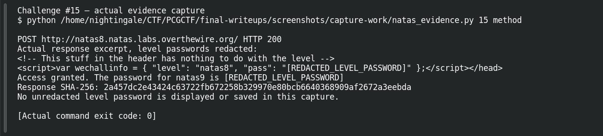
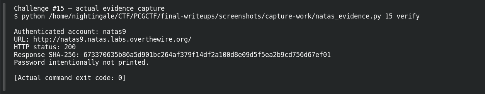

# Layers of Encoding

| Field | Details |
|---|---|
| Platform | OverTheWire Natas, mirrored by PCGCTF |
| Challenge ID | 15 |
| Technical category | Web Exploitation - Natas |
| Points in saved inventory | 100 |
| Difficulty | Not stated in the saved challenge description |
| Objective | Reverse a published encoding chain and submit the recovered comparison secret. |
| Result | Recovered next-level password — intentionally redacted in this publication draft. |

**Verified on OverTheWire** from the saved live-authentication record; PCGCTF acceptance remains unconfirmed.

## Reading the clues

The source compares a transformed form input against a constant. Hexadecimal, string reversal and Base64 are all reversible encodings; there is no unknown cryptographic key. The only delicate part is undoing the operations in the opposite order.

## Working through the evidence

Commands below reproduce the recorded training procedure; the screenshot pass independently replayed the level-specific method and next-level authentication. `curl --user natasN` prompts for the current level password rather than putting it in shell history. `-sS` hides the progress meter while retaining errors. The output excerpts are redacted from the saved investigation; the redaction is not part of the server response.

### 1. Read the transformation, not only its result

```sh
curl -sS --user natas8 http://natas8.natas.labs.overthewire.org/index-source.html
```

The recorded source uses `bin2hex(strrev(base64_encode($secret)))`. Encoding therefore runs Base64 → reverse → hex. Decoding must run hex → reverse → Base64.

### 2. Reverse all three stages offline

```python
import base64
encoded = "3d3d516343746d4d6d6c315669563362"
reversed_b64 = bytes.fromhex(encoded).decode('ascii')
b64_text = reversed_b64[::-1]
secret = base64.b64decode(b64_text).decode('ascii')
print(reversed_b64)
print(b64_text)
print(secret)
```

The recorded intermediate values are `==QcCtmMml1ViV3b` and `b3ViV1lmMmtCcQ==`; the final comparison secret is `oubWYf2kBq`. These are challenge encoding data, not the live next-level password. `bytes.fromhex` removes the outer textual hexadecimal representation, and `[::-1]` reverses the decoded string.

### 3. Submit the comparison secret

```sh
curl -sS --user natas8 --data-urlencode 'secret=oubWYf2kBq' -d 'submit=Submit' http://natas8.natas.labs.overthewire.org/index.php
```

The investigation records an `Access granted` response containing the next password. The later check authenticated to `natas9` with HTTP **200**.

## Captured screenshots and evidence

Captured on 2026-10-29 from actual terminal sessions or browser views. Captions distinguish new results, preserved records, source images and blockers. No platform acceptance is inferred from these images.

### Challenge #15 — actual evidence capture



Actual authenticated request to the named authorized Natas training level; passwords redacted before terminal display.

Command/action actually executed:

```sh
python /home/nightingale/CTF/PCGCTF/final-writeups/screenshots/capture-work/natas_evidence.py 15 method
```

[Actual command transcript](../screenshots/capture-work/015-natas-method.terminal.log) · [Execution record](../screenshots/capture-work/015-natas-method.result.json). Notice the result fields discussed in the corresponding solution step; the transcript retains lines that extend beyond the screenshot viewport.

### Challenge #15 — actual evidence capture



Actual authenticated request to the named authorized Natas training level; passwords redacted before terminal display.

Command/action actually executed:

```sh
python /home/nightingale/CTF/PCGCTF/final-writeups/screenshots/capture-work/natas_evidence.py 15 verify
```

[Actual command transcript](../screenshots/capture-work/015-natas-verify.terminal.log) · [Execution record](../screenshots/capture-work/015-natas-verify.result.json). Notice the result fields discussed in the corresponding solution step; the transcript retains lines that extend beyond the screenshot viewport.

## Flag discovery and final verification

The saved verification at **2026-10-28T22:37:26+08:00** authenticated to **natas9** at `http://natas9.natas.labs.overthewire.org/` and returned **HTTP 200**. Its response SHA-256 is `673370635b86a5d901bc264af379f14df2a100d8e09d5f5ea2b9cd756d67ef01`. This is a recorded independent OverTheWire check, the earlier authentication record; the screenshot pass also made a fresh successful authentication, documented below.

The demonstration uses the level-specific host and username. Keep the recovered password in a private working copy; the PCGCTF candidate wraps that exact recovered value as `pcgCTF{<RECOVERED_NEXT_LEVEL_PASSWORD>}`. Neither that wrapper nor the PCGCTF solved state was independently confirmed. Redact the password from any browser or terminal capture before publishing it.

## What this challenge taught me

A chain of encodings can look cryptographic while adding no secrecy. Writing down the forward function first makes the inverse unambiguous and gives useful intermediate checks.

## Evidence and references

[Original archived challenge](../../unsolved/web-exploitation-natas/015-layers-of-encoding/README.md)

- [Sanitized live verification ledger](../evidence/ready-natas/natas-verification-redacted.json)

**Provenance:** Rewritten from saved level-specific investigation and the 2026-10-28 live-authentication ledger. The screenshot pass independently repeated the intended level-specific requests and authentication; runtime passwords were redacted before terminal display and logging.
