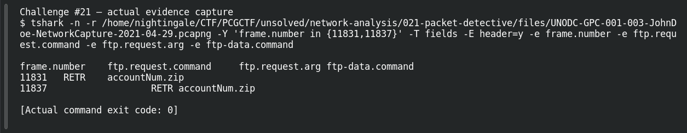

# Packet Detective

**Platform:** PCGCTF · **Challenge ID:** 21 · **Category:** Network Analysis · **Points:** 100

**Status:** Answer backed by the capture. Exact PCGCTF submission not re-confirmed (the challenge wording is slightly ambiguous — see below).

## The challenge

Identify the extension of a file downloaded in the supplied capture.

## Solving it

There are a few downloads in the capture, so rather than grabbing a filename out of `strings`, I filtered on the actual FTP retrieve command:

```sh
tshark -nr capture.pcapng -Y 'ftp.request.command=="RETR"' -T fields -e ftp.request.arg
```

```text
accountNum.zip
```

FTP splits control and data across two connections; the RETR on the control channel (stream 19) is the download, transferred on stream 20. So the extension is `zip`.

## Screenshot

The terminal image below displays a retained verification transcript.



## Flag

```text
pcgCTF{zip}
```

One caveat: the capture also has an HTTP `.crx` download and a CA-cert filename, and the question gives no protocol to disambiguate. The FTP download is proven; which one the author meant isn't 100% certain.

## Takeaway

Prove a download from the actual transfer command (RETR), not a filename that happened to appear in packet strings — and note genuine ambiguity instead of hiding it.

## Reference

- [Original challenge description](../../unsolved/network-analysis/021-packet-detective/README.md)
