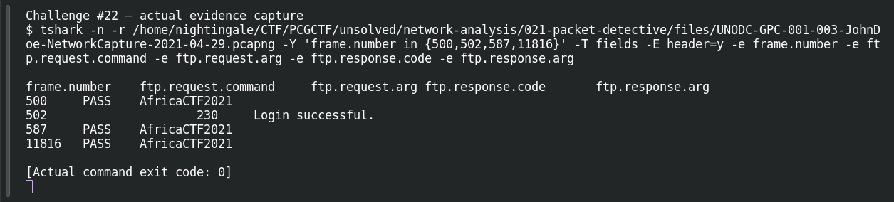

# FTP Credential Leak

**Platform:** PCGCTF · **Challenge ID:** 22 · **Category:** Network Analysis · **Points:** 100

**Status:** Answer backed by the capture. Exact PCGCTF submission not re-confirmed.

## The challenge

Recover the password from a successful FTP login. (Uses the same capture as Packet Detective #21.)

## Solving it

FTP is cleartext, so I pulled the PASS command and tied it to a successful-login response (230):

```sh
tshark -nr capture.pcapng -Y 'ftp.request.command=="PASS" || ftp.response.code==230' \
  -T fields -e ftp.request.arg -e ftp.response.code
```

```text
USER kali     (frame 496)
PASS AfricaCTF2021  (frame 500)
230 Login successful (frame 502)
```

The password tied to the 230 is `AfricaCTF2021` (keep the exact capitalization). The same password recurs in later sessions — a string in a PASS field could be a failed guess, but the 230 confirms this one worked.

## Screenshot



## Flag

```text
pcgCTF{AfricaCTF2021}
```

## Takeaway

Associate the password with the success response (230), not just any value in a PASS field — and return the password, not the whole USER/PASS exchange.

## Reference

- [Original challenge description](../../unsolved/network-analysis/022-ftp-credential-leak/README.md)
