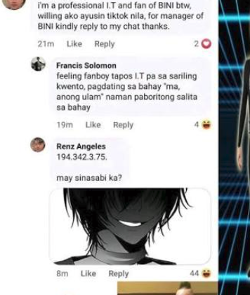
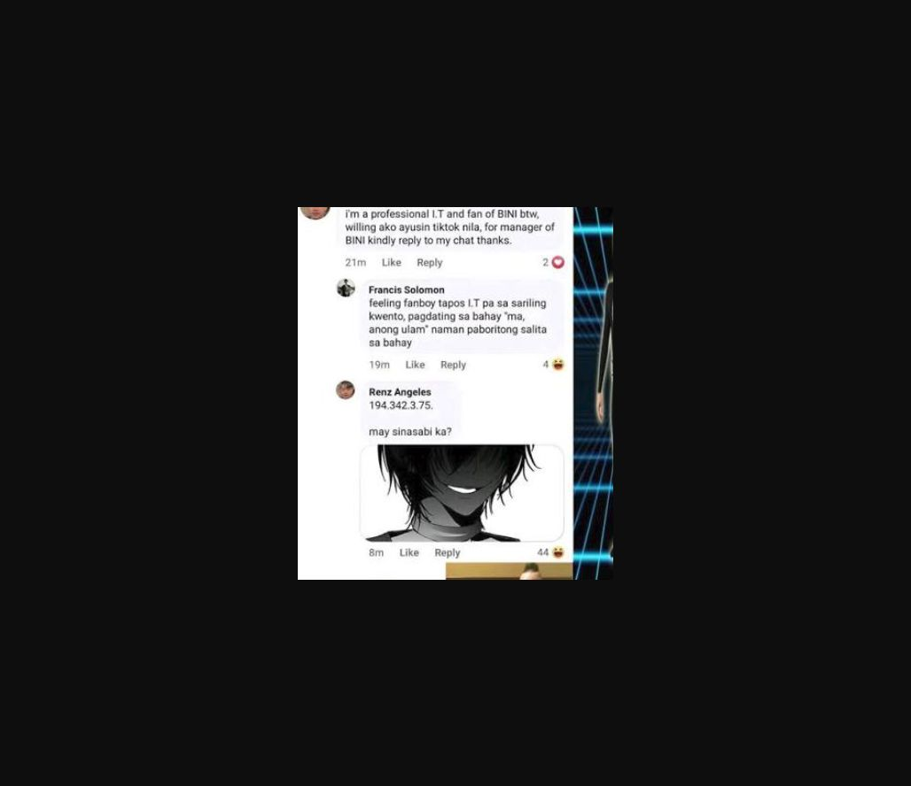

# The Viral Name

| Field | Details |
|---|---|
| Platform | PCGCTF |
| Challenge ID | 57 |
| Technical category | OSINT |
| Points in saved inventory | 100 |
| Difficulty | Not stated in the saved challenge description |
| Objective | Identify the exact Facebook display name tied to the supplied anime-avatar meme. |
| Result | `pcgCTF{Renz Angeles}` |

**Needs Flag Verification:** the answer is supported by the evidence described below, but its exact submission has not been confirmed accepted by PCGCTF.

## Reading the clues

The supplied file is only an anime avatar. It does not contain a readable account name, so identifying an anime character would answer a different question. The turning point is the contextual meme screenshot supplied by the user: it places the same avatar under a named Facebook comment.

## Working through the evidence

### 1. Separate the original avatar from the contextual evidence

The original `maysinasabi_ka.jpg` supplies the visual marker. The later screenshot shows several comments, so proximity alone is not enough: the matching avatar and the “may sinasabi ka?” line must belong to the same comment block as the displayed name.

### 2. Read the correct comment header

The screenshot labels that block **Renz Angeles**. The comment contains an IP-like string followed by the quoted phrase and the same monochrome anime image. Francis Solomon is a separate commenter above it; copying that nearby name would be a visual-association error.

The IP-like string is not needed to solve this task and is not a target to investigate. The question asks for a display name, not the identity of an IP address, a real person's legal name, or proof of account ownership.

### 3. Preserve the requested display spelling

The decisive transformation is simply to retain `Renz Angeles` with its capital letters and space inside the displayed `pcgCTF{...}` wrapper. The earlier Jhepoy Dizon suggestion was a weak meme association, not evidence tied to this image. It is superseded by the matching screenshot, not by a search-result popularity guess.

No terminal command is necessary for reading this evidence. An image viewer with zoom is the relevant tool; inventing a successful reverse-image search would obscure the actual basis of the answer.

## Visual evidence

*User-supplied contextual meme screenshot.* Place this immediately after the comment-header step. Box “Renz Angeles” and use a second box around the matching avatar; an arrow should connect the two within the same comment block.

## Flag discovery and final verification

The saved submission candidate is **`pcgCTF{Renz Angeles}`**. The screenshot establishes the displayed name only. It does not establish real-world identity or ownership, and no platform acceptance is claimed.

The remaining platform check is to open the specific PCGCTF challenge, copy the documented payload with its exact capitalization, spaces and punctuation, and capture the real acceptance or rejection response. No successful submission is inferred from the existence of the answer. If rejected, record the response and compare the stated format before changing the evidence-backed payload.

## What this challenge taught me

Context can be the missing evidence in an image-based OSINT task. Matching the exact visual artifact to a labeled record is stronger than recognizing a broadly similar meme or guessing a famous username.

## Evidence and references

[Original archived challenge](../../unsolved/osint/057-the-viral-name/README.md)

- [Preserved investigation notes](../../unsolved/osint/057-the-viral-name/solution.md)

**Provenance:** Original image/video and recorded independent visual/source comparison; rewritten from the preserved verification notes without inventing a historical search transcript.

## Captured screenshots and evidence

Captured on 2026-10-29 from actual terminal sessions or browser views. Captions distinguish new results, preserved records, source images and blockers. No platform acceptance is inferred from these images.

### 057-actual-browser-image.png

Original supplied image displayed in the browser; identification context only, not an independent acceptance record.
