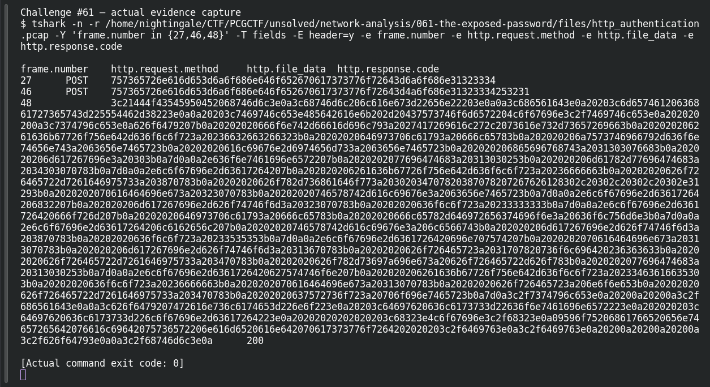

# The Exposed Password

**Platform:** PCGCTF · **Challenge ID:** 61 · **Category:** Network Analysis · **Points:** 100

**Status:** Answer backed by the capture. Exact PCGCTF submission not re-confirmed.

## The challenge

Recover the password from the successful HTTP login.

## Solving it

I isolated the POST login attempts and matched the password to the one followed by a success (not the failed attempt):

```sh
tshark -nr http_authentication.pcap -Y 'http.request.method=="POST"' -T fields \
  -e frame.number -e http.file_data
```

The successful login's form data (URL-decoded) carries:

```text
password=John1234!
```

The earlier attempt fails; the one that succeeds uses `John1234!`.

## Screenshot

The terminal image below displays a retained verification transcript.



## Flag

```text
pcgCTF{John1234!}
```

## Takeaway

Tie the credential to the *successful* response, and URL-decode the form value so characters like `!` come through correctly.

## Reference

- [Original challenge description](../../unsolved/network-analysis/061-the-exposed-password/README.md)
