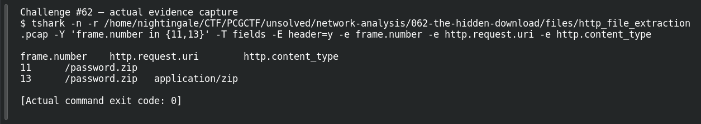

# THE HIDDEN DOWNLOAD

| Field | Details |
|---|---|
| Platform | PCGCTF |
| Challenge ID | 62 |
| Technical category | Network Analysis |
| Points in saved inventory | 150 |
| Difficulty | Not stated in the saved challenge description |
| Objective | Recover the text inside the downloaded HTTP ZIP. |
| Result | `pcgCTF{Cx689iO7Fu4G}` |

**Needs Flag Verification:** the answer is supported by the evidence described below, but its exact submission has not been confirmed accepted by PCGCTF.

## Reading the clues

The packet capture carries file contents, not only URLs. A response labeled application/zip provides a direct extraction path; looking for a plaintext flag in packet strings would miss compressed members.

## Working through the evidence

### 1. Locate request and body

The recorded frame 11 requests `/password.zip`; frame 13 returns application/zip. Use the original attached capture:

```sh
tshark -n -r '/home/nightingale/CTF/PCGCTF/unsolved/network-analysis/062-the-hidden-download/files/http_file_extraction.pcap' -Y http -T fields -e frame.number -e http.request.uri -e http.content_type
```

`-Y http` narrows the view, and the selected fields correlate the requested path with its response type. A content-type claim alone does not validate an archive, so extraction follows.

### 2. Export the reconstructed HTTP object

In Wireshark, use File → Export Objects → HTTP and select the password.zip response. TShark’s `--export-objects http,<OUTPUT_DIRECTORY>` is the equivalent reproduction route. The output directory is chosen by the reader; no imaginary export path or command result is asserted here.

### 3. Read the ZIP member and validate integrity

The preserved extracted archive was opened with ZIP integrity checks and contains password.txt. Its actual text is:

```text
my password is:
Cx689iO7Fu4G
```

The password is the second line, with uppercase/lowercase distinctions preserved. The ZIP’s CRC check supports that this text came from a valid reconstructed object. Challenge 70 carries a byte-identical capture and teaches the same extraction, but its solved status is not borrowed for this ID.

### Reproduction inputs and preserved output

Use the original artifact links below to replace any angle-bracketed input path. Those placeholders select local files; they are not missing exploit parameters. Commands in this draft explain a recorded method and should be checked against the preserved hashes before rerunning. The linked original investigation retains additional tool output and exact filenames; where a result is reported above, its verification record is linked rather than invented as a terminal screenshot.

## Captured screenshots and evidence

Captured on 2026-10-29 from actual terminal sessions or browser views. Captions distinguish new results, preserved records, source images and blockers. No platform acceptance is inferred from these images.

### Challenge #62 — actual evidence capture



Actual field extraction from preserved capture; no invented successful grader response.

Command/action actually executed:

```sh
tshark -n -r /home/nightingale/CTF/PCGCTF/unsolved/network-analysis/062-the-hidden-download/files/http_file_extraction.pcap -Y 'frame.number in {11,13}' -T fields -E header=y -e frame.number -e http.request.uri -e http.content_type
```

[Actual command transcript](../screenshots/capture-work/062-packet-proof.terminal.log) · [Execution record](../screenshots/capture-work/062-packet-proof.result.json). Notice the result fields discussed in the corresponding solution step; the transcript retains lines that extend beyond the screenshot viewport.

## Flag discovery and final verification

The saved submission candidate is **`pcgCTF{Cx689iO7Fu4G}`**. The extracted member is confirmed locally; this challenge’s site acceptance remains unverified.

The remaining platform check is to open the specific PCGCTF challenge, copy the documented payload with its exact capitalization, spaces and punctuation, and capture the real acceptance or rejection response. No successful submission is inferred from the existence of the answer. If rejected, record the response and compare the stated format before changing the evidence-backed payload.

## What this challenge taught me

Export application objects after stream reconstruction; compressed contents may not appear as packet-level plaintext.

## Evidence and references

[Original archived challenge](../../unsolved/network-analysis/062-the-hidden-download/README.md)

- [Decisive preserved verification results](../../analysis-network-analysis/verification.json)
- [Original capture](../../unsolved/network-analysis/062-the-hidden-download/files/http_file_extraction.pcap)
- [Preserved investigation notes](../../unsolved/network-analysis/062-the-hidden-download/solution.md)

**Provenance:** Original local artifacts and preserved independent extraction/source verification; drafted without claiming new live attacks or fabricated executions.
