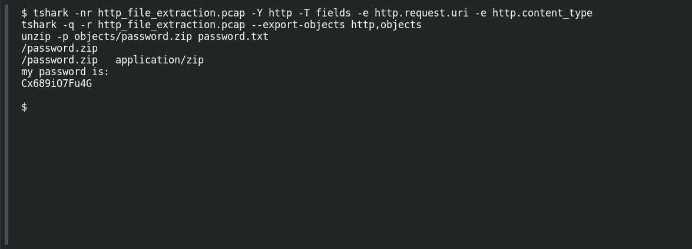

# The Hidden Download

**Platform:** PCGCTF · **Challenge ID:** 62 · **Category:** Network Analysis · **Points:** 100

**Status:** Answer backed by the capture. Exact PCGCTF submission not re-confirmed. (Same capture/answer as HTTP File Extraction #70.)

**Evidence:** Packets 11, 13 · TCP stream 0 · [http_file_extraction.pcap](../../solved/network-analysis/070-http-file-extraction/files/http_file_extraction.pcap).

## The challenge

Recover the text inside a ZIP downloaded over HTTP.

## Solving it

The capture carries the file bytes, not just URLs, so I found the ZIP response and exported it:

```sh
tshark -nr http_file_extraction.pcap -Y http -T fields -e http.request.uri -e http.content_type
tshark -q -r http_file_extraction.pcap --export-objects http,objects
unzip -p objects/password.zip password.txt
```

```text
/password.zip
/password.zip	application/zip
my password is:
Cx689iO7Fu4G
```

## Screenshot

Fresh local reproduction using the command described above.



## Flag

```text
pcgCTF{Cx689iO7Fu4G}
```

## Takeaway

Reconstruct the HTTP object and read the member — grepping packet strings would miss anything inside a compressed archive.

## Reference

- [Original challenge description](../../unsolved/network-analysis/062-the-hidden-download/README.md)
