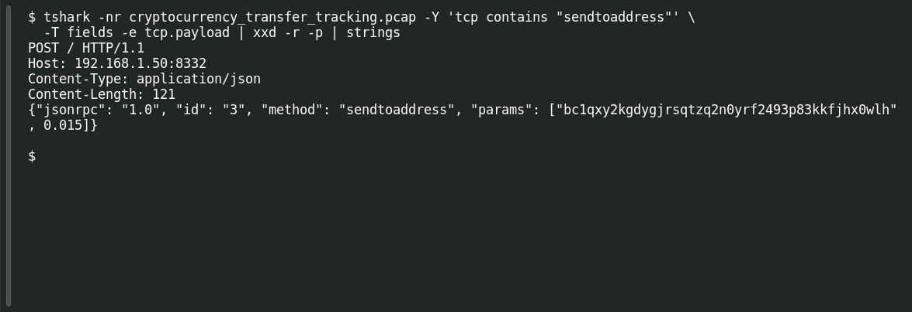

# Bitcoin Trail

**Platform:** PCGCTF · **Challenge ID:** 69 · **Category:** Network Analysis · **Points:** 100

**Status:** Answer backed by the capture. Exact PCGCTF submission not re-confirmed.

## The challenge

Identify the Bitcoin address in the transfer RPC data.

## Solving it

Search for the Bitcoin JSON-RPC method `sendtoaddress`, then decode the matching TCP payload:

```sh
tshark -nr cryptocurrency_transfer_tracking.pcap -Y 'tcp contains "sendtoaddress"' \
  -T fields -e tcp.payload | xxd -r -p | strings
```

The JSON request contains `"method": "sendtoaddress"`. Its first parameter is the destination address, followed by the amount `0.015`:

```text
bc1qxy2kgdygjrsqtzq2n0yrf2493p83kkfjhx0wlh
```

## Screenshot

Fresh local reproduction using the command described above.



## Flag

```text
pcgCTF{bc1qxy2kgdygjrsqtzq2n0yrf2493p83kkfjhx0wlh}
```

## Takeaway

Read the address from the RPC method's parameter, and keep the bech32 (`bc1...`) casing exactly — Bitcoin addresses aren't safely lowercased.

## Reference

- [Original challenge description](../../unsolved/network-analysis/069-bitcoin-trail/README.md)
