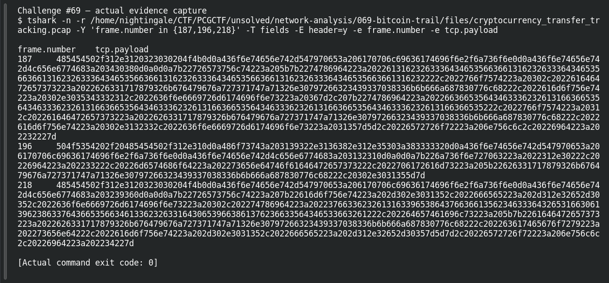

# Bitcoin Trail

**Platform:** PCGCTF · **Challenge ID:** 69 · **Category:** Network Analysis · **Points:** 100

**Status:** Answer backed by the capture. Exact PCGCTF submission not re-confirmed.

## The challenge

Identify the Bitcoin address in the transfer RPC data.

## Solving it

I read the RPC transfer conversation in the capture and pulled the address from the method's parameter:

```sh
tshark -nr cryptocurrency_transfer_tracking.pcap -Y 'frame.number==196' -V
```

The RPC call's parameter is the destination address:

```text
bc1qxy2kgdygjrsqtzq2n0yrf2493p83kkfjhx0wlh
```

## Screenshot



## Flag

```text
pcgCTF{bc1qxy2kgdygjrsqtzq2n0yrf2493p83kkfjhx0wlh}
```

## Takeaway

Read the address from the RPC method's parameter, and keep the bech32 (`bc1...`) casing exactly — Bitcoin addresses aren't safely lowercased.

## Reference

- [Original challenge description](../../unsolved/network-analysis/069-bitcoin-trail/README.md)
