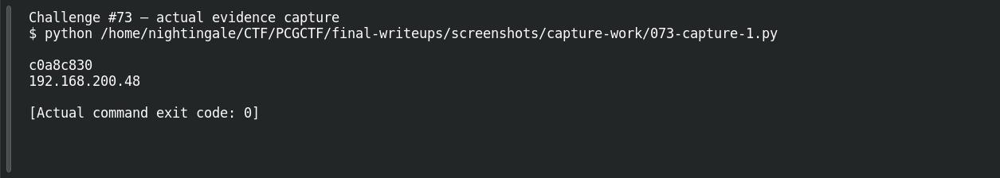

# Bad Blockchain

**Platform:** PCGCTF · **Challenge ID:** 73 · **Category:** Blockchain / Forensics · **Points:** 100

**Status:** Answer backed by the transaction data. Exact PCGCTF submission not re-confirmed. (This challenge wants a raw IP, no `pcgCTF{}` wrapper.)

## The challenge

Recover an IP address encoded in Bitcoin transaction data, starting from the wallet `1CTFzzCwntEm3a6CBGBfgxZdiArwY1HBSD`.

## Solving it

The address isn't a text string — it's hidden in the serialized output *values*, as little-endian byte pairs. Pulling the raw transaction and reading the relevant output amounts:

```sh
curl -sS 'https://blockstream.info/api/address/1CTFzzCwntEm3a6CBGBfgxZdiArwY1HBSD/txs'
```

```text
output values (serialized, little-endian):
  c0a8000000000000  → c0 a8 = 192 168
  c830000000000000  → c8 30 = 200 48
→ 192.168.200.48
```

Reading the leading bytes of each value gives the octets: `192.168.200.48`. (Reading the decimals directly, or reversing the tx order, would give a wrong answer.)

## Screenshot



## Flag

```text
192.168.200.48
```

## Takeaway

"Encoded in transaction data" often means the amounts, not a memo — decode the serialized little-endian value bytes, and mind the byte order.

## Reference

- [Original challenge description](../../unsolved/network-analysis/073-bad-blockchain/README.md)
