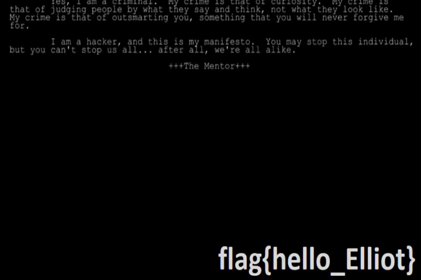
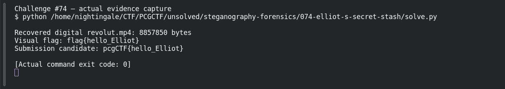

# ELLIOT'S SECRET STASH

| Field | Details |
|---|---|
| Platform | PCGCTF |
| Challenge ID | 74 |
| Technical category | Steganography / Forensics |
| Points in saved inventory | 150 |
| Difficulty | Not stated in the saved challenge description |
| Objective | Recover the hidden message in the supplied audio. |
| Result | `pcgCTF{hello_Elliot}` |

**Needs Flag Verification:** the answer is supported by the evidence described below, but its exact submission has not been confirmed accepted by PCGCTF.

## Reading the clues

The Elliot/Mr. Robot clue suggests hiding files inside music. A lack of a password hash does not mean absence of a payload: DeepSound can carry unencrypted files.

## Working through the evidence

### 1. Identify the DeepSound header

The originalZIP contains Dubwreckerz-DigitalRevolution(AnonymousVIP).wav. The installed deepsound2john helper reports a normal-quality DeepSound header at WAV offset 46 and states that it is **not encrypted**. No password cracking is needed.

### 2. Decode the carrier and validate the filerecord

The linked solve.py reads the WAVdatachunk and combines the low nibbles of consecutive 16-bit audio samples:

```python
hidden_byte = ((carrier[i] & 15) << 4) | (carrier[i + 2] & 15)
```

The decoded header is DSCF0400, followed by DSSF and the 20-byte filename field **digital revolut.mp4**. A big-endian length field gives 8,857,850 bytes. The solver checks the four zero initialization bytes, alignment padding, closing DSSF marker and payload SHA-256. This is a structured extraction, not an unbounded file carve.

### 3. Watch the recovered video closely

The extracted MP4 decodes with FFmpeg. Sampling every three seconds missed the brief text; a one-second contact sheet reveals the flag beneath the scrolling manifesto around 39 seconds. The saved frame visibly reads **flag{hello_Elliot}**.

```sh
python '<ORIGINAL_CHALLENGE_FOLDER>/solve.py'
ffmpeg -i 'digital revolut.mp4' -vf 'fps=1,select=eq(n\,39)' -frames:v 1 flag-frame-39s.png
```

Replace the marked folder with the original folder linkedbelow; run FFmpeg fromthe extracted video’s directory. The first command reproduces checked extraction; the second selects one output frame after one-frame-per-second sampling. Keep the capital E in Elliot whenapplying the PCGCTF wrapper.

### Reproduction inputs and preserved output

Use the original artifact links below to replace any angle-bracketed input path. Those placeholders select local files; they are not missing exploit parameters. Commands in this draft explain a recorded method and should be checked against the preserved hashes before rerunning. The linked original investigation retains additional tool output and exact filenames; where a result is reported above, its verification record is linked rather than invented as a terminal screenshot.

## Visual evidence



*Actual flag frame from thehidden video.* Place after video inspection; box flag{hello_Elliot} and mark thecapitalE.

## Captured screenshots and evidence

Captured on 2026-10-29 from actual terminal sessions or browser views. Captions distinguish new results, preserved records, source images and blockers. No platform acceptance is inferred from these images.

### Challenge #74 — actual evidence capture



Re-run checked DeepSound extraction from the original audio ZIP.

Command/action actually executed:

```sh
python /home/nightingale/CTF/PCGCTF/unsolved/steganography-forensics/074-elliot-s-secret-stash/solve.py
```

[Actual command transcript](../screenshots/capture-work/074-extract.terminal.log) · [Execution record](../screenshots/capture-work/074-extract.result.json). Notice the result fields discussed in the corresponding solution step; the transcript retains lines that extend beyond the screenshot viewport.

## Flag discovery and final verification

The saved submission candidate is **`pcgCTF{hello_Elliot}`**. The raw flag is visually confirmed andthe payload hash checked; PCGCTF acceptance remains untested.

The remaining platform check is to open the specific PCGCTF challenge, copy the documented payload with its exact capitalization, spaces and punctuation, and capture the real acceptance or rejection response. No successful submission is inferred from the existence of the answer. If rejected, record the response and compare the stated format before changing the evidence-backed payload.

## What this challenge taught me

A tool’s “not encrypted” message can identify an easier extraction path; video sampling can miss brief overlays.

## Evidence and references

[Original archived challenge](../../unsolved/steganography-forensics/074-elliot-s-secret-stash/README.md)

- [Decisive preserved verification results](../../unsolved/steganography-forensics/074-elliot-s-secret-stash/evidence/verification.json)
- [Reproducible checked DeepSound extractor](../../unsolved/steganography-forensics/074-elliot-s-secret-stash/solve.py)
- [Recovered MP4 video](../../unsolved/steganography-forensics/074-elliot-s-secret-stash/evidence/digital%20revolut.mp4)
- [Preserved investigation notes](../../unsolved/steganography-forensics/074-elliot-s-secret-stash/solution.md)

**Provenance:** Original local artifacts and preserved independent extraction/source verification; drafted without claiming new live attacks or fabricated executions.
